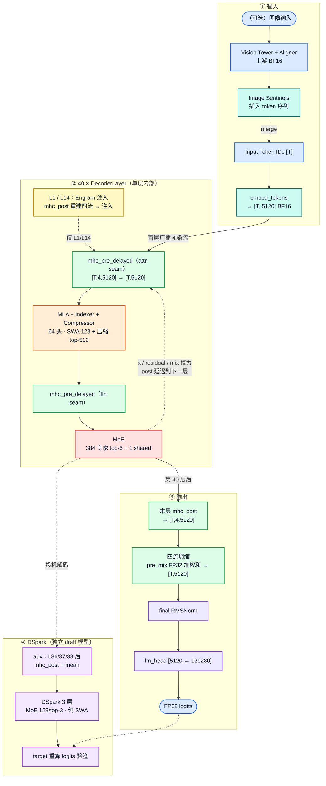
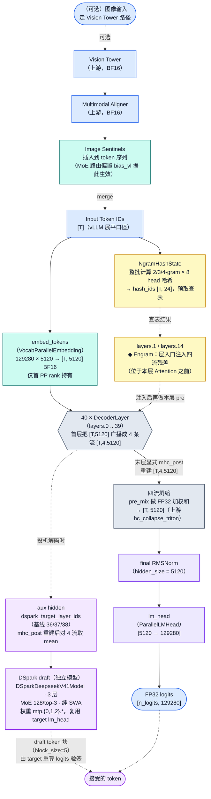
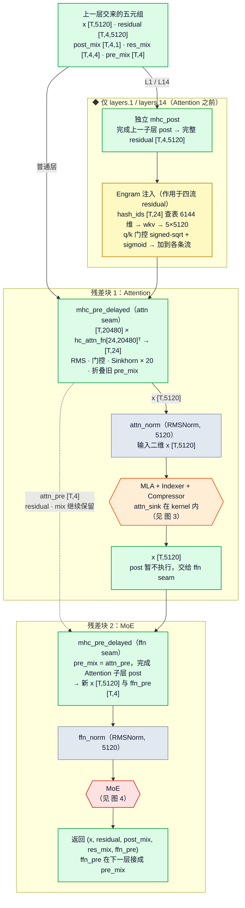
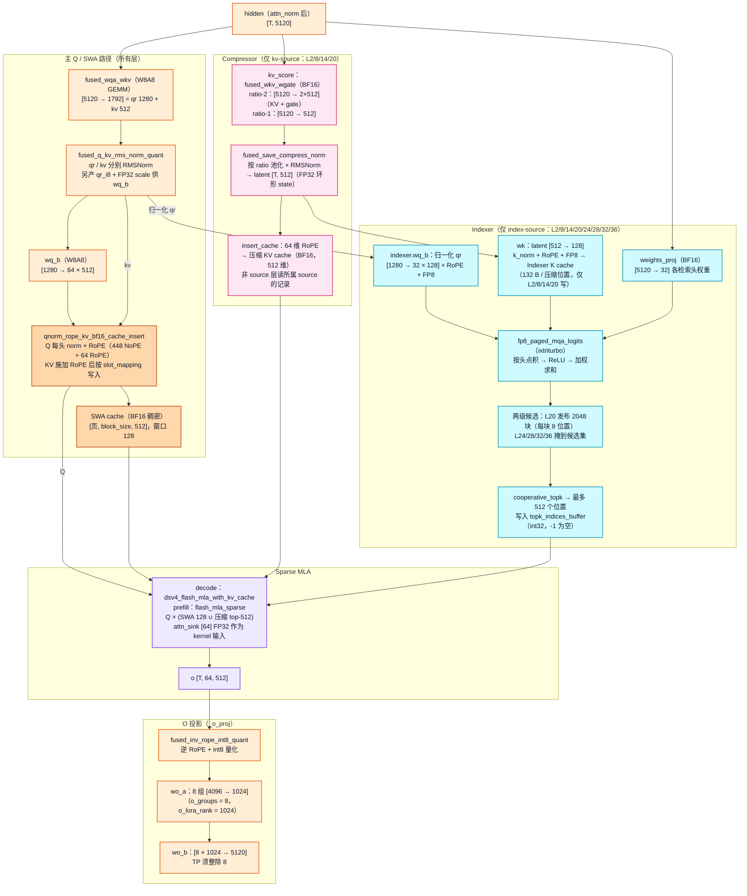
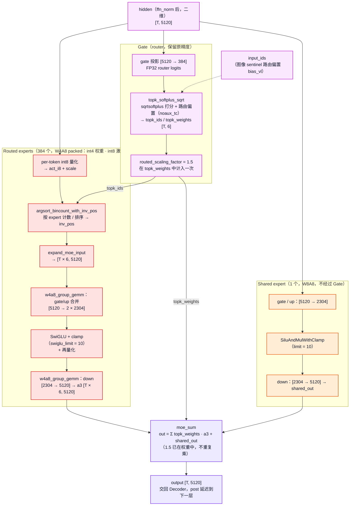

# DeepSeek-V4.1-Flash：从模型结构到一次推理

> **阅读导航**：[全局索引 (INDEX)](INDEX.md) ｜ **[本仓设备侧实现（本文，含全部架构图）](README.md)** ｜ [上游 vLLM 实现（NVIDIA，对外口径）](上游vLLM实现.md) ｜ [实服部署指南](部署指南.md) ｜ [分步交互查看器](assets/html/dsv41_dynamic_architecture.html) ｜ [原图集文档（已并入本文，保留备查）](架构图集与算子映射.md)
>
> **视角提示**：本文描述的是**本仓在自有设备上的适配实现**（W8A8 / W4A8 packed、平台算子），**基线 vLLM 0.30.0 + vllm_iluvatar 0.30.0**。[`上游vLLM实现.md`](上游vLLM实现.md) 已锚定上游 **v0.32.0**，两边版本不同属正常，不要互相对齐行号或接口。模型结构部分与上游一致，但量化方案、kernel 归属与 cache 布局是设备侧口径。需要**对外讲上游 NVIDIA 实现**时请走 [`上游vLLM实现.md`](上游vLLM实现.md)。

DeepSeek-V4.1-Flash 的主干把 token 变成 hidden，连续经过40层 Decoder，最后生成供词表投影使用的二维 hidden。理解这条过程，需要先分清两种数据：层间保留的四流残差 `[T,4,5120]`，以及 Attention、MoE 实际计算的二维激活 `[T,5120]`。Attention 用滑动窗口与压缩检索读取历史，MoE 用路由专家与共享专家更新激活；Engram 和 DSpark 在指定条件下参与。

本文采用**自顶向下**的顺序：第0章先用一页速览图给出全貌；第1章建立参数与对象轮廓；第2章把一次推理从入口到采样**在上层完整走通一遍**，此时 mHC、Attention、MoE 都只按「输入什么、输出什么」的黑盒接口对待；第3章再逐个拆开这三个模块的内部计算；之后才是状态存放、条件分支、平台实现与工程约束。**首次阅读不需要同时打开代码。** 每个模块小节顶部给出紧凑的**接口契约**（输入/输出张量、读写状态与核心步骤），不绑定易随代码重构而变动的文件路径或私有包装类名；文末 [9.2 节](#92-m1m12-模块接口与张量契约总表)汇总 M1–M12 全部模块的张量契约。

**全部架构图都已嵌在正文对应位置**：第0章是一页速览与调用链总图，1.3 节是七分区全景与模型总览，2.3 节是 DecoderLayer，2.5 节是推理数据流与算子映射，3.2 节是 MLA，3.3 节是 MoE。每张 PNG 下方都有可展开的 `<details>` 折叠块，内含该图的 Mermaid 源码，便于直接编辑重绘。另有[分步查看器](assets/html/dsv41_dynamic_architecture.html)：读第2章时看①全模型与②一层 Decoder；读第3章时再看③Attention；读5.1/5.4节时看④Engram、⑤DSpark。五页各自从左向右读，用同名输入/输出连接理解，页面之间没有跨区长线。需要查全部接口时，再打开[完整 SVG](assets/svg/dsv41_call_architecture.svg)。节点的 M1–M12 链接直接定位本文相应段落。

- [0. 一页纸速览](#0-一页纸速览)：调用链总图、主调用链/Attention/MoE 三段要点与图 0 一页速览。
- [1. 先建立模型轮廓](#1-先建立模型轮廓)：精简参数、[完整参数速查表](#12-完整参数速查表)、对象层级（含七分区全景与模型总览图）与40层的分工。
- [2. 先从上层走通一次端到端推理](#2-先从上层走通一次端到端推理)：调度 → embedding → 40层主干循环 → 坍缩与输出头，模块按黑盒对待；末尾附推理数据流与算子映射图。
- [3. 深入模块内部：mHC、Attention 与 MoE](#3-深入模块内部mhcattention-与-moe)：把第2章的三个黑盒逐个拆开，附 MLA 与 MoE 内部图。
- [4. 数据保存在哪里](#4-数据保存在哪里)：历史 cache、共享索引与层间状态。
- [5. 什么条件会改变这条流程](#5-什么条件会改变这条流程)：Engram、短上下文、prefill、DSpark（含与经典 MTP 的辨析）与 PP。
- [6. 同一模块在 Iluvatar 上怎样实现](#6-同一模块在-iluvatar-上怎样实现)：量化、算子实现与上游差异。
- [7. 插件怎样接入框架，哪些依赖必须保持](#7-插件怎样接入框架哪些依赖必须保持)：注册、patch、多流与接口约束。
- [8. 算子计算负载](#8-算子计算负载主要算在哪里怎样随输入增长)：GEMM、注意力/检索、访存与控制流，及随上下文增长的计算规模。
- [9. 查阅与维护](#9-查阅与维护)：图文定位、[M1–M12 张量契约总表](#92-m1m12-模块接口与张量契约总表)、[结构—算子对照与历史验证记录](#93-结构算子对照与历史验证记录)、[口径说明](#94-全文图例与口径说明)与图源维护。


## 阅读与显示（Typora）

- 可使用 Typora 大纲侧栏按章节导航；M1–M12 是模块索引，通过对应标题供文内链接和架构图定位。
- SVG 与 PNG 配图可在正文直接查看；每张图下方 `<details>` 折叠块内是 Mermaid 源码，Typora 展开后可渲染与编辑。交互分步查看器需通过浏览器打开，Typora 不执行其中的交互脚本。
- 各小节顶部的“接口契约”与 9.2 节总表统一按**输入张量 → 输出张量 → 状态读写 → 核心步骤**描述，与具体代码分支的文件名和行号解耦。
- 粗体小编号（`0.1`–`5.4`，共38个）是贯穿全文的算子定位点，供源码和算量查阅。它们按数据流编号，**不等于章节顺序**：第2章使用 `0.x / 1.x / 5.x`，第3章使用 `2.x / 3.x`。注意这些**算子编号**与**章节号**（如 0.1 节、2.3 节）是两套独立体系，正文提到“节”时一定带“节”字。
- 同一对象常有两张图，视角不同：Graphviz 导出的 SVG 是**接口视角**（带 M 编号、函数名可搜索可复制），Mermaid 导出的 PNG 是**拓扑视角**（画张量形态与数据流向）。两张都保留，按需要看。


## 0. 一页纸速览

想先有个整体印象再读细节，就从这一章开始：下面的速览图和三段要点把 40 层主干、Attention 与 MoE 的调用关系压缩到一页。需要逐算子公式、跨层共享细节与计算量推导时，再往后读第 1 章起的正文。


- **动态交互版**：[打开调用链速览动态查看器](assets/html/dsv41_dynamic_architecture_brief.html)（支持调用链动画、节点聚焦、路径追踪及 MLA / MoE / DSpark 分章节播放）
- **可维护图源**：[`assets/dot/dsv41_call_architecture_brief.dot`](assets/dot/dsv41_call_architecture_brief.dot)


### 0.1 主调用链

1. `DeepseekV41ForCausalLM` 作为 VL 外层包装；纯文本或视觉特征最终都进入 CoreX 版 `DeepseekV41LLMForCausalLM`。
2. `DeepseekV41LLMForCausalLM.forward()` 调用 `DeepseekV4Model.forward()`，先完成 token embedding（`[T,5120]`，vocab=129280）。
3. 若启用 Engram，进入 Decoder **之前**整批计算 n-gram hash（2/3/4-gram × 8 head = 24 列）并预取查表结果；注入发生在 **L1 / L14** 的层入口：先独立 `mhc_post` 重建四流残差，注入后才执行本层 `mhc_pre_delayed`，因此 Engram 位于 **Attention 之前**。
4. 主干执行 40 个 `DeepseekV4DecoderLayer`。每层依次执行：
   - `mhc_pre_delayed → attn_norm → MLA（投影 fan-out）→ O Projection`
   - `mhc_pre_delayed`（把 attention 子层 post 折进 pre）`→ ffn_norm → MoE`
5. mHC 在子层外维护 `[T, hc_mult=4, hidden_size=5120]`；进入 Attention / MoE 前折叠为 `[T, 5120]`。MoE 输出不在本层做完整 post，而是连同 `residual / post_mix / res_mix / ffn_pre` 交给下一层的 `mhc_pre_delayed`（`ffn_pre` 在下一层接成 `pre_mix`）。
6. 第 40 层结束后才显式 `mhc_post`，再用末层 `pre_mix` 对 4 条流做 FP32 加权求和坍缩为 `[T,5120]`（插件用 torch 实现，上游对应 `hc_collapse_triton`），然后 `final RMSNorm → ParallelLMHead`，得到 **target logits**。
7. 投机解码时，选定层结束后用 `mhc_post` 重建 aux hidden（再对 hc 流 `mean`），交给 DSpark。层号来自 `dspark_target_layer_ids`（基线 0-based 36/37/38）。DSpark 默认 3 个 draft layer；`dspark_block_size=5` 是 token 块长度，`num_speculative_tokens` 是建议 token 数，二者都不是网络层数。Draft 由 target 重算 logits 验签后采样。

### 0.2 Attention 路径

- `attn_gemm_parallel_execute` 从同一份 `attn_norm` hidden **fan-out** 三路（不是 `fused_wqa_wkv → compressor → indexer` 串行）：
  - `fused_wqa_wkv`（W8A8，5120→1792）→ `qr [T,1280]` + `kv [T,512]` → q_norm / RoPE / SWA KV insert（SWA 窗 128）
  - `kv_score` → Compressor（**仅 kv-source 层** L2/8/14/20）→ compressed KV cache
  - `indexer.weights_proj` + 归一化 qr → Indexer（**仅 index-source 层** L2/8/14/20/24/28/32/36）→ top-512
- 两级候选：L20 发布 2048 个候选块（每块 8 个压缩位置），L24/28/32/36 只在候选集中选 top-512。
- 压缩比按层分三档：L0–L1 纯 SWA、L2–L19 ratio-2、L20–L39 ratio-1；非 source 层复用所属 source 的 cache / top-k。
- Sparse MLA kernel 吃 Q、SWA KV、compressed KV、top-k；**`attn_sink`（每头一个 FP32 标量，全局 `[64]`）是该 kernel 的输入**，不是 O Projection 前的加法。
- prefill：`flash_mla_sparse`；decode：`dsv4_flash_mla_with_kv_cache`。
- `_o_proj`：inverse RoPE → 8 组 `wo_a [4096→1024]` → `wo_b [8×1024→5120]`，输出 `[T, 5120]`；分组布局要求 TP 整除 8。

### 0.3 MoE 路径

- `ffn_norm` 的同一份 hidden **并行**进入 Gate 与 Shared Expert；Shared Expert **不经过** Gate。
- Gate 输出 384 个专家的 FP32 logits，`sqrtsoftplus` 打分后每 token 选 **top-6**，驱动 **384 个 W4A8 packed routed experts**（int4 权重 / int8 激活；gate/up 合并 `[5120→2×2304]` → SwiGLU/clamp → down `[2304→5120]`）。
- Shared expert 为 W8A8 SwiGLU，`swiglu_limit=10`。
- 聚合语义：`routed_scaling_factor=1.5` 已在 top-k 路由权重中计入一次，`moe_sum` 再加 shared，聚合处**不重复乘 1.5**。

---

### 0.4 图 0 · 一页速览


<details>
<summary>展开查看图 0 Mermaid 图源（对应 <code>assets/png/dsv41_model_architecture_overview.png</code>）</summary>



</details>

本文按「一页速览 → 模型总览 → DecoderLayer 内部 → MLA 内部 → MoE 内部」逐层拆解**网络拓扑与张量形态**，这五张图分别嵌在 0.4、1.3、2.3、3.2、3.3 节。每张图先给出高清导出图，下方可展开查看/编辑对应的 Mermaid 源码。


## 1. 先建立模型轮廓

本文沿用已整理的 `DeepSeek-V4.1-Flash-w4a8`、vLLM 0.30.0 与 vllm_iluvatar 0.30.0 基线。TP8/PP2 是解释跨 rank 边界的一个例子，不是模型必须采用的拓扑。

`T` 始终是本 step 展平后的新 token 数，历史 token 由 cache 提供。除明确写出 `local` 的量外，维度均为 TP 切分前的全局口径。BF16 主干 cache 是本文 w4a8 基线的描述；实现还支持解析为 FP16，不能据此推断任意服务的实际 dtype 或后端。本文整合的是结构与静态调用契约，不代表本轮重新起服验证了 checkpoint、数值或性能。

### 1.1 抓住这些参数

| 对象 | 本文参数 | 阅读时的含义 |
|---|---|---|
| 主干 | 40层，hidden=5120，vocab=129280 | 不是43层、hidden=4096的 V4 标准版 |
| mHC | 4条残差流，每流5120 | 层间 `[T,4,5120]`；子层输入 `[T,5120]` |
| 主注意力 | 64头，head_dim=512；q_lora=1280 | 512维 latent 分为448维 NoPE 与64维 RoPE |
| 历史选择 | SWA窗128；压缩 top-k=512 | 当前位置同时读局部窗口与选中的压缩记录 |
| 检索 | 32头，每头128维 | 检索 Q/K 与主注意力 Q/KV 是不同数据 |
| 输出投影 | 8组 `wo_a`，每组输出1024，再接 `wo_b` | TP必须整除8，当前约束为1/2/4/8 |
| MoE | 384路由专家、每 token 选6个；另有1个共享专家；中间宽2304 | 路由权重中计入一次1.5；`swiglu_limit=10` |
| Engram | 层号 `{1,14}`，每层24个哈希列 | 2/3/4-gram各8个 head，在指定层入口注入 |
| DSpark | 默认3层 draft，MoE 128/top-3，纯 SWA | `dspark_block_size=5` 表示 token 块长度，和层数分别配置 |

此外，`attn_sink` 是每头一个 FP32 标量（全局 `[64]`），作为 MLA kernel 输入。mHC 的 Sinkhorn 迭代20轮，`hc_eps=1e-6`。这些参数在各自模块处使用，不需在开始阅读时记住全部数值。

### 1.2 完整参数速查表

| 维度 | 值 | 备注 |
|---|---|---|
| `hidden_size` | **5120** | V4.1；V4 标准版是 4096 |
| `vocab_size` | 129280 | `lm_head` 输出宽度 |
| 层数 | **40** | V4.1 紧凑版；V4 标准版是 43 |
| `hc_mult` | **4** | 残差流数；**每流宽 = 5120**（不是展平 20480） |
| hc 张量形态 | `[T, hc_mult=4, hidden_size=5120]` | 3 维张量；子层实际计算 `[T,5120]` |
| mHC 混合系数 | `pre_mix [T,4]`、`post_mix [T,4,1]`、`res_mix [T,4,4]` | 均为 FP32 |
| `hc_sinkhorn_iters` / `hc_eps` / `hc_post_alpha` | 20 / 1e-6 / 2.0 | Sinkhorn 双随机归一化 |
| `num_attention_heads` | 64 | MLA 主干头数 |
| `head_dim` | **512 = 448 NoPE + 64 RoPE** | 主 Q 与 KV latent 同宽 |
| `q_lora_rank` | **1280** | `fused_wqa_wkv` 输出 `qr 1280 + kv 512 = 1792` |
| SWA 窗口 | 128 | 每层都读本地窗口 |
| `compress_ratios` | L0–L1 = 0（纯 SWA）、L2–L19 = 2、L20–L39 = 1 | 只接受 0/1/2 三档 |
| kv-source 层 | L2 / L8 / L14 / L20 | 持有 Compressor；L20–L39 共享 L20 的压缩 KV |
| index-source 层 | L2 / L8 / L14 / L20 / L24 / L28 / L32 / L36 | 持有 Indexer；只有前 4 个写 Indexer K |
| 两级候选 | L20 发布 2048 块（每块 8 个压缩位置） | L24/28/32/36 只在候选集中选 |
| Indexer | 32 头 × 128 维；`index_topk = 512` | 检索 Q/K 与主注意力 Q/KV 是不同数据 |
| `o_groups` / `o_lora_rank` | 8 / 1024 | 8 组 `wo_a [4096→1024]` → `wo_b [8192→5120]`；TP 须整除 8 |
| `attn_sink` | 每头 1 个 FP32 标量，全局 `[64]` | **Sparse MLA kernel 的输入**，不是 O 投影前的加法 |
| `n_routed_experts` | **384** | 路由专家数 |
| `num_experts_per_tok` | **6** | 另有 1 个 shared expert |
| `moe_intermediate_size` | 2304 | 每个 expert 中间宽 |
| `routed_scaling_factor` | **1.5** | 在 top-k 路由权重中计入一次，聚合时不重复乘 |
| `swiglu_limit` | 10 | routed / shared 激活钳制 |
| 路由打分 | `sqrtsoftplus` + `noaux_tc` | `topk_softplus_sqrt` 选 top-6 并归一化 |
| Engram 层 | `{1, 14}` | 24 个哈希列（2/3/4-gram × 8 head），在本层 **Attention 之前**注入 |
| DSpark | **独立 3 层 draft**，MoE 128/top-3，纯 SWA | `dspark_block_size=5` 是 token 块长度，不是层数；捕获层基线 0-based 36/37/38 |
| 量化（w4a8 基线） | routed expert = W4A8 packed；attention 投影与 shared expert = W8A8 | router / norm / mHC / Engram / compressor / `indexer.weights_proj`·`wk` / `attn_sink` 保留原精度 |
| 主干 KV cache | **BF16 稠密**，SWA 与压缩 KV 每行 512 维 | 区别于上游 `fp8_ds_mla` 打包记录 |
| Indexer K cache | FP8 值 + 页尾 FP32 scale，132 B / 压缩位置 | 上游 MXFP4 变体为 68 B |
| 多模态 | VL 包装 `DeepseekV41ForCausalLM` | 视觉塔 / aligner 复用上游，文本特征汇入主干 |

上表是完整口径，和 1.1 节的九行精简版配合使用：1.1 用于建立第一印象，本表用于查具体数值。


### 1.3 代码对象怎样嵌套

```text
DeepseekV41ForCausalLM                         M1：VL外壳
└─ language_model: DeepseekV41LLMForCausalLM   文本塔
   ├─ model: DeepseekV4Model                  主干
   │  ├─ embed_tokens                        M2：词表查表
   │  ├─ engram_hash                         为M10准备哈希
   │  ├─ layers[0..39]: DeepseekV4DecoderLayer M4
   │  │  ├─ mhc_pre_delayed / mhc_post        M3：状态处理
   │  │  ├─ attn_norm → attn                 M5
   │  │  │  ├─ compressor（仅kv-source）     M7
   │  │  │  ├─ indexer（仅index-source）     M6
   │  │  │  └─ _o_proj → wo_a / wo_b         M9：方法与权重
   │  │  ├─ ffn_norm → ffn                   M8：MoE
   │  │  └─ engram（仅L1/L14）               M10
   │  └─ norm                                M12的一部分
   └─ lm_head / logits_processor             M12的另一部分
DSparkDeepseekV41ForCausalLM                  M11：独立draft模型
└─ model: DSparkDeepseekV41Model → layers[40..42]
```

图中的 M 编号是阅读索引。M3 是状态处理，M9 是 attention 方法，M12 跨主干与文本塔，代码中没有三个同名独立模块。M6/M7/M9 属于 M5，M11 是条件启用的另一个模型。


**七分区模型架构总图（SVG 矢量全景）**

- **可维护图源**：[`assets/dot/dsv41_model_architecture.dot`](assets/dot/dsv41_model_architecture.dot)


---

#### 图 1 · 模型总览（Top-Level）


> **hc 残差流的真实形态**：DSV4.1 把层间状态维护成 `residual ∈ R[T, hc_mult=4, hidden_size=5120]` 的 **3 维张量**，每流宽 5120。每个子层（Attention / MoE）前由 `mhc_pre_delayed` 用 mix 系数把 4 流折叠成二维 `x [T,5120]` 再做 norm 与计算；普通层的 post 延迟到下一个子层的 pre 里一并完成。**NORM 与 LM_HEAD 看到的维度始终是 `hidden_size=5120`，不是 20480。** 40 层循环结束后才显式 `mhc_post`，再用末层 `pre_mix` 做 FP32 加权和坍缩 → `final RMSNorm (5120)` → `lm_head (5120→129280)`。

<details>
<summary>展开查看图 1 Mermaid 图源（对应 <code>assets/png/dsv41_model_architecture.png</code>）</summary>



</details>


### 1.4 40层并不重复同一套历史处理

L0/L1 只用 SWA；L2–L19 增加 ratio-2 压缩，L20–L39 用 ratio-1。压缩率与 source 层来自配置，以下是本文基线：

- **压缩 KV 的 source** 是 L2/L8/L14/L20，负责写入压缩记录；其他层复用所属 source 的 cache。L20–L39 共用 L20 的压缩 KV。
- **检索的 source** 是 L2/L8/L14/L20/L24/L28/L32/L36，负责重新选 top-k；其间的层复用最近 source 的结果。只有 L2/L8/L14/L20 持有并写入 Indexer K。
- **两级候选的 source** 是 L20，先发布候选块；L24/L28/L32/L36 在这些候选中选择。候选块不是额外一层 KV。

因此，“没有自己的 Compressor”不等于“不读压缩 KV”，“没有自己的 Indexer”也不等于“不读 top-k”。各层的本地 SWA、压缩 cache 归属和检索结果归属要分别判断。


## 2. 先从上层走通一次端到端推理

本章的目标是**一口气从请求走到 next token**，中途不下沉到任何算子内部。一次标准 decode 分四段：引擎排批 → 模型入口与 embedding → 40层 Decoder 循环 → 末层坍缩与输出头采样。

**本章把三个模块当黑盒处理**，只看它们的对外接口：

| 黑盒 | 输入 | 输出 | 内部见 |
|---|---|---|---|
| mHC（M3） | 上一子层 `x [T,5120]` + 四流 `residual [T,4,5120]` + mix 系数 | 新的二维 `x [T,5120]` + 更新后的状态 | [3.1节](#31-mhc延迟状态机怎样接力四条残差流m3) |
| Attention（M5） | `x [T,5120]`、`positions [T]` | `x [T,5120]` | [3.2节](#32-attention-怎样读历史并返回结果m5内部含-m7--m6--m9) |
| MoE（M8） | `x [T,5120]`、`input_ids [T]` | `x [T,5120]` | [3.3节](#33-moe-怎样汇合两路专家并把状态交给下一层m8) |

三者都是 `[T,5120] → [T,5120]` 的等宽变换，这正是能在上层先走通全局的原因：主流程只需关心**状态怎样在层之间接力**，而不必先知道 Attention 内部有17个算子。

### 2.1 引擎先准备本步输入和缓存位置

模型开始计算前，引擎要先确定“本步处理哪些token，以及它们应读写哪些缓存槽”。这一阶段准备执行所需的信息，还没有计算模型hidden。

**0.1** `Scheduler.schedule()` 在CPU上读取调度队列和KV block状态，排出本步请求，形成 `SchedulerOutput`，交给 `execute_model`。后续的模型输入、缓存映射和采样信息都围绕这次排批准备。

**0.2** 根据 `block_table`、`query_start_loc` 和 `seq_lens` 构建attention metadata。插件的 `_build_swa_metadata_kernel` 等构建逻辑生成SWA窗口索引及有效长度，压缩路径的builder准备压缩cache所需信息。结果是按layer prefix索引的 `attn_metadata`，相关GPU buffer供本步计算使用。上游对应 `DeepseekV41SparseSWAMetadataBuilder` 和 `FlashMLASparseMetadataBuilder`；FlashMLA tile planner等平台差异见第6章。

**0.3** `set_forward_context` 把metadata挂到本次forward的上下文。Attention内部通过 `get_forward_context()` 读取它，因此图中的metadata、cache依赖不一定都出现在 `forward(...)` 的显式参数里。准备完成后，执行才进入M1的文本塔和主干。

从服务入口看，`vllm serve → run_server → AsyncLLM` 接收请求，经 ZMQ/队列交给 `EngineCoreProc.run_busy_loop`；busy loop 调用 `EngineCore.step`，再调度执行。`AsyncLLM` 不直接驱动模型 step。多进程执行器经 RPC 把 `SchedulerOutput` 交给 Worker，`GPUModelRunner.execute_model` 准备输入和 metadata，设置 forward context 后调用模型。`non_block=True` 返回 future，CPU grammar 工作可与 GPU 工作重叠，`future.result()` 再收口。


### 2.2 从模型入口到 embedding（M1 / M2）

> **接口契约（M1）**：**输入** `input_ids [T]`、`positions [T]`（及可选多模态特征） → **输出** 主干 hidden `[T,5120]`（或非末 PP 阶段的 `IntermediateTensors`）｜**核心步骤**：VL 外层包装透传 → 文本塔 → 40 层主干

外壳 `DeepseekV41ForCausalLM` 持有 `language_model: DeepseekV41LLMForCausalLM`，后者持有主干 `model: DeepseekV4Model`。纯文本请求直接进入文本塔；多模态请求的视觉塔与 aligner 复用上游，处理后的输入最终进入同一个文本主干。外壳执行 `self.language_model(input_ids, positions, ...)`，文本塔再调用 `self.model(...)`。外壳透传 hidden/PP中间状态，不在这里生成 logits。

#### 词表查表（M2）

> 接口契约（M2）：**输入** `input_ids [T]` → **输出** `hidden_states [T,5120]` BF16、`hash_ids [T,24]` int64｜**核心步骤**：词表查表（`129280×5120`）→ 整批计算 2/3/4-gram 哈希并预取 Engram 表 → 首层入口建立四流 `residual [T,4,5120]`

词表查表仅首 PP rank 持有，其他 rank 从上游阶段接收中间状态。

**1.1** `embed_tokens` 按 `input_ids [T]` 查词表，得到BF16的 `hidden_states [T,5120]`。这时每个token只有一份5120维向量。传入现成 `inputs_embeds` 时会绕过查表；非首PP rank则从 `IntermediateTensors` 接收上游阶段的hidden。

**1.2** 进入Decoder循环前，哈希状态模块为Engram整批计算n-gram哈希：先把token映射为归一化压缩id，再用 `_hash_ids_kernel` 计算2/3/4-gram、每种8个head的哈希。选中某个Engram层后，该层拿到的是 `hash_ids [T,24]` int64。哈希路径还通过 `_write_hash_cache_kernel` 等逻辑维护与SWA slot对应的缓存，并使用 `lookback_token_ids` 补充chunk起点之前的token；随后gather哈希，为各Engram层预取查表结果。查表可在独立预取流上进行，实际注入留到L1/L14层入口（见[5.1节](#51-engram在指定层入口补入-n-gram-信息m10)）。

**1.3** 首层Decoder为embedding建立4条残差流，得到 `residual [T,4,5120]`。广播发生在首层入口内，不属于embedding模块。首层还保留二维embedding作为x，用专门的 `hc_attn_fn_broadcast` 权重计算mix系数；四流residual与二维GEMM输入各有用途。后续层已有残差和混合系数，沿用层间状态。


### 2.3 40层主干循环：单层怎样靠五元组接力（M4）

> **接口契约（M4）**：**输入** `(x [T,5120], residual [T,4,5120], pre_mix [T,4], post_mix [T,4,1], res_mix [T,4,4])` → **输出** 更新后的五元组 `(x, residual, post_mix, res_mix, ffn_pre)`｜**核心步骤**：mHC (attn seam) → `attn_norm` → Attention → mHC (ffn seam) → `ffn_norm` → MoE

这是整条主流程的核心循环：主干对 `layers[0..39]` 依次调用，**每层拿到五个张量，再交还五个张量**，没有别的层间通道。在查看器②与[DecoderLayer 接口详图](assets/svg/dsv41_decoder_layer.svg)中，一层的输入和输出用 `S_l / S_(l+1)` 表示。它们是图上的状态记号；代码把各个张量分别传入单层 Decoder，并没有把一个名为 S 的对象交给层。

**DecoderLayer 单层拓扑与延迟 mHC 状态接力**


一层内部是**两个对称的子层段**，每段都是「mHC 取出二维输入 → RMSNorm → 计算模块 → 结果接回 x」：

| 段 | mHC seam | 归一化 | 计算模块（黑盒） | 本段结束时 |
|---|---|---|---|---|
| Attention 子层 | 用层入口的 `pre_mix` 折叠出 `x`，并产出 `attn_pre` | `attn_norm` | Attention（M5）：`[T,5120] → [T,5120]` | x 被 Attention 结果替换 |
| FFN 子层 | 用 `attn_pre` 折叠出新的 `x`，并产出 `ffn_pre` | `ffn_norm` | MoE（M8）：`[T,5120] → [T,5120]` | x 被专家聚合结果替换 |

读懂这张表就读懂了主干：**四流 `residual [T,4,5120]` 始终由 mHC 持有并逐段累积，Attention 和 MoE 只看见从中折叠出来的二维 `x [T,5120]`。** 两类数据的区分是全文最关键的一条线索。

还有三点收尾约定：

- **延迟性质。** 每个子层的 post 更新不在本子层末尾立刻做，而是推迟到**下一个 seam 的 pre 里一并完成**。因此普通层在 FFN 之后不会再独立执行一次 post，最后一次 post 由下一层入口（或末层的显式 post，见[2.4节](#24-40层之后怎样得到下一个-tokenm12)）负责。
- **层末返回。** 本层返回 `(x, residual, post_mix, res_mix, ffn_pre)`，主干把最后一项接成下一层的 `pre_mix`；同一张量在层内和层间的变量名不同。
- **特殊层。** 首层额外执行算子 `1.3` 的四流广播；L1/L14 在本层 pre 之前多一个 Engram 注入过程（见[5.1节](#51-engram在指定层入口补入-n-gram-信息m10)）。除此之外40层走同一套层内拓扑，差别只在[1.4节](#14-40层并不重复同一套历史处理)列出的 cache / 检索归属。

主流程到这里已经可以直接往下走——mHC 的 Sinkhorn、Attention 的三路投影与稀疏检索、MoE 的 384 个专家，都不影响上面这个状态接力的形状，它们在[第3章](#3-深入模块内部mhcattention-与-moe)展开。


#### 图 2 · DecoderLayer 内部（单层拓扑）

每个 DecoderLayer 由两个**残差块**组成，hc 流贯穿整个 layer。**layers.1 / layers.14** 在本层入口、Attention 之前插入 Engram 注入。


> **hc 流 3 维张量与折叠节点**：
> - `residual ∈ R[T, hc_mult=4, hidden_size=5120]`：mHC 维护的 3 维张量；`x [T,5120]` 是子层实际计算的二维激活。
> - `mhc_pre_delayed` 交回 `(residual, post_mix, res_mix, x, attn_pre)`：`x` 送往 `attn_norm`，`attn_pre [T,4]` 留给本层 FFN 前的 mHC 当 `pre_mix`。
> - 首层没有上一层状态：先在层内把 embedding 广播成 4 条流，并用专门的 `hc_attn_fn_broadcast` 权重计算 mix 系数。
> - **Engram 层特殊处理**（仅 L1/L14）：注入**必须发生在上一子层 post 完成之后、本层 pre 之前**，让本层 Sinkhorn 系数看到注入后的残差；因此 Engram 层不能像普通层那样把 post 折进 pre，而是先独立执行一次 `mhc_post`。

<details>
<summary>展开查看图 2 Mermaid 图源（对应 <code>assets/png/fig2_decoder_layer_internals.png</code>）</summary>



</details>


### 2.4 40层之后，怎样得到下一个 token（M12）

> **接口契约（M12）**：**输入** 第 40 层输出的五元组 `(x, residual, post_mix, res_mix, pre_mix)` → **输出** `logits [n_logits,129280]` FP32｜**核心步骤**：末层显式 `mhc_post` 重建 `[T,4,5120]` → `pre_mix` FP32 加权和坍缩为 `[T,5120]` → `final RMSNorm` → 按 `logits_indices` 选行 → `lm_head [5120→129280]`

M12 跨主干与文本塔两个阶段：主干做末层 post、四流坍缩和 `final RMSNorm`；文本塔持有 `lm_head` 与 `logits_processor`。先得到二维 hidden，runner 再选行并调用输出头，最后才是框架采样。

**5.1** 层循环结束后，显式执行末层 `mhc_post`，使用末层x、residual和mix完成最后子层的post，重建 `hidden_states [T,4,5120]`。非末PP rank在这个四流边界返回 `IntermediateTensors`；下面的坍缩和输出头由末PP rank继续。

**5.2** 用末层FFN留下的pre_mix对4条流做FP32加权求和，再转回激活dtype，得到 `[T,5120]`：

```python
hidden_states = (
    hidden_states.float() * pre_mix.unsqueeze(-1)
).sum(dim=1).to(hidden_states.dtype)
```

插件这里使用torch加权和；上游对应 `hc_collapse_triton`。这次是主干末尾的四流坍缩，与每个子层前的mHC处理位置不同。

**5.3** final RMSNorm处理二维hidden后，主干forward先返回hidden，捕获aux时另附aux列表。runner随后按 `logits_indices` 选择需要预测的hidden行，再另调文本塔 `compute_logits`，经 `logits_processor(lm_head,selected_hidden)` 的 `[5120→129280]` 投影得到FP32 `logits [n_logits,129280]`。选行发生在lm_head之前。

**5.4** 框架Sampler结合logits和 `sampling_metadata`，按请求的温度/top-p等设置得到next token ids。`update_from_output` 再把结果回写到调度与KV状态，供下一个step使用。模型主干本身不直接返回采样token。


### 2.5 端到端时序小结

至此一次 decode 已经在上层走通。把全程按阶段排一遍，便于在深入细节前先有整体位置感：

| 阶段 | 算子编号 | 在哪里执行 | 产出 |
|---|---|---|---|
| 排批与 metadata | `0.1`–`0.3` | 引擎/CPU + 少量 GPU kernel | `SchedulerOutput`、`attn_metadata`、forward context |
| 入口与 embedding | `1.1`–`1.3` | 文本塔 + 主干首层入口 | `x [T,5120]`、`hash_ids [T,24]`、四流 `residual [T,4,5120]` |
| 40层循环 × Attention 子层 | `2.1`–`2.2`（mHC）+ `3.1`–`3.17`（Attn） | `layers[i]` | 更新后的 `x`，以及写入的 SWA / 压缩 cache 与 top-k |
| 40层循环 × FFN 子层 | `3.18`–`3.19`（mHC+norm）+ `3.20`–`3.26`（MoE） | `layers[i].ffn` | 更新后的 `x` 与层末五元组 |
| 坍缩、输出头与采样 | `5.1`–`5.4` | 主干末尾 + 文本塔 + 框架 Sampler | `logits [n_logits,129280]` → next token ids |

两点容易混淆的地方先说明：算子编号按**数据流**而非章节顺序排列，所以第3章会从 `2.1` 讲起；Attention 内部按支路讲解，编号可能跳转（如 `3.6` 之后先到 `3.14`），**不表示所有支路串行执行**。


前面几节展示网络拓扑与张量形态；下面这张图把同一条前向路径映射到 **Iluvatar / CoreX 上实际调用的算子**，可以和上表对照着看一次 decode 的全貌。


#### 颜色图例

| 颜色 | 含义 |
|---|---|
| 🟦 蓝 | 输入 / 输出（含 VL 多模态入口） |
| 🟩 绿 | mHC / hc 流（3 维张量折叠混合） |
| 🟧 橙 | Attention 主路径（主 Q / SWA / Sparse MLA / O 投影） |
| 🩷 粉 | Compressor（仅 kv-source 层） |
| 🩵 青 | Indexer（仅 index-source 层） |
| 🟨 黄 | Engram（哈希在入口，注入仅 L1 / L14） |
| 🟥 红 | MoE |
| 🟪 紫 | DSpark draft |
| ⬜ 灰 | 辅助（norm / PP 边界 / 输出头） |

```mermaid
flowchart TB
    classDef inputStyle fill:#dbeafe,stroke:#2563eb,stroke-width:1.5px,color:#0f172a
    classDef mhcStyle fill:#dcfce7,stroke:#16a34a,stroke-width:1.5px,color:#0f172a
    classDef attnStyle fill:#ffedd5,stroke:#ea580c,stroke-width:1.5px,color:#0f172a
    classDef idxStyle fill:#cffafe,stroke:#0891b2,stroke-width:1.5px,color:#0f172a
    classDef compStyle fill:#fce7f3,stroke:#db2777,stroke-width:1.5px,color:#0f172a
    classDef moeStyle fill:#fee2e2,stroke:#dc2626,stroke-width:1.5px,color:#0f172a
    classDef normStyle fill:#e2e8f0,stroke:#64748b,color:#0f172a
    classDef draftStyle fill:#f3e8ff,stroke:#9333ea,stroke-width:1.5px,color:#0f172a
    classDef engramStyle fill:#fef9c3,stroke:#ca8a04,stroke-width:1.5px,color:#0f172a

    %% ===== 输入 =====
    subgraph INPUT["输入（首 PP rank）"]
        direction LR
        IMG(["图像输入（可选）"]):::inputStyle --> VTOWER["Vision Tower + Aligner<br/>上游 BF16"]:::inputStyle --> SENT["Image Sentinels<br/>插入 token 序列"]:::inputStyle
        TOK["input_ids [T]"]:::inputStyle --> EMB["embed_tokens<br/>→ [T, 5120] BF16"]:::inputStyle
        TOK --> HASH["NgramHashState<br/>_hash_ids_kernel → hash_ids [T, 24]<br/>预取流查表"]:::engramStyle
    end

    %% ===== 单层 =====
    subgraph LAYER["DecoderLayer × 40（TP 须整除 8；PP=2 示例边界 L19 → L20）"]
        direction TB

        ENGRAM["仅 L1 / L14：Engram 注入<br/>独立 mhc_post → residual [T,4,5120]<br/>_fused_engram_post_wkv_kernel 门控加到各条流"]:::engramStyle
        MHC_PRE_ATTN["mhc_pre_delayed（attn seam）<br/>FP32 matmul + mhc_delayed_after_gemm<br/>Sinkhorn × 20 → x [T,5120] · attn_pre [T,4]"]:::mhcStyle
        ATTN_NORM["attn_norm · RMSNorm(5120)"]:::normStyle

        subgraph ATTN["Attention：三路 fan-out（默认流 + aux 流 0/1）"]
            direction TB
            subgraph FANOUT[" "]
                direction LR
                GEMM1["fused_wqa_wkv<br/>cuInfer scaled_mm · W8A8<br/>5120 → qr 1280 + kv 512"]:::attnStyle
                KVS["kv_score（仅 kv-source）<br/>fused_wkv_wgate · BF16"]:::compStyle
                IDXW["weights_proj（仅 index-source）<br/>5120 → 32 · BF16"]:::idxStyle
            end
            FQK["fused_q_kv_rms_norm_quant<br/>qr / kv RMSNorm + qr int8 量化"]:::attnStyle
            WQB["wq_b · W8A8<br/>1280 → 64 × 512"]:::attnStyle
            ROPE_SWA["fused_deepseek_v4_qnorm_rope_kv_bf16_cache_insert<br/>Q norm / RoPE · KV RoPE → SWA cache（BF16，窗 128）"]:::attnStyle
            CMN["fused_save_compress_norm<br/>→ latent [T,512]（FP32 环形 state）"]:::compStyle
            CINS["compressor.insert_cache<br/>_rope_plain_insert_kernel → 压缩 KV cache（BF16）"]:::compStyle
            IDXQ["indexer.wq_b + fused_indexer_q_rope_quant<br/>→ index_q [T,32,128] FP8"]:::idxStyle
            IDXK["indexer_k_norm_rope_store<br/>wk 512 → 128 · FP8 K cache（132 B/位置）"]:::idxStyle
            BSLOG["fp8_paged_mqa_logits（ixtriturbo Triton）<br/>L20 候选块 / L24–36 候选掩码"]:::idxStyle
            SEL["cooperative_topk<br/>→ topk_indices_buffer [*, 512] int32"]:::idxStyle
            MAP["compute_global_topk_indices_and_lens<br/>压缩位置 → 物理 slot"]:::idxStyle
            FLASH["decode · dsv4_flash_mla_with_kv_cache<br/>prefill · flash_mla_sparse<br/>attn_sink [64] FP32 作为 kernel 参数"]:::attnStyle
            OP["_o_proj：fused_inv_rope_int8_quant<br/>→ wo_a（8 组 4096→1024）→ wo_b（8192→5120）"]:::attnStyle
        end

        MHC_PRE_FFN["mhc_pre_delayed（ffn seam）<br/>pre_mix = attn_pre → x [T,5120] · ffn_pre [T,4]"]:::mhcStyle
        FFN_NORM["ffn_norm · RMSNorm(5120)"]:::normStyle

        subgraph MOE["MoE：384 routed（top-6）+ 1 shared"]
            direction TB
            GATE["gate [5120 → 384] FP32 logits<br/>topk_softplus_sqrt → top-6（权重含 ×1.5）"]:::moeStyle
            PREP["per-token int8 量化 · argsort_bincount_with_inv_pos<br/>expand_moe_input → [T×6, 5120]"]:::moeStyle
            W4A8["w4a8_group_gemm × 2（W4A8 packed）<br/>gate/up [5120→2×2304] → SwiGLU clamp 10 → down"]:::moeStyle
            SHARED["shared expert · W8A8<br/>SiluAndMulWithClamp"]:::moeStyle
            MOE_SUM["moe_sum<br/>Σ topk_weights · a3 + shared_out"]:::moeStyle
        end

        RET["返回 (x, residual, post_mix, res_mix, ffn_pre)<br/>post 延迟到下一层 pre"]:::mhcStyle
    end

    %% ===== 输出 =====
    subgraph OUTPUT["输出（末 PP rank）"]
        direction TB
        POST["末层显式 mhc_post → [T,4,5120]"]:::mhcStyle
        HC_COL["四流坍缩：pre_mix FP32 加权和（torch）<br/>[T,4,5120] → [T,5120]（上游 hc_collapse_triton）"]:::mhcStyle
        NORM["final RMSNorm(5120)"]:::normStyle
        HEAD["logits_indices 选行 → lm_head [5120 → 129280]"]:::normStyle
        OUT(["FP32 logits → Sampler"]):::inputStyle
    end

    PPLBL["PP 边界：IntermediateTensors<br/>hidden_states [T,4,5120] · pre_mix [T,4] · input_ids · aux"]:::normStyle

    %% ===== DSpark =====
    subgraph DSPARK["DSpark（独立 draft 模型）"]
        direction TB
        AUX["aux：L36/37/38 后 mhc_post + mean<br/>combine_hidden_states：main_proj 3×5120 → 5120"]:::draftStyle
        DRAFT["DSparkDeepseekV41Model · 3 层<br/>MoE 128/top-3 · 纯 SWA<br/>precompute_and_store_context_kv"]:::draftStyle
        VERIFY["draft token 块（block_size=5）<br/>target 重算 logits 验签 / 采样"]:::draftStyle
    end

    %% ===== 连接 =====
    SENT -.->|merge| TOK
    EMB -->|首层广播 4 条流| MHC_PRE_ATTN
    HASH -.->|L1 / L14| ENGRAM
    ENGRAM --> MHC_PRE_ATTN
    MHC_PRE_ATTN --> ATTN_NORM
    ATTN_NORM --> GEMM1
    ATTN_NORM --> KVS
    ATTN_NORM --> IDXW
    GEMM1 --> FQK --> WQB --> ROPE_SWA
    KVS --> CMN --> CINS
    CMN --> IDXK
    FQK -->|归一化 qr| IDXQ
    IDXQ --> BSLOG
    IDXK --> BSLOG
    IDXW --> BSLOG
    BSLOG --> SEL --> MAP --> FLASH
    ROPE_SWA --> FLASH
    CINS --> FLASH
    FLASH --> OP --> MHC_PRE_FFN
    MHC_PRE_FFN --> FFN_NORM
    FFN_NORM --> GATE
    FFN_NORM --> PREP
    FFN_NORM --> SHARED
    GATE --> PREP --> W4A8 --> MOE_SUM
    SHARED --> MOE_SUM
    MOE_SUM --> RET
    RET -.->|下一层| MHC_PRE_ATTN
    RET -->|第 40 层后| POST
    RET -.->|非末 PP rank| PPLBL
    POST --> HC_COL --> NORM --> HEAD --> OUT
    RET -.->|投机解码| AUX --> DRAFT --> VERIFY
    OUT -.-> VERIFY

    style FANOUT fill:none,stroke:none
```

<details>
<summary>展开查看推理数据流 Mermaid 图源（对应 <code>assets/png/dsv41_inference_pipeline.png</code>）</summary>



</details>


## 3. 深入模块内部：mHC、Attention 与 MoE

第2章已经把主流程走通，三个黑盒的对外形状也已固定为 `[T,5120] → [T,5120]`。本章逐个拆开它们的内部计算，顺序与一层 Decoder 的执行顺序一致：先 mHC seam，再 Attention，最后 MoE。读完任意一节都可以回到[2.3节](#23-40层主干循环单层怎样靠五元组接力m4)继续看主干。


### 3.1 mHC：延迟状态机怎样接力四条残差流（M3）

> **接口契约（M3）**：**输入** 上一子层输出 `x [T,5120]`、四流 `residual [T,4,5120]` 及上一轮 mix 系数 → **输出** `(residual [T,4,5120], post_mix [T,4,1], res_mix [T,4,4], x [T,5120], new_pre [T,4])`｜**核心步骤**：完成上一子层 post 更新 → `[T,20480]→[T,24]` FP32 投影 → RMS/门控/20 轮 Sinkhorn → 折叠出当前子层二维输入 `x`

先抓住各变量的用途：`x [T,5120]` 是当前子层的激活；`residual [T,4,5120]` 保存四条流；`pre_mix [T,4]`、`post_mix [T,4,1]`、`res_mix [T,4,4]` 是 FP32 混合系数。普通入口把上一子层尚未完成的 post 合入本次 pre，得到子层实际使用的二维 x——这就是2.3节所说“延迟性质”的实现位置。

普通层在本次pre中一并处理上一子层尚未完成的post更新。**2.1** 对普通的四流输入，取展平后的 `[T,20480]`，与 `hc_attn_fn [24,20480].T` 做FP32 matmul，得到 `gemm_out [T,24]`。首层GEMM使用二维x和 `hc_attn_fn_broadcast`，四流residual由前面的算子1.3另行建立。

**2.2** `mhc_delayed_after_gemm` 接着完成RMS、门控、20轮Sinkhorn及旧 `pre_mix` 的折叠。插件先做上述matmul，再执行这个Triton融合核；上游TileLang/`mega_mhc`路径的融合边界不同，接口对照见第6章。

从层的视角，OOT接口交回 `(residual, post_mix, res_mix, x, attn_pre)`。其中 `x [T,5120]` 送往 `attn_norm`，`attn_pre [T,4]` 留给本层FFN前的mHC；`residual [T,4,5120]` 和另外两种mix继续随状态保留。mix系数使用FP32，模块返回的 `post_mix` 为 `[T,4,1]`、`res_mix` 为 `[T,4,4]`。核内原始post为 `[T,4]`，由OOT `unsqueeze(-1)` 扩维，这属于核与模块之间的接口区别。

这里的接力发生在同一次forward的子层/层之间。先分清“用于子层计算的二维x”和“保留的四流residual”，再对照mix公式，会更容易跟上后续流程。


### 3.2 Attention 怎样读历史并返回结果（M5，内部含 M7 / M6 / M9）

> **接口契约（M5）**：**输入** `x [T,5120]`（`attn_norm` 后）、`positions [T]` → **输出** 二维激活 `x [T,5120]`｜**状态读写**：写本层 SWA cache `[页,block_size,512]`；读/写所属 source 的压缩 KV cache 与 `topk_indices_buffer`｜**核心步骤**：三路并发投影 → 主 Q 展开与 SWA 写入 → 压缩与检索（按层分工）→ Sparse MLA（含 `attn_sink [64]`）→ O 投影

结合查看器③与[MLA接口详图](assets/svg/dsv41_mla.svg)阅读：输入是②的 `[A] x`，输出回到②的 `[B] x`。这段需要顺着“准备输入 → 生成可读历史及索引 → 稀疏注意力 → 输出投影”理解。

**MLA、压缩、检索与输出投影**


Decoder 执行 `x = self.attn(positions, x, None)`；内部先完成注意力主核计算得到 `o [T,64,512]`，最后经 `_o_proj(o, positions)` 返回 `[T,5120]`。它从 forward context 取 metadata 与 cache 引用，因此调用签名没有显式列出全部历史依赖。

#### 先从同一份hidden准备三路投影

**3.1** `attn_norm` 对mHC给出的x做RMSNorm，宽度保持5120。归一化后的同一份hidden被送往下面三路，彼此之间没有“先算完一路，再把结果传给另一路”的关系。

- **3.2** 主Q/KV投影 `fused_wqa_wkv` 使用W8A8 GEMM，把5120投到1792，再切成 `qr [T,1280]` 和 `kv [T,512]`。
- **3.3** 仅kv-source层计算compressor的 `kv_score`。ratio-2时 `fused_wkv_wgate` 产生两段512维结果，分别用于KV和gate；ratio-1时只有512维KV。该投影的权重沿用BF16，未随主Q/KV投影量化。
- **3.4** 仅index-source层执行 `indexer.weights_proj`，把5120投到32，得到各检索head的打分权重；这部分同样保留BF16。

满足多流并发条件时，主投影在默认流，另外两路分别在aux流0/1上执行。**3.5** 通过 `execute_in_parallel` 和 `ln_events` 建立等待关系，让后续算子在依赖的投影结果可用后再消费。关闭多流时按[5.6节](#56-执行模式并发图捕获与-profile-各有条件)退化为串行；三路的输入输出关系保持不变。

#### 主Q/SWA路径：先归一化，再展开Q并写窗口cache

**3.6** `fused_q_kv_rms_norm_quant` 接收主投影的qr和kv，分别做1280/512维RMSNorm。它保留归一化后的BF16 qr供Indexer使用，同时为W8A8 `wq_b` 另行产生 `qr_i8 / qr_scale`，scale为FP32。`wq_b`消费量化激活、scale与原dtype，输出64个512维head；BF16权重分支则直接消费归一化qr。

这里要区分两种Q：Attention主Q已经由1280展开到 `64×512`；Indexer稍后使用的是展开前的归一化qr，也就是文档中的q_lora。

**3.14** 主Q随后进入CUDA算子 `fused_deepseek_v4_qnorm_rope_kv_bf16_cache_insert`。它完成主Q所需的每头归一化/RoPE，同时对归一化KV施加RoPE，再按 `slot_mapping` 写入本层SWA cache；512维按448维NoPE和64维RoPE处理。结果是可送入MLA的Q，以及更新后的窗口cache `[页,block_size槽,512]` BF16。L0/L1只走SWA，没有后面的压缩检索路径。

#### 压缩路径：latent先算好，再分别交给两个下游

> **接口契约（M7，仅 kv-source 层 L2/8/14/20）**：**输入** `kv_score`（ratio-2 为 `[T,2×512]`，ratio-1 为 `[T,512]`）、`positions [T]` → **输出** pre-RoPE `latent [T,512]` BF16，并施加 64 维 RoPE 写入共享压缩 KV cache｜**状态读写**：ratio-2 维护 FP32 环形 `state_cache`

仅在 kv-source 层创建并执行 Compressor，其余压缩层直接读取所属 source 的压缩 KV cache。

**3.7** kv-source层将 `kv_score` 和 `positions` 交给 `compressor(kv_score,positions)`。其内部Triton核 `fused_save_compress_norm` 按ratio池化并做RMSNorm，返回pre-RoPE的 `latent [T,512]` BF16。ratio-2利用gate softmax流式加权，状态保存在FP32环形 `state_cache` 中，只有压缩组边界行产生有效新latent。

latent有两个下游：一份用于生成Indexer的K，另一份发布到压缩KV cache。**3.13** 后一个动作由独立接口 `compressor.insert_cache(latent,positions,rotary_emb)` 完成，返回None。它经 `rope_quant_insert` 的BF16路径（`rope_plain_insert` / `_rope_plain_insert_kernel`）在64维位置部分施加RoPE，写出512维BF16压缩记录。cache的 `tokens_per_state=ratio`，非kv-source层读取source的共享记录。latent就绪后，发布cache与Indexer准备可以重叠。

#### 检索路径：准备打分输入，再把选中位置写入共享buffer

> **接口契约（M6，仅 index-source 层 L2/8/14/20/24/28/32/36）**：**输入** 归一化 `qr [T,1280]`、头权重 `[T,32]`、（owns_k 层另有 `latent [T,512]`）→ **输出** 将选中的最多 512 个压缩位置写入模型级 `topk_indices_buffer [*,512]` int32｜**核心步骤**：准备检索 Q `[T,32,128]` 与检索 K `[T,128]` → 按头点积打分 → L20 发布 2048 候选块 / L24–36 掩码过滤 → top-512 选择

**3.8** 只有owns_k层（L2/8/14/20）用latent产生检索K：`wk` 将512投到128，经 `k_norm`、压缩组位置RoPE与FP8量化后，由 `indexer_k_norm_rope_store` 写入Indexer K cache。每页连续存放 `BS×128` 字节量化值，页尾集中存放BS个FP32 scale；每个压缩位置摊销132字节。

**3.9** 检索Q来自前面的归一化qr。`indexer.wq_b` 将1280投到 `32×128`，再经 `fused_indexer_q_rope_quant` 做64维RoPE和FP8量化。`indexer(...)` 将准备结果返回为 `index_q / index_q_scale / index_weights_out`，其中Q为 `[T,32,128]`，打分权重为FP32。短上下文可以在此接口内直接填选中位置并返回三个None，具体见[5.2节](#52-压缩历史很短直接填-top-k)。

需要打分时才继续执行 `indexer.indexer_op(...)`。**3.10** decode基线路径由ixtriturbo的Triton `fp8_paged_mqa_logits` 读取检索Q、Indexer K cache和head权重，按head计算点积、截断负值并加权求和，形成位置分数。打分和padding处理使用FP32工作区；target压缩检索路径在 `requires_padding`（如投机 `next_n>1`）时会先用 `pack_seq_triton` 装包，分数按 `[B×next_n,max_model_len]` 组织，组内无效位置填 `-inf`。

对应的上游打分接口是DeepGEMM `fp8_fp4_paged_mqa_logits`，两侧实现归属见第6章。

**3.11** 两级候选过滤使用这些分数：L20的 `_select_candidate_blocks` 发布候选块id（基线2048块、每块覆盖8个压缩位置），L24/28/32/36通过 `_apply_candidate_mask` 将选择范围掩到候选集。共享的 `candidate_block_buffer [T,candidate_topk_blocks]` 存的是块id，块大小8不构成额外一维。

**3.12** `cooperative_topk` 从有效分数中选择最多512个压缩位置，得到int32索引，并将无效槽保留为 `-1`。结果写入模型级 `topk_indices_buffer [max_batch_tokens,512]`，供本层MLA及后续复用层读取。存在padding时，`unpack_seq_triton` 将打包结果还原。最终top-k是共享buffer的写入结果，不是前面 `indexer(...)` 准备接口返回的Q/scale/weights。

#### Sparse MLA读取Q、窗口与检索结果

**3.15** 对decode压缩路径，`compute_global_topk_indices_and_lens` 根据 `block_table` 把buffer中的压缩位置转为物理cache slot，并给出 `topk_lens`；压缩页宽按 `block_size//ratio` 解释。至此，主Q、SWA窗口、共享压缩KV和检索索引都已准备好。

**3.16** 经注册后端分发的 `dsv4_flash_mla_with_kv_cache` 读取这些输入，并把 `attn_sink` 作为核参数参与注意力计算。decode接口中Q可带单query维，形如 `[T,1,64,512]`；输出写入 `o [T,64,512]`。有压缩路径时，注意力覆盖SWA窗128和选出的最多512条压缩记录；纯SWA层只使用窗口。它不会对全部历史位置执行一次完整的主干MLA注意力。

#### O投影把多头结果送回Decoder

> **接口契约（M9）**：**输入** MLA 多头输出 `o [T,64,512]`、`positions [T]` → **输出** 二维激活 `x [T,5120]`｜**核心步骤**：64 维位置部分逆 RoPE + int8 量化 → 8 组 `wo_a [4096→1024]` 分组投影 → `wo_b [8×1024→5120]`（TP 须整除 8）

M9 对应同一 attention 对象的 `_o_proj` 方法，权重是 `wo_a / wo_b`。

**3.17** [M9](#o投影把多头结果送回decoder)的入口是 `attn._o_proj(o,positions)`。W8A8路径先通过 `fused_inv_rope_int8_quant` 做逆RoPE和int8量化，再执行8组 `wo_a [4096→1024]` 分组投影，最后用 `wo_b [8×1024→5120]` 返回二维结果。BF16权重的不同处理见本段后面的说明。

返回后，Decoder仍把结果接成 `x [T,5120]`，Attention 子层到此结束。Attention内部的cache、top-k和投影临时量各自留在所属对象或buffer中，下一段接着处理FFN子层。

代码中的 MLA 输出为 `o`，`wo_a` 结果为 `z`，最后执行 `attn.wo_b(z.flatten(1))`。全局64头分为8组，每组4096维压到1024；代码的 `n_local_heads / n_local_groups` 则是 TP 后份额。BF16 `wo_a` 分支使用 torch 逆 RoPE 与 BF16 BMM；W8A8 分组权重还需先按组重排。


#### 图 3 · MLA 内部（Multi-Head Latent Attention + Indexer + Compressor）

MLA 用 512 维 latent 同时充当 K/V，并用滑动窗口（128）加压缩检索（top-512）读取历史，不对全部历史做完整注意力。CoreX fork 的主干 cache 为 BF16 稠密行。


> **MLA 关键点**：
> - **三路 fan-out**：同一份 `attn_norm` hidden 同时进入 `fused_wqa_wkv`、`kv_score`、`weights_proj`，满足多流条件时分别在默认流与 aux 流 0/1 上并发，三者之间没有串行依赖。
> - **两种 Q**：主注意力 Q 已从 1280 展开为 `64×512`；Indexer 使用的是展开前的归一化 qr（再投到 `32×128`）。
> - **cache 布局**：SWA 与压缩 KV 都是 512 维 BF16 稠密行（448 NoPE + 64 RoPE，不另拼 576 维）；Indexer K 为 FP8 + 页尾 FP32 scale。
> - **latent 两个下游**：Compressor 的 latent 一份经 `wk` 生成 Indexer K，另一份经 `insert_cache` 发布为压缩 KV，二者可重叠执行。
> - **`attn_sink`**：每头一个 FP32 标量（全局 `[64]`，TP 后各 rank 持有本地头部分），作为 Sparse MLA kernel 参数参与 softmax，而不是 O 投影前的加法偏置。
> - **短上下文**：`max_seq_len // ratio ≤ 512` 时直接填满 top-k，跳过打分；owns_k 层仍写 K cache。

<details>
<summary>展开查看图 3 Mermaid 图源（对应 <code>assets/png/fig3_mla_indexer_internals.png</code>）</summary>



</details>


### 3.3 MoE 怎样汇合两路专家，并把状态交给下一层（M8）

> **接口契约（M8）**：**输入** `x [T,5120]`（`ffn_norm` 后）、`input_ids [T]` → **输出** 专家聚合结果 `x [T,5120]`｜**核心步骤**：Gate `[5120→384]` + `sqrtsoftplus` 选 top-6（路由权重含 `×1.5`）∥ Shared Expert（W8A8 SwiGLU）→ 384 个 W4A8 路由专家分组 GEMM → `moe_sum` 求和

Attention 已返回二维 x。本层随后处理 FFN 前的 mHC，再让同一份归一化 hidden 分别经过路由专家和共享专家，最后相加。结合[MoE接口详图](assets/svg/dsv41_moe.svg)看两条分支的汇合。

**路由专家、共享专家与聚合**


对象 `layers[i].ffn` 内部持有 `gate / shared_experts / experts`。输入 `x` 在 MoE 内叫 `hidden_states`；`input_ids` 原样传入，用于图像 sentinel 的路由偏置（`bias_vl`）。接口只返回专家聚合后的 `[T,5120]`，四流 residual 与 mix 仍由 Decoder 管理。

**3.18** 再次调用 `mhc_pre_delayed`，这次用 `pre_mix=attn_pre` 处理Attention子层的post和折叠，得到新的二维x及 `ffn_pre`（机制同[3.1节](#31-mhc延迟状态机怎样接力四条残差流m3)）。**3.19** `ffn_norm` 对x做RMSNorm。随后 `self.ffn(x,input_ids)` 让同一份归一化hidden进入路由专家和共享专家两路。

#### 路由专家：先决定去哪些专家，再按专家组织计算

**3.20** gate投影把5120映射到384个专家的FP32 router logits，`topk_softplus_sqrt` 结合sqrtsoftplus分数与路由偏置选出top-6并归一化，形成 `topk_ids / topk_weights [T,6]`。`routed_scaling_factor=1.5` 在这些路由权重上计入一次；shared分支不经过gate。

输入激活还需要变成分组GEMM可用的布局。**3.22** 先做per-token int8量化，得到 `act_i8` 和scale；**3.23** `argsort_bincount_with_inv_pos` 根据topk_ids按expert计数、排序，并产生 `tokens_per_experts / sorted_indices / inv_pos`。这一步改变token的组织方式，便于批量执行被选中的专家。

**3.24** `expand_moe_input` 按expert展开激活，形成 `[T×6,5120]`。随后cuinfer的两次 `w4a8_group_gemm` 消费int4权重：合并的gate/up投影先做 `[5120→2×2304]`，中间经SwiGLU/clamp和再量化，down投影再做 `[2304→5120]`。各路专家输出形成workspace中的 `a3 [T×6,5120]`，等待聚合。W4A8专家执行与上游MegaMoE的差异见第6章。

#### 共享专家：同一份输入直接经过独立MLP

**3.21** shared expert与路由专家分开计算。它使用W8A8的gate/up/down投影，先把5120映射到2304，中间经 `SiluAndMulWithClamp`，再映射回5120，得到 `shared_out`。本配置的 `swiglu_limit=10`；shared不受top-6分发，也不再乘路由缩放因子。

两路就绪后，**3.25** `moe_sum` 用已包含1.5缩放的topk_weights对路由结果加权求和，再加shared_out，得到 `[T,5120]`。聚合处不重复乘1.5。

**3.26** 本层返回 `(x,residual,post_mix,res_mix,ffn_pre)`。主干把最后一项接成 `pre_mix`，供下一层使用；同一张量在层内和层间的变量名不同。普通层不会在FFN后再独立执行一次post，相关更新交给下一层入口处理。到末层后则进入[2.4节](#24-40层之后怎样得到下一个-tokenm12)。上游六元组中的 `previous_aux` 与插件的这份五元组区别见第6章。


#### 图 4 · MoE 内部（384 experts × top-6 + 1 shared）


> **MoE 关键点**：
> - **routed experts** 采用 W4A8 packed（int4 权重、int8 激活、TN 布局、`iluvatar_quant.version=2`）；gate/up 是**合并**的一次分组 GEMM，down 是第二次分组 GEMM。上游 NVIDIA 路径对应 MXFP4 + MegaMoE。
> - **shared expert** 与 routed 共享输入但走独立 W8A8 MLP，不受 top-6 分发，也不乘路由缩放因子。
> - top-k = 6，路由专家 384 个（区别于 V3 系列的 256 / top-8）。
> - **routed_scaling_factor = 1.5**：只在路由权重中计入一次，`output = Σ(topk_weights · routed) + shared`。
> - `bias_vl` 是图像 sentinel 的**路由偏置**，作用在 gate 选专家阶段，不在聚合处相加。

<details>
<summary>展开查看图 4 Mermaid 图源（对应 <code>assets/png/fig4_moe_internals.png</code>）</summary>



</details>


## 4. 数据保存在哪里

读完主链与模块内部后，可以按生命周期区分状态：历史cache跨step保留，索引buffer在本step内共享，激活和workspace随层或算子更新。

### 跨step保留的历史cache

- **SWA cache**位于GPU页池，每层持有，布局为 `[num_blocks,block_size,512]` BF16，随请求分配和回收block。
- **压缩KV cache**同样保存512维BF16行，但由kv-source层写入，`tokens_per_state=ratio`。本配置L20–L39共享L20的压缩cache。
- **Indexer K cache**由owns_k层持有，按压缩位置存FP8 K及scale。FP8按每个压缩位置摊销128字节值加4字节scale，即132B/token（scale集中存于页尾）；上游MXFP4变体为68B。Engram的int32 slot哈希缓存则随SWA cache slot保存，供后续step回看。

插件主干SWA/压缩cache采用上述稠密BF16行。上游 `fp8_ds_mla` 使用打包记录，SM100为528B（512B FP8值和16B ue8m0），其他布局为584B；这些是实现布局差异，不能直接互换cache指针。

### 本step内共享的选择结果与层间状态

`topk_indices_buffer [max_batch_tokens,512]` 是模型级单份int32 buffer，由Indexer写、MLA读，后续层可复用或覆盖。`candidate_block_buffer [max_batch_tokens,candidate_topk_blocks]` 同样是模型级int32 buffer，L20发布候选块id，后续候选层读取；每块覆盖8位置。

mHC的x、residual和mix在本次forward中逐层接力，PP边界通过 `IntermediateTensors` 传递需要的hidden/pre_mix等状态。它们与保存历史token的KV cache有不同的生命周期。

### 算子临时量与查表预取结果

prefill gather workspace由 `current_workspace_manager()` 池提供，按chunk使用；MoE排序、扩展与 `a1/a2/a3` 等中间量使用workspace，服务当前算子计算。上游MegaMoE将相应工作区融入自身执行路径。

Engram查表结果放在预取staging中，进层前可以独立预取，层内使用前再等待结果。slot哈希缓存、staging行和模型的四流残差各自承担不同作用，读图时应按变量名区分。


## 5. 什么条件会改变这条流程

第2–3章已经走完标准 decode。以下分别说明分支为何出现、插入哪一步以及继续交给谁；不会重新讲一遍主流程。


### 5.1 Engram：在指定层入口补入 n-gram 信息（M10）

> **接口契约（M10，仅 L1 / L14 层入口）**：**输入** `hash_ids [T,24]`、四流 `residual [T,4,5120]`、`engram_mask` → **输出** 注入后的四流 `residual [T,4,5120]`｜**核心步骤**：先独立 `mhc_post` 重建完整四流残差 → 查表行（6144 维）经 `wkv` 投到 `5×5120`（4 流 key + 共享 value）→ `q_weight/k_weight` signed-sqrt + sigmoid 门控累加到各流 → 再进入本层 `mhc_pre_delayed`

层内 `engram` 模块负责查表和门控注入，主干的哈希状态模块负责 n-gram 哈希与跨 step 缓存。先看查看器④：前面已计算哈希并预取查表结果，到层入口才把查表内容加进四流残差。

[M10](#51-engram在指定层入口补入-n-gram-信息m10)默认在L1/L14启用。哈希已经由1.2整批准备好，查表结果可以提前预取；层入口先独立 `mhc_post` 重建完整 `[T,4,5120]` 残差，再取已准备的查表结果做wkv与门控，由Triton `_fused_engram_post_wkv_kernel` 将value加到各条流上。注入后才执行本层pre，让新的混合系数看到注入后的残差；Engram位于Attention之前。

层内取 `engram_hashes[:, self.engram.layer_hash_index]` 作为 `hash_ids [T,24]`，把 `residual [T,4,5120]` 作为 Engram 的 `hidden_states`，把 `engram_mask` 作为 `token_mask`，返回值仍接回 residual。大表采用 FP8E4M3 值与 ue8m0 scale；查出的6144维经 `engram.wkv` 投到 `5×5120`，形成四流 key 与共享 value，再由 `q_weight / k_weight [4,5120]` 做 signed-sqrt 与 sigmoid 门控。表规模和 CPU/UVA/DP共享策略取决于配置。

`_engram_lookup_kernel` 完成 gather，`_engram_select_rows_kernel` 选取本层行，`_fused_engram_post_wkv_kernel` 完成门控注入；哈希与回写核见2.2节。CPU offload 时，预取流与当前计算重叠；消费前 `_ready_rows` 必须等待预取，并正确维护 `record_stream`。哈希 slot cache 依赖 SWA slot 的 request/position 身份稳定，chunk 起点可由 `lookback_token_ids` 补给，不能把查表 staging 当成历史哈希 cache。


### 5.2 压缩历史很短：直接填 top-k

当满足 `max_seq_len//ratio ≤ 512` 等短上下文快捷分支条件时，所有有效压缩位置都能被选中，不需要再打分排序。`_fill_short_context_topk_indices` 直接写topk buffer，`indexer(...)` 返回三个None，后续跳过打分/top-k选择。owns_k层仍会生成并写入K cache，保证后续step可继续读取。

是否进入快捷分支还受 metadata 与图捕获条件约束；不能只比较一个长度就推断任何运行分支已经跳过打分。


### 5.3 Prefill：同一结构，一次处理一段新 token

prefill沿用同样的模型结构，但一次处理一段新token，历史KV的gather方式与decode不同。当前实现按 `PREFILL_CHUNK_SIZE=4` 分chunk执行。这里保留一张对照表，便于查两条路径的接口差别。

| 环节 | decode(第2–3章) | prefill(分chunk) |
|---|---|---|
| Indexer打分 | paged方式读Indexer K cache | `cp_gather_indexer_k_quant_cache` 按chunk gather K，再用Triton `fp8_mqa_logits` 做dense打分 |
| top-k | `cooperative_topk` | CUDA `top_k_per_row_prefill`，按chunk的cu_seqlens处理 |
| MLA | `dsv4_flash_mla_with_kv_cache` 消费页式cache | `gather_k_cache_dense` 分别gather压缩区和SWA区，经 `combine_topk_swa_indices` 合并并对齐到128，再交cuinfer `flash_mla_sparse` |
| top-k索引承接 | 3.15先映射为物理slot | 合并后的索引直接供MLA消费，不再执行3.15的全局重映射 |

上游NVIDIA的prefill gather对应 `dequantize_and_gather_k_cache`，从FP8打包记录反量化gather；MLA核为 `flash_mla_sparse_fwd`，dense Indexer打分为DeepGEMM `fp8_fp4_mqa_logits`。这些差异与decode接口一起查第6章。


### 5.4 DSpark：用独立草稿模型提案，再交 target 验证（M11）

> **接口契约（M11，独立 3 层 draft 模型）**：**输入** target 捕获层（基线 0-based `36/37/38`）重建并取四流均值的拼接 `aux [T,3×5120]`，以及草稿 token/positions → **输出** 候选 token 块（`dspark_block_size=5`）交 target 重算 logits 验签｜**核心步骤**：`main_proj [3×5120→5120]` + `main_norm` 预写各 draft 层上下文 KV → 3 层纯 SWA + MoE (128/top-3) 非因果块式前向 → 共享 target `lm_head` 产出 draft logits

DSpark 是独立的草稿模型，不是 target 40层中的某个子模块。结合查看器⑤，先分清两条输入：target 的 aux 用于准备草稿上下文 KV；草稿 token/embedding 则用于 draft forward。

target主干在指定层用 `mhc_post` 重建四流状态并取mean，收集aux hidden。[M11](#54-dspark用独立草稿模型提案再交-target-验证m11)接收拼接后的aux，再由 `combine_hidden_states` 使用main_proj权重和main_norm形成 `main_x`。它仅供 `precompute_and_store_context_kv` 写入各draft层上下文KV；draft另接收token id、positions或embedding输入。

draft默认3层，复用相同Decoder层结构，主干采用纯SWA；非因果SWA索引让块内未来位置也能参与草稿计算。`draft.forward` 返回坍缩后、norm前的hidden，`compute_draft_logits` 再计算base logits。框架结合Markov/置信度接口生成候选token块，target另行重算logits并验签/采样。网络层数与一次建议的token数是不同参数。

当一次处理 `next_n>1` 的相关行时，target的压缩检索路径还可能通过 `pack_seq_triton / unpack_seq_triton` 装拆包；这与draft自身的纯SWA主干区分，布局处理不改变“先得到候选，再由target验证”的职责划分。

接口上，`combine_hidden_states(aux_hidden_states)` 内部执行 `F.linear(..., self.main_proj.weight)` 再接 `main_norm`，形成 `main_x`；`precompute_and_store_context_kv` 只负责发布各 draft 层上下文 KV。另行调用的 `forward` 处理 token/positions/embedding，返回坍缩后、norm前的 hidden；`compute_draft_logits` 再执行 norm 与共享 lm_head，生成 base draft logits。`markov_embed / markov_bias / compute_confidence` 是框架附加接口；预测置信度不等于 target 的实际验签结果。

当前工作区还提供 `compute_draft_logits_local`：同样先norm再做lm_head，但传 `skip_gather=True`，只返回本TP rank的词表分片。它是另一接口；不能把本地分片当作已gather的全词表logits，也不能仅凭该方法存在认定框架已调用或性能已验证。

`dspark_target_layer_ids` 决定捕获层，基线为0-based 36/37/38；`main_proj` 将拼接的 `3×5120` 投回5120。draft 默认3层，优先读 `n_mtp_layers / num_nextn_predict_layers`，缺失时回退3；权重命名空间为 `mtp.{0,1,2}.*`，V4.1 的 Markov命名使用 `embed/head`，0731为 `markov_w1/w2`。`has_own_lm_head=False` 表示复用 target 输出头。embedding 的持有与别名还受 PP rank 影响：PP>1的末 rank可自行加载，不能笼统说全部共享。V4标准版的43层/4096宽度及经典 MTP 配置不能直接套用。


#### DSpark vs 经典 MTP：两者不通用

DSV4.1 的投机解码草稿模型是 **DSpark**，不是经典 MTP：
- 是独立模型 `DSparkDeepseekV41ForCausalLM`，不是 target 40 层里的子模块；层号接在主干之后（`layers[40..42]`）。
- 权重命名空间：`mtp.{0,1,2}.*`（V4.1 的 Markov 命名为 `embed/head`，0731 为 `markov_w1/w2`）。
- 默认 3 层（优先读 `n_mtp_layers / num_nextn_predict_layers`，缺失时回退 3），MoE 128 专家 / top-3，主干纯 SWA。
- `dspark_block_size=5` 是一次草稿的 token 块长度；部署可设 `num_speculative_tokens`，二者都不是层数。
- 与 V4 标准版（`deepseek_v4`、43 层、hidden 4096）的经典 MTP **不通用**。
- `has_own_lm_head = False`：draft logits 复用 target `lm_head`，最终由 target 重算 logits 验签。


### 5.5 PP：在完整状态边界交给下一 rank

> **接口契约（PP 边界）**：**传递状态** `IntermediateTensors(hidden_states [T,4,5120], pre_mix [T,4], input_ids [T], aux)`｜**切分约束**：切分点必须位于跨层 KV/索引共享组之间（如 `L19 → L20`），不能拆断 `L20–L39` 共享组

非末 PP rank先完成本阶段末层 post，返回 `IntermediateTensors`，其中包括四流 `hidden_states [T,4,5120]`、`pre_mix [T,4]`、`input_ids`，以及配置捕获时的本地 aux；下一阶段接收这些状态继续执行。只有末 PP rank 坍缩成 `[T,5120]` 并做 final norm。

PP切分不能落在需要跨层共享、但未跨rank传递cache的 sharing group 中间。本文 TP8/PP2 示例的 L19→L20 边界位于两个组之间；L20–L39需要共享L20 cache，在该组内部切分会因找不到 source 显式报错。这是 cache 归属约束，不能靠传递 hidden 解决。

### 5.6 执行模式：并发、图捕获与 profile 各有条件

辅助流会改变可重叠的工作，不改变张量依赖。设置 `VLLM_ILUVATAR_DSV41_DISABLE_AUX_STREAM=1` 关闭辅助流后，3.3/3.4投影及3.7/3.13等工作按依赖顺序回到默认流；具体 Event 顺序见7.2节。

metadata builder 的图捕获入口、`eager_break_during_capture` 和 `attn_metadata is None` 的 profile 分支各有用途。profile 分支会预留 workspace 并将输出置零返回，不代表真正执行了注意力。诊断结果必须标明 enforce-eager、CUDA Graph、padding 和真实 metadata 条件，不能混为同一路径。


## 6. 同一模块在 Iluvatar 上怎样实现

前文只讲当前插件的计算过程；本章集中说明实现归属，避免每个阶段再维护一份上游/插件大表。这里列的是源码可选择的路径；运行时究竟命中哪个后端，需要实际 dispatch 证据，不能仅凭已注册或优先级判断。

### 6.1 结构相同，量化与 cache ABI 有差别

先用一张表定位分叉点。**结构层两边一致**（40 层全 MoE 拓扑、384/top-6 + 1 shared、MLA 的 64×512 与两段低秩、`compress_ratios` 三档与各 source 层表、mHC 四流延迟 pre-mix、Engram 的 24 哈希列、DSpark 3 层 draft），分叉全部发生在实现层：

| 维度 | 上游 NVIDIA（见 [`上游vLLM实现.md`](上游vLLM实现.md)） | 本仓设备侧（本文） |
|---|---|---|
| 线性层量化 | MXFP8（`[32,32]` block + ue8m0） | W8A8（动态 per-token 激活 + 静态 per-channel 权重） |
| 专家量化 | MXFP4（`expert_dtype="fp4"`） | W4A8 packed（int4 权重 / int8 激活，TN 布局） |
| 主干 KV cache | `fp8_ds_mla` 打包记录（V4.1 为 528 B，页对齐 512 B） | 稠密 BF16 行（每行 512 维） |
| Indexer K | MXFP4 变体 68 B / 压缩位置 | FP8 值 + 页尾 FP32 scale，132 B / 压缩位置 |
| mHC 融合边界 | `mega_mhc`（DeepGEMM）/ TileLang | FP32 matmul + Triton 门控/Sinkhorn/折叠核 |
| Indexer 打分 | DeepGEMM `fp8_fp4_(paged_)mqa_logits` | 平台 FP8 核（或 INT8 核） |
| MoE 专家执行 | `deep_gemm.fp8_fp4_mega_moe`（MegaMoE） | 两次分组 GEMM（显式拒绝 MegaMoE） |
| O 投影 | `deep_gemm_fp8_o_proj` 融合 FP8 einsum | 逆 RoPE/量化 + 8 组 `wo_a` + `wo_b` 三段 |
| 硬件门槛 | sparse-MLA 限 SM 9/10；`mega_mhc` 限 SM100 | 不适用 |

**一句话边界**：讲「模型是什么」两边一致；讲「怎么算出来的」就必须说清楚是哪一侧。以下各节逐模块展开设备侧的实现归属。

上游 NVIDIA 讲义的线性层采用 MXFP8 块尺度与 ue8m0，专家采用 MXFP4；本文 w4a8 基线的 attention 投影与 shared expert采用 W8A8（动态 per-token 激活、静态 per-channel 权重尺度），routed expert采用 W4A8 packed（int4权重、int8激活，TN布局、`iluvatar_quant.version=2`）。router、norm、mHC、Engram、compressor、`indexer.weights_proj/wk`、`attn_sink`、视觉模块，以及 draft的 `main_proj/markov_head/confidence_head` 等按量化 ignore 清单保留原精度，不能把“w4a8模型”理解成每个参数都4bit。

主干 SWA/压缩 KV 使用第4章的 dense BF16/FP16，Indexer K 则继续使用 FP8值加尾部 FP32 scale 的布局。上游 `fp8_ds_mla` 打包记录与 dense 行布局不能共用指针解释；`use_fp8_ds_mla_layout=False` 是当前插件路径的重要边界。相关解析入口为 `_iluvatar_dsv4_resolve_swa_cache_dtype / _iluvatar_dsv4_dense_cache_dtype_str`。选择 dense 可以避免打包/反量化，但实际显存增幅需要计入记录开销、页池与 dtype，不能把所有 cache 一概说成精确翻倍。

### 6.2 mHC：替换融合边界，保留状态语义

> **适配要点**：将上游 TileLang/`mega_mhc` 融合核拆分为「FP32 线性投影 + Triton 门控/Sinkhorn/折叠核」；单层返回五元组（不含 `previous_aux`）

上游使用 `mhc_pre_delayed_tilelang / mhc_shifted_post_pre`，部分平台使用 `mega_mhc`，可把 post/pre/RMSNorm 融合。插件路径走 `FP32 matmul → mhc_delayed_after_gemm`，后者承担门控、Sinkhorn和折叠。独立 post 分发到 ixtriturbo/Triton 路径，torch可作fallback；末层坍缩明确使用2.4节的 torch FP32加权和。

插件 Decoder 返回五元组，aux在指定层边界独立重建；上游六元组中的 `previous_aux` 不能加入插件返回。这里的差别是接口与实现边界，不是给 mHC 换了一套数学定义。

### 6.3 Attention：平台后端与主核被替换

> **适配要点**：SWA 与压缩 KV 改用稠密 BF16/FP16 行布局；Q/KV 归一化、RoPE 与 SWA 写入改用独立融合算子；O 投影拆为逆 RoPE/量化 + 8 组 `wo_a` + `wo_b`

Attention 模块在模型中直接装配，不通过通用 `Attention` 层；`AttentionLayerBase` 仍承担 cache 绑定，metadata 仍由 runner 准备。纯 decode 用 `_build_swa_metadata_kernel` 一次构建窗口索引、长度与有效标记，外部 FlashMLA tile scheduler 置 None，压缩 metadata 延用上游结构。

Q/KV归一化用独立 CUDA `fused_q_kv_rms_norm_quant`；窗口写入与Q/KV RoPE用 `fused_deepseek_v4_qnorm_rope_kv_bf16_cache_insert`。它们替换上游的融合epilogue或FP8打包变体，不改变“q_norm先于wq_b”的顺序。

decode 的 `dsv4_flash_mla_with_kv_cache` 以 SWA 为主 `kv_cache`，压缩区由 `extra_kv_cache / extra_indices` 提供；实现注册含 cuinfer与ixtriturbo候选。prefill 的 `gather_k_cache_dense` 无需反量化，再交 `flash_mla_sparse`；上游对应 `dequantize_and_gather_k_cache → flash_mla_sparse_fwd`。两侧 decode 的压缩位置到全局 slot 重映射、prefill的 `combine_topk_swa_indices` 继续复用上游 Triton。

O投影从上游 `deep_gemm_fp8_o_proj` 融合实现改为逆RoPE/量化、`wo_a`分组BMM、`wo_b`三段；W8A8权重的组内重排在权重加载后处理阶段完成。TP约束来自分组布局，不能仅写“TP≤8”。

### 6.4 Compressor 与 Indexer：哪些延用，哪些替换

> **适配要点**：Compressor 主体与候选掩码延用上游 Triton；Indexer 打分替换为 ixtriturbo FP8 核（或 cuinfer INT8 核）

Compressor 的 `fused_save_compress_norm`、`rope_quant_insert`、`_ring_slot_mapping_kernel` 延用上游 Triton；dense cache选择 `_rope_plain_insert_kernel`。ratio-2 环形状态为 FP32，`state_dim=1024`。`forward` 返回latent，`insert_cache` 发布记录，两者不能合并成一个返回KV的接口。

Indexer 的 `fused_indexer_q_rope_quant`、`_indexer_k_norm_rope_quant_store_kernel`、候选选择/掩码、短上下文直填、`pack_seq_triton / unpack_seq_triton` 延用上游 Triton；`cooperative_topk / persistent_topk / top_k_per_row_{prefill,decode}` 与 `cp_gather_indexer_k_quant_cache / indexer_k_quant_and_cache` 属于 CUDA入口。

被替换的是 DeepGEMM 的 `fp8_fp4_mqa_logits / fp8_fp4_paged_mqa_logits` 实现指针：插件适配 Q/scale元组，接入 ixtriturbo `fp8_mqa_logits_kernel / fp8_paged_mqa_logits_kernel`，并支持按请求分组限行复用打分缓冲；开启 `VLLM_ILUVATAR_INDEXER_INT8=1` 时则走 cuinfer INT8 打分路径（见 [`部署指南.md`](部署指南.md)）。


### 6.5 MoE：保持路由，替换专家执行

> **适配要点**：保持上游 `sqrtsoftplus + noaux_tc` 路由与 top-6 归一化；路由专家替换为 W4A8 packed 分组 GEMM × 2

`sqrtsoftplus + noaux_tc + e_score_correction_bias` 的路由数学、top-6归一化、shared独立支路和 `SiluAndMulWithClamp` 语义沿用上游。插件显式拒绝 MegaMoE，经 `argsort_bincount_with_inv_pos / expand_moe_input` 组织输入，用两次 cuinfer `w4a8_group_gemm` 与中间 `apply_moe_activation` 计算专家，再由 `moe_sum` 聚合。

另有通用/未量化 MoE 的 cuinfer/Triton fallback 分支，其“不对齐或不可用时回退”的条件不能直接当作本文 W4A8 packed 路径已经命中fallback的证据。实际专家 dispatch 和回退行为须按所用量化方法核对。

### 6.6 Engram 与 DSpark：复用主体，补平台边界

> **适配要点**：Engram 五类 Triton 核与 DSpark 非因果 SWA 索引延用上游；补齐设备驻留开关与 Eagle 兼容算子

Engram的哈希、lookup、选行、门控注入和回写五类 Triton kernel延用上游，插件添加启停与设备驻留开关。DSpark复用相同attention模块，draft KV写入走dense融合路径；非因果索引 `_COMPUTE_DSPARK_NONCAUSAL_SWA_INDICES_KERNEL` 延用上游，并注册warmup。`eagle_prepare_next_token_padded_kernel` 则由 `ixtriturbo.ops.compat` 的兼容版替换，仍为Triton。


## 7. 插件怎样接入框架，哪些依赖必须保持

本章供需要追调用、适配或排查的人查阅。服务框架负责请求、排批、cache分配和采样；插件覆盖平台、模型与部分算子。模型结构相同，并不意味着会自动走到相同后端。

### 7.1 从插件发现到 kernel dispatch

> **接入机制**：平台/模型插件注册 → CustomOp OOT 覆盖 → Python 运行时补丁 → 自定义算子优先级分发（`cuinfer > perf > ixtriturbo > triton > torch`）

启动时，`pyproject.toml` 的 `vllm.platform_plugins / vllm.general_plugins` 入口触发 `register_platform / register_patch / register_ops / register_models`。平台入口提前处理 import兼容，校验配置、注册attention backend，并选择平台 Worker。这些发生在模型执行之前。

模型注册将 `DeepseekV41ForCausalLM` 与 `DSparkV41DraftModel` 指向平台实现。随后有三种不同的实现替换方式：

- **类与对象装配**：替换 Decoder 与 Attention 组件；用 `@register_oot` 覆盖 mHC、Indexer、部分 norm/activation/量化等 CustomOp。调用者仍面对原接口。
- **Python patch**：按序载入补丁并同步替换相关模块引用。Indexer特别通过替换 DeepGEMM 打分函数指针接入平台实现；由于上游 `_lazy_init` 首次绑定实现，patch必须在首次调用之前生效。
- **自定义算子与内核注册**：`direct_register_custom_op` 暴露 `torch.ops.vllm.deepseek_v41_attention` 等接口；内核注册表为算子登记后端，再通过 `torch.ops._C.*`、`_C.perf / _C.cuinfer` 或 ixtriturbo入口执行。注册优先级含 torch=10、triton=15、ixtriturbo=20、perf=30、cuinfer=40，最终仍受可用性和算子条件影响。

Python顺序调用、跨进程RPC、CUDA/Triton launch和GPU流重叠分别是不同边界。在同一流中，host先后launch保证device依赖顺序，并不表示每次调用都会阻塞CPU等GPU完成。原文中的“同步”应按这个范围理解。


### 7.2 多流先保证依赖，再谈重叠

> **并发契约**：默认流在 `fn0` **之前**记录 `event0` → 辅助流等待 `event0` 后与 `fn0` 并发执行 `fn1` → 辅助流结束记录 `event1` → 默认流等待 `event1` 汇合

三路输入投影用 `execute_in_parallel`：主 `fused_wqa_wkv` 在默认流，`kv_score / weights_proj` 在aux流，`ln_events` 建立起点和汇合。是否启用还受 `VLLM_MULTI_STREAM_GEMM_TOKEN_THRESHOLD`、source层条件与辅助流开关影响。

后续两组 `maybe_execute_in_parallel` 分别重叠“主Q/窗口插入与Compressor计算”，以及“Indexer准备与压缩cache发布”。它在默认流的 fn0 **之前**记录 event0；aux流等待这个事件，看到此前 norm/quant等已就绪的输入，然后与fn0并发执行fn1；fn1结束记录event1，默认流等待event1后再向下走。不能误写成“先等fn0结束，再执行fn1”。

Engram另有预取流，消费前要等待lookup结果，见5.1节。进程/协程异步、aux投影流与Engram预取流各自有等待关系，不能凭某个API名字带“async”推断另一条依赖已经满足。


### 7.3 修改实现时，首先检查这些契约

**索引与缓存要对上坐标。** 打分logits工作区为FP32 `[B×next_n,max_model_len]`，未覆盖位置填 `-inf`；top-k存压缩位置，decode消费端再按 `block_size//compress_ratio` 重映射到物理slot。Indexer K按页保存 `[BS×128 uint8 | BS×4 FP32 scale]`，scale在尾部，不能按每行紧邻结构任意重排。`topk_indices_buffer` 预填 `-1`，prefill合并后的128对齐槽仍需按有效长度屏蔽。

**共享buffer必须按层序生产与消费。** 模型只有一份top-k与candidate buffer；L20写candidate必须先于L24/28/32/36读掩码。`indexer_op` 使用 `skip_k_cache_insert=True` 时，K由前面的 `_produce_k` 写入，打分依赖其写入可见。source cache从 `static_forward_context[source_prefix].kv_cache` 解析，消费层的prefix必须正确，PP边界不能拆断归属。

**状态与padding必须保留身份。** mHC算子返回 `(residual,post_mix,res_mix,x,new_pre)`，层返回 `(x,residual,post_mix,res_mix,ffn_pre)`，两个顺序不同；主干将末项接成pre_mix。Engram哈希缓存依赖slot与request/position对应，prefix复用和spec回滚也要保持这一点。`pack_seq_triton / unpack_seq_triton` 的padding行依靠context_lens等屏蔽旧槽，不能只验证非padding行。

**编译和生命周期也是接口。** profile分支用 `current_workspace_manager().get_simultaneous` 预留workspace峰值，实际分支不能超出对应生命周期；custom op的 `mutates_args` 必须声明out/top-k的原地写，fake实现应与真实shape和变更语义一致。图捕获、eager break与enforce-eager可能命中不同分支，需要在相同模式下比较。模型注册、patch和部分env在import/构造期消费，运行中改环境变量不等于重建了模型与分发。

以上是静态可见的前置条件。某项违反会带来错误风险，但“存在这条依赖”不等于“当前已发生竞态或精度故障”；历史怀疑与已验证根因应继续查对应排查记录。

### 7.4 环境开关按用途查

下列名字给出控制范围，实际读取时点以源码为准。实验开关不能作为正确性或性能已经验收的标记。

- `VLLM_ILUVATAR_DSV41_DISABLE_ENGRAM=1`：跳过Engram哈希与注入，默认0；`VLLM_ILUVATAR_ENGRAM_DEVICE_RESIDENT=1`：强制表驻留设备，不能与 `dp_shared_memory` 同开。`engram_config.cpu_offload / dp_shared_memory` 控制放置与共享。
- `VLLM_ILUVATAR_DSV41_DISABLE_AUX_STREAM=1`：关闭相关辅助流，默认0；`VLLM_MULTI_STREAM_GEMM_TOKEN_THRESHOLD`：多流投影token阈值。`VLLM_MOE_SKIP_PADDING` 延用上游语义。
- `VLLM_ILUVATAR_DSA_DECODE_ROWS`：decode检索按请求分组限行，默认0；`VLLM_ILUVATAR_DSA_PERSISTENT_PAGES=1`：换persistent打分，默认关；`VLLM_ILUVATAR_INDEXER_INT8=1`：替换Q/K为 `_q_rope_int8_kernel / _k_rope_int8_kernel` 并调用cuinfer `paged_mqa_logits_int8`，默认关（实服推荐开启，见 [`部署指南.md`](部署指南.md)）。
- `VLLM_ILUVATAR_ENABLE_STARTUP_PATCH`：服务脚本用于启用startup patch，需结合脚本与插件初始化核对，不能替代所有注册检查。
- 诊断探针包括 `VLLM_ILUVATAR_MLA_IO_DUMP`、`DSV41_VERIFY[_DUMP]`、`DSV41_DP_LAYER_BARRIER / DSV41_SYNC_LAYERS`、`MOE_ZERO / ATTN_ZERO / MQA_ZERO / SKIP_HEAD`。dump、同步屏障、模块置零和跳头会改变观测条件，其中后几项也会改变模型行为；不能带着诊断结果推断正常服务表现。


### 7.5 追到上游时，从哪个文件开始

前文的源码路径均指向原工程仓库插件。复用的上游定义位于容器 `/usr/local/lib/python3.12/site-packages/vllm/`，以下路径相对该目录；这是一份符号索引，不再重复维护逐行调用大表。

- 请求与执行：`entrypoints/cli/{main,serve}.py`、`entrypoints/launchers/api_server/entry.py`；`v1/engine/{async_llm,core,core_client}.py`；`v1/core/sched/scheduler.py`；`v1/executor/multiproc_executor.py`；`v1/worker/{gpu_worker,gpu_model_runner}.py`；输出为 `model_executor/layers/logits_processor.py`、`v1/sample/sampler.py` 及spec rejection sampler。
- 模型与attention：`models/deepseek_v41/nvidia/{vl_model,model,dspark}.py`、`models/deepseek_v41/{attention,compressor,sparse_mla}.py`；SWA框架入口 `v1/attention/backends/mla/sparse_swa.py`、稀疏MLA接口 `flashmla_sparse.py`，NVIDIA原生调用还会落到 `v1/attention/ops/flashmla.py → vllm._flashmla_C`。
- 检索与压缩：`model_executor/layers/{sparse_attn_indexer,indexer_topk}.py`、`utils/deep_gemm.py`；模型的 `common/ops/{fused_compress_quant_cache,indexer_k_store,query_quant,cache_utils,fused_indexer_q}.py`；cache坐标与候选协议优先从这些调用者追起。
- mHC与Engram：`model_executor/kernels/mhc/{tilelang,triton}.py`、`models/deepseek_v41/common/engram.py` 及相关Engram实现；注意当前插件的OOT入口已替换部分上游kernel路径。

`launch_core_engines` 进程编排内部、TileLang JIT内部launch行、部分兼容patch的外层触发条件，以及PD/NIXL和多DP副本的跨进程细节不在本文核实范围内。需要扩展这些边界时，应另做对应代码与运行证据核对。


## 8. 算子计算负载：主要算在哪里，怎样随输入增长

前面的章节说明数据怎样流动。本章接着回答：每个阶段承担多少计算，这些工作随新token数和历史长度怎样增长，以及哪些工作不能只用FLOPs描述。这里沿用三类划分：**A类看矩阵乘加规模，B类看访存、重排与元素操作，C类看调度和执行编排。** 同一个模块可能同时包含几类工作，例如MoE既有大GEMM，也有排序、展开和聚合。

先区分两个量：本步新token数 `T` 决定多少行要通过模型；历史长度 `L` 决定检索要扫描多少旧位置。GEMM主要随T增长，Indexer打分还随L增长，Sparse MLA则只计算窗口与选中记录。这个差别解释了模型在短输入、长上下文、prefill和decode下的负载为什么不同。

### 8.1 先统一估算口径

一次乘加计2次运算，因此每行线性投影 `[a→b]` 的等效计算量为 `2×a×b`。W4A8/W8A8也按同一等效乘加口径计数，不能把这个数字直接当作FP32硬件指令数。下文 `M FLOPs=10^6`，`G FLOPs=10^9`；上下文长度统一用 `K=1024、1M=1,048,576个token`。

所有数值采用TP/EP切分前的**全局逻辑工作量**。除lm_head按选中的hidden行计数外，GEMM按每个有效新token、单层/单次调用估算，再乘经过的层数。它们不包含量化/scale、通信、padding、重复执行及部分非线性操作。CUDA Graph填充、专家padding与具体dispatch可能使真实执行量偏离有效token的逻辑算量。

以下只估算target主干；DSpark draft、target候选验证和提案的额外工作须按实际执行行数单独计入。Prefill可以沿用线性层的每行公式，但不能把decode固定历史长度的检索公式不加处理地乘到整段prompt上。算子小编号对应第2–3章，M编号对应模块段落。

### 8.2 A1类：固定宽度的GEMM

固定模型配置后，每行投影的宽度不随历史L变化。batch中新token越多，这部分总乘加越多。下表列出单次算量及target中的调用次数，先看数量级，再回正文核对输入输出。

| 算子与正文位置 | 每token单次计算量 | target中的次数/条件 |
|---|---|---|
| [路由专家GEMM](#33-moe-怎样汇合两路专家并把状态交给下一层m8)（3.24） | `6×[2×5120×4608 + 2×2304×5120]`，约 **424.67M** | 40层；top-6的gate/up与down合计 |
| [O投影](#o投影把多头结果送回decoder)（3.17） | `2×8×4096×1024 + 2×8192×5120`，约 **150.99M** | 40层；wo_a约67.11M，wo_b约83.89M |
| [主Q的wq_b](#32-attention-怎样读历史并返回结果m5内部含-m7--m6--m9)（3.14前置） | `2×1280×(64×512)`，约 **83.89M** | 40层 |
| [共享专家](#33-moe-怎样汇合两路专家并把状态交给下一层m8)（3.21） | `2×5120×4608 + 2×2304×5120`，约 **70.78M** | 40层；shared不按top-6扩展 |
| [fused_wqa_wkv](#32-attention-怎样读历史并返回结果m5内部含-m7--m6--m9)（3.2） | `2×5120×1792`，约 **18.35M** | 40层 |
| [Engram的wkv](#51-engram在指定层入口补入-n-gram-信息m10)（5.1节） | `2×6144×(5×5120)`，约 **314.57M** | 仅L1/L14，共2次；关闭Engram则跳过 |
| [Compressor的kv_score](#压缩路径latent先算好再分别交给两个下游)（3.3） | ratio-2约 **10.49M**；ratio-1约 **5.24M** | L2/L8/L14是ratio-2，L20是ratio-1，共4个source |
| [Indexer的wq_b](#检索路径准备打分输入再把选中位置写入共享buffer)（3.9） | `2×1280×(32×128)`，约 **10.49M** | 需要打分时执行，最多8个index-source层 |
| [lm_head](#24-40层之后怎样得到下一个-tokenm12)（5.3） | `2×5120×129280`，约 **1.324G/选中hidden行** | 按runner的logits_indices计数，不能乘全部T |

把40层的次数算进去，路由专家约 **16.99G/token**，O投影约 **6.04G/token**，主Q展开约 **3.36G/token**，共享专家约 **2.83G/token**。表中除lm_head外的项目合计约 **30.70G/token**，按Engram开启、8个source均执行检索Q投影计入；再根据本步实际选中的hidden行另计输出头。短上下文跳过检索Q准备时，要扣除对应工作。

router投影（3.20）每层约3.93M，`indexer.weights_proj`（3.4）每个source约0.33M；它们比上面的主GEMM小，但同样属于投影工作。mHC的FP32 matmul见8.4节，它的乘加量较小，不能代表整个mHC开销。

“GEMM算量大”只说明逻辑乘加多。小batch下的权重读取、专家分发、量化布局、不同后端的利用率和通信都会影响耗时；需要实测才能判断哪项占用最多时间。

### 8.3 A2类：Indexer扫描历史，MLA只计算选中记录

**Indexer打分（3.10）随压缩历史位置数增长。** 每个检索Q有32个128维head，若扫描N个压缩位置，点积主项约为：

```text
每行、每个index-source层：2 × 32 × 128 × N = 8192N FLOPs
ratio-2层：N约为L/2
ratio-1层：N约为L
```

本文8个index-source层中，L2/L8/L14是ratio-2，L20/L24/L28/L32/L36是ratio-1。假设每层都执行完整打分，同一新token经过这些层的点积主项合计为：

```text
8192 × (3×L/2 + 5×L) = 53,248L FLOPs/token
```

| 上下文长度L | 单个ratio-2层 | 单个ratio-1层 | 8个index-source层合计 |
|---|---|---|---|
| 128K（131,072） | 约0.54G | 约1.07G | **约6.98G/token** |
| 256K（262,144） | 约1.07G | 约2.15G | **约13.96G/token** |
| 512K（524,288） | 约2.15G | 约4.29G | **约27.92G/token** |
| 1M（1,048,576） | 约4.29G | 约8.59G | **约55.83G/token** |

这里没有计head加权、截断负值、量化、候选掩码和top-k选择。短上下文直填会跳过打分；不同请求的L也不相同。Prefill各query的可见历史沿因果位置增长，应按实际query逐行累加，不能将表中某个L的值直接乘整段prompt长度。

当前链路的两级candidate mask作用在已经生成的分数上；候选数变少不自动代表前面的点积扫描减少。打分kernel内部是否省略无效位置，还要看实际实现与dispatch。Top-k选择（3.12）也需要读取分数和处理索引，它的比较/访存工作不能折算成上述点积FLOPs。

**Sparse MLA（3.16）的乘加规模受有效窗口和选中条目数限制。** 设实际消费S条KV记录，QK与加权V两次矩阵乘加的主项合计约为：

```text
每层、每token：4 × 64 × 512 × S FLOPs
纯SWA且窗口满128：S=128，约16.78M FLOPs
SWA满128且top-k满512：S≤640，约83.89M FLOPs
```

系数4同时包含QK和加权V，不能只写一个矩阵乘法的系数2。这个估算没有计softmax、sink和索引/读cache开销。按2层纯SWA、38层用满640条记录估算，target全层的这部分乘加约 **3.22G/token**；实际有效长度较短时相应减少。

由此可以看出，长上下文增加的是检索扫描的逻辑工作量；稀疏MLA的有效记录数仍受窗口和top-k限制。这解释了两者不同的增长方式，不能据此直接给出当前服务的耗时排名或优化收益。

### 8.4 B类：FLOPs较小，仍需关注数据搬运与执行形态

这一类包括访存、整数索引、重排、归约和依赖较强的元素计算。它们不一定都受带宽限制，具体还可能受小kernel启动、同步或串行依赖影响；分类的用途是提醒读者不要只比较FLOPs。

**Norm与量化。** `attn_norm / ffn_norm`（3.1/3.19）、`fused_q_kv_rms_norm_quant`（3.6）、路由激活量化（3.22）、Indexer K量化（3.8）、逆RoPE量化（3.17内）都要读写激活、执行归约或尺度变换。量化节省了后续GEMM输入字节，也引入自己的工作，评估时要合并上下游。

**RoPE、压缩与cache写入。** Q/K RoPE与SWA插入（3.14）、Compressor池化（3.7）、压缩cache发布（3.13）、prefill的 `gather_k_cache_dense`（5.3节）涉及状态、记录与页式索引。Compressor还包含流式softmax/gate和跨token状态更新；其GEMM小，不代表整个压缩阶段耗时小。cache写入与gather的读取量取决于有效长度、dtype、页布局和chunk。

**索引与metadata。** `pack_seq_triton / unpack_seq_triton`（3.10/3.12内）、候选选择/掩码（3.11）、全局slot重映射（3.15）、prefill的 `combine_topk_swa_indices`、SWA metadata构建（0.2）主要处理整数、掩码和地址。Top-k还要读打分工作区；扫多少分数取决于实际有效范围与分组策略，不能把它描述成固定常数开销。

**MoE辅助。** `argsort_bincount_with_inv_pos`（3.23）按专家组织token，`expand_moe_input`（3.24内）复制/展开被路由的激活，`moe_sum`（3.25）还原顺序并加权聚合。展开后逻辑行数达到 `T×6`，workspace和搬运量也随之变化。专家GEMM的计时不能替代完整MoE阶段的计时。

**mHC。** 普通四流输入的FP32 matmul（2.1）约 `2×20480×24=0.983M FLOPs/token/次`，每层两个seam。整个mHC还包括RMS、gates、20轮Sinkhorn、post与旧pre_mix折叠，依赖和中间读写不能用这0.983M代表。末层hc坍缩（5.2）约0.04M FLOPs/token，仍需读四条5120维流、做FP32归约并回写。

**Engram。** 哈希（1.2）、lookup、选行与门控注入（5.1节）包含整数计算、大表读取和staging。若表采用CPU offload，还要计主机到设备搬运与预取等待；驻留设备和DP共享模式的工作不同。Engram的wkv乘加已列入A1，查表与预取并没有包含在那314.57M里。

### 8.5 C类：CPU调度与控制流组织

`Scheduler.schedule()`（0.1）在CPU上决定本步请求、token与cache block，`set_forward_context`（0.3）建立本次forward的上下文。进程RPC、future收口、kernel launch和Event编排决定工作何时能开始或继续；它们没有适合与大GEMM直接相加的FLOPs指标。

Event join（3.5）可能包含host发起的device等待依赖，不能一概当作CPU忙等。metadata构建和采样也包含GPU工作，不能因它们位于框架层就全部归入CPU。应分别观察CPU排批/准备、GPU计算、通信和等待，避免把某段等待时间错误归到一个数学算子上。

### 8.6 怎样用这份负载分析

读一个阶段时，先看本步有效token数T，再看每行面对的历史长度L，接着核对该层是否是kv-source/index-source、有没有短上下文快捷分支，最后判断使用的dtype、后端与padding。这样才能把“模型逻辑上做多少工作”对应到“当前实际执行了多少工作”。

TP/EP改变的是每个rank的份额、复制和通信。注意力头、分组O与词表投影可以按实际本地shape估算；router、Engram wkv以及专家TP/EP分布要分别检查，不能把所有算量一概除以TP。lm_head若按词表分片，还要区分本地计算与全词表gather；DSpark提案和target验证则需按各自实际行数累计。

静态负载适合解释增长规律和选择profile范围。性能结论还需要真实dispatch、阶段计时与端到端证据；这里不把“FLOPs最多”“访存量最大”直接写成“当前耗时最多”。


## 9. 查阅与维护

### 9.1 图中位置怎样回到正文

**全文图索引。** 所有图都嵌在正文，这里按出现顺序列一遍，便于反查：

| 图 | 视角 | 所在小节 | 图源 |
|---|---|---|---|
| 调用链与模型结构速览 | 调用链（接口视角） | [0 章](#0-一页纸速览) | `assets/dot/dsv41_call_architecture_brief.dot` |
| 图 0 · 一页速览 | 拓扑 | [0.4 节](#04-图-0--一页速览) | 同节折叠的 Mermaid |
| 七分区模型架构总图 | 全景（接口视角） | [1.3 节](#13-代码对象怎样嵌套) | `assets/dot/dsv41_model_architecture.dot` |
| 图 1 · 模型总览 | 拓扑 | [1.3 节](#13-代码对象怎样嵌套) | 同节折叠的 Mermaid |
| DecoderLayer 状态接口图 | 接口（M3/M4） | [2.3 节](#23-40层主干循环单层怎样靠五元组接力m4) | `assets/dot/dsv41_decoder_layer.dot` |
| 图 2 · DecoderLayer 内部 | 拓扑 | [2.3 节](#23-40层主干循环单层怎样靠五元组接力m4) | 同节折叠的 Mermaid |
| 推理数据流与算子映射图 | 算子映射 | [2.5 节](#25-端到端时序小结) | 同节折叠的 Mermaid |
| MLA 接口图 | 接口（M5/M6/M7/M9） | [3.2 节](#32-attention-怎样读历史并返回结果m5内部含-m7--m6--m9) | `assets/dot/dsv41_mla.dot` |
| 图 3 · MLA 内部 | 拓扑 | [3.2 节](#32-attention-怎样读历史并返回结果m5内部含-m7--m6--m9) | 同节折叠的 Mermaid |
| MoE 接口图 | 接口（M8） | [3.3 节](#33-moe-怎样汇合两路专家并把状态交给下一层m8) | `assets/dot/dsv41_moe.dot` |
| 图 4 · MoE 内部 | 拓扑 | [3.3 节](#33-moe-怎样汇合两路专家并把状态交给下一层m8) | 同节折叠的 Mermaid |

同一对象的「接口图」与「拓扑图」是两种视角，不是重复：接口图带 M 编号、函数名可搜索可复制，适合查调用；拓扑图画张量形态与数据流向，适合建立直觉。

**分步查看器的页签对应。** ①全模型对应2.2–2.4节；②一层对应2.3节；③Attention对应3.2节；④Engram对应5.1节；⑤DSpark对应5.4节。完整SVG的七个分区按输入、Decoder、Attention、MoE、Engram、DSpark、输出展开，与这些正文段落使用相同M编号。

图的三个局部入口是[Decoder状态接口](assets/svg/dsv41_decoder_layer.svg)（M3/M4）、[MLA接口](assets/svg/dsv41_mla.svg)（M5/M6/M7/M9）、[MoE接口](assets/svg/dsv41_moe.svg)（M8）。M1/M2见输入区，M10/M11见两个条件区，M12见输出区。节点链接到本文显式 `module-m1` 至 `module-m12` 锚点；正文再链接代码对象的创建、调用和实现。阅读模型时顺着正文；查一个函数时可以直接在SVG中搜索、复制接口名。

实线表示主要数据依赖，虚线表示条件/source/共享关系，局部布局不用于表示准确耗时。五个阅读流程之间保持独立，数据通过相同名称对应，不增加跨全图长线。图与文使用全局维度，rank本地shape要按实际TP/EP布局核对。

### 9.2 M1–M12 模块接口与张量契约总表

下表按 M1–M12 汇总各模块的**输入张量、输出张量、状态读写与核心计算步骤**，与具体分支的文件名和私有包装类名解耦：

| 模块 | 名称与触发范围 | 输入张量（全局口径） | 输出张量（全局口径） | 状态读写与核心步骤 |
|---|---|---|---|---|
| **M1** | VL 外壳与文本塔入口 | `input_ids [T]`、`positions [T]`（及可选图像特征） | 主干 `hidden_states [T,5120]` 或 PP `IntermediateTensors` | 视觉塔/Aligner 特征合并 → 文本塔 → 40 层主干 |
| **M2** | 词表查表与哈希预计算 | `input_ids [T]` | `hidden_states [T,5120]` BF16、`hash_ids [T,24]` int64 | 首 PP rank 查词表（`129280×5120`）；整批算 2/3/4-gram×8 head 哈希并预取查表；首层入口广播建立 `residual [T,4,5120]` |
| **M3** | mHC 延迟状态机 | `x [T,5120]`、`residual [T,4,5120]`、`pre_mix [T,4]`、`post_mix [T,4,1]`、`res_mix [T,4,4]` | `(residual [T,4,5120], post_mix [T,4,1], res_mix [T,4,4], x [T,5120], new_pre [T,4])` | 完成上一子层 post 更新 → `[T,20480]→[T,24]` FP32 投影 → RMS/门控/20 轮 Sinkhorn → 折叠出当前子层二维 `x` |
| **M4** | 单层 Decoder（×40） | 层间五元组 `(x, residual, pre_mix, post_mix, res_mix)` | 更新后的五元组 `(x, residual, post_mix, res_mix, ffn_pre)` | （L1/L14 先走 M10）→ M3 (attn seam) → `attn_norm` → M5 → M3 (ffn seam) → `ffn_norm` → M8 |
| **M5** | MLA 主路径与稀疏注意力 | `x [T,5120]`（`attn_norm` 后）、`positions [T]` | 多头注意力结果 `o [T,64,512]` → 经 M9 投回 `x [T,5120]` | 三路并发投影 → `qr [T,1280]` / `kv [T,512]` RMSNorm → `wq_b [1280→64×512]` → Q/KV RoPE 并写本层 SWA cache（窗 128）→ Sparse MLA（含 `attn_sink [64]`） |
| **M6** | Indexer 稀疏检索（仅 L2/8/14/20/24/28/32/36） | 归一化 `qr [T,1280]`、头权重 `[T,32]`、（L2/8/14/20 另有 `latent [T,512]`） | 写模型级共享 `topk_indices_buffer [*,512]` int32 | L2/8/14/20 经 `wk [512→128]` 写 Indexer K cache（132B/位置）；`indexer.wq_b [1280→32×128]` → MQA 点积打分 → L20 发布 2048 候选块 / L24–36 掩码 → 选 top-512 |
| **M7** | Compressor 压缩缓存（仅 L2/8/14/20） | `kv_score`（ratio-2 为 `[T,2×512]`，ratio-1 为 `[T,512]`）、`positions [T]` | pre-RoPE `latent [T,512]` BF16 | 按 ratio 池化 + RMSNorm（ratio-2 用 FP32 环形 `state_cache` 流式 gate 加权）→ 一路给 M6 产生 K，一路施加 64 维 RoPE 写入共享压缩 KV cache |
| **M8** | MoE 路由与专家执行 | `x [T,5120]`（`ffn_norm` 后）、`input_ids [T]` | 专家聚合输出 `x [T,5120]` | Gate `[5120→384]` + `sqrtsoftplus` 选 top-6（路由权重计入一次 `×1.5`）→ 384 个 W4A8 路由专家两次分组 GEMM（gate/up `[5120→2×2304]`、SwiGLU clamp 10、down `[2304→5120]`）∥ 1 个 W8A8 共享专家 → `moe_sum` 求和 |
| **M9** | O 分组投影（`_o_proj`） | `o [T,64,512]`、`positions [T]` | `x [T,5120]` | 64 维位置部分逆 RoPE + int8 量化 → 8 组 `wo_a [4096→1024]` 分组投影 → `wo_b [8×1024→5120]`（约束 TP 整除 8） |
| **M10** | Engram 门控注入（仅 L1/L14） | `hash_ids [T,24]`、四流 `residual [T,4,5120]`、`engram_mask` | 注入后的四流 `residual [T,4,5120]` | 先独立 `mhc_post` 重建完整四流残差 → 6144 维查表行经 `wkv [6144→5×5120]` 生成 4 流 key + 共享 value → `q_weight/k_weight` signed-sqrt + sigmoid 门控加到各流 |
| **M11** | DSpark 投机草稿模型（独立 3 层） | target L36/37/38 重建并取均值的 `aux [T,3×5120]`、草稿 token/positions | 候选 token 块（`dspark_block_size=5`） | `main_proj [3×5120→5120]` + `main_norm` 预写各 draft 层上下文 KV → 3 层纯 SWA + MoE (128/top-3) 非因果块式前向 → 复用 target `lm_head` 产出 draft logits 交 target 验签 |
| **M12** | 末层坍缩与输出头 | 第 40 层输出五元组 `(x, residual, post_mix, res_mix, pre_mix)` | `logits [n_logits,129280]` FP32 | 末层显式 `mhc_post` 重建 `[T,4,5120]` → `pre_mix` FP32 加权和坍缩为 `[T,5120]` → `final RMSNorm` → 按 `logits_indices` 选行 → `lm_head [5120→129280]` |

### 9.3 结构—算子对照与历史验证记录

下表整合了网络结构元素、Iluvatar 推理算子，以及原分支调试期的验证记录（仅作历史排查参考，本轮只按源码与配置校订了结构口径，未重新起服复核数值）。

| 模型架构元素 | 对应推理算子 | 原分支验证记录（历史） | 现状说明 |
|---|---|---|---|
| embed 查表 | `VocabParallelEmbedding` | ✅ cos = 1.0 | — |
| hc 流 3 维张量 `[T, hc_mult, hidden_size]` | 层内广播 / OOT `mhc_pre_delayed` | ✅ 已自然继承 | — |
| mHC-pre（Sinkhorn） | FP32 matmul + `mhc_delayed_after_gemm`（Triton） | ✅ 与官方 tilelang 公式对照一致 | — |
| attn_norm（RMSNorm, 5120） | fused RMSNorm | ✅ | — |
| MLA：`fused_wqa_wkv` | `fused_wqa_wkv`（cuInfer scaled_mm, W8A8） | ✅ 绝对口径一致 | — |
| MLA：Q/KV RMSNorm + 量化 | `fused_q_kv_rms_norm_quant` | ★ L0 的 q 存在 bf16 ULP 级非确定，会翻转 top-k，层间放大到 7–9% | 未复核 |
| MLA：`wq_b` | `wq_b`（W8A8） | ✅ cos = 0.9999 | — |
| MLA：q_norm + RoPE + SWA insert | `fused_deepseek_v4_qnorm_rope_kv_bf16_cache_insert` | ✅ cache 内容 cos = 0.9998 | — |
| Indexer：`wq_b` + 后处理 | `indexer.wq_b` + `fused_indexer_q_rope_quant` | ⚠️ 未单独验证 | 未复核 |
| Indexer 打分 + top-k | `fp8_paged_mqa_logits` + `cooperative_topk` | ✅ top-512 overlap = 1.000 | 实服已支持 INT8 Indexer（见 [`部署指南.md`](部署指南.md)） |
| Sparse MLA（prefill / decode） | `flash_mla_sparse` / `dsv4_flash_mla_with_kv_cache` | ✅ prefill err ≤ 0.009（S9239/S16792）；decode 合成 A/B err ≤ 0.002 | — |
| Compressor | `fused_save_compress_norm` + `insert_cache` | ⚠️ 当时未做 per-stage 复核 | — |
| KV cache dtype | BF16 稠密（区别于上游打包 FP8） | ⚠️ 长上下文需关注显存 | 是设计选择（`use_fp8_ds_mla_layout=False`） |
| O 投影 | `fused_inv_rope_int8_quant` → `wo_a` → `wo_b` | ✅ cos 0.995–0.9995 | — |
| aux 多流并发 | `execute_in_parallel` / `maybe_execute_in_parallel` | ★ 曾存在竞态，用 `VLLM_ILUVATAR_DSV41_DISABLE_AUX_STREAM=1` 规避 | 开关仍保留，Event 顺序见 [7.2 节](#72-多流先保证依赖再谈重叠) |
| Engram 注入（L1/L14） | `Engram` + `NgramHashState` | ⚠️ 当时仅对照开关 Engram 的差别 | — |
| ffn_norm（RMSNorm, 5120） | fused RMSNorm | ✅ | — |
| MoE：gate + sqrtsoftplus + top-k | `topk_softplus_sqrt` | ✅ A/B 100% 一致、确定性 | — |
| MoE：routed experts | `w4a8_group_gemm` × 2（W4A8 packed） | ★★ 当时观测到输出 ≈ 原始 × 1.4999，cos 0.03–0.27 | 幅值 1.5 与 `routed_scaling_factor=1.5` 计入路由权重的设计语义吻合；方向差未复核 |
| MoE：shared expert | W8A8 path | ⚠️ 当时混在 MoE 段整体对照 | 未复核 |
| SwiGLU clamp（limit = 10） | `SiluAndMulWithClamp` / fused activation | ★ 曾缺失 `swiglu_limit` 钳制，后已补 | 补丁后未单独验证 |
| 四流坍缩 | torch FP32 加权和（上游 `hc_collapse_triton`） | ✅ 误差 0.000% | — |
| DSpark draft | `DSparkDeepseekV41Model`（`mtp.*` 权重） | ⚠️ 与 V4 标准版经典 MTP 不通用 | — |
| VL 多模态 | `DeepseekV41ForCausalLM`（VL 包装） | ⚠️ 当时已补 `packed_modules_mapping` | — |

### 9.4 全文图例与口径说明

- 图中 `[T, ...]` 使用 vLLM 已展平 token 维度。
- `dspark_target_layer_ids` 是 checkpoint 配置（基线 0-based `36/37/38`），不是实现硬编码。
- 图只描述 forward 推理结构；权重加载、TP/PP/EP 约束和 CUDA Graph 细节见[第 7 章](#7-插件怎样接入框架哪些依赖必须保持)。


### 9.5 参考来源与图源维护

- **配套文档**：实服编译与启动配置见 [`部署指南.md`](部署指南.md)。原《架构图集与算子映射》的全部内容（调用链速览、图 0～图 4、推理数据流图、结构—算子对照与历史验证记录）已并入本文第 0 章、1.3 / 2.3 / 2.5 / 3.2 / 3.3 节与 9.3 / 9.4 节；[`架构图集与算子映射.md`](架构图集与算子映射.md) 原件保留备查，内容与本文重复，后续维护以本文为准。
- **上游参考**：`reference/` 中保留[上游原始讲义](reference/LEARN.md)与[当时的评审](reference/REVIEW_deepseek_v41_flash.md)，作为背景材料，**不属于首次阅读路径，也不代表当前插件运行状态**。
- **原工程归档记录**：历史精度、竞态与性能排查记录位于原工程仓库 `adaptation_records/deepseek_v41_architecture/` 与 `adaptation_records/deepseek_v41_performance/`。
- **图文共源更新**：本文主图源位于 [`assets/dot/dsv41_call_architecture.dot`](assets/dot/dsv41_call_architecture.dot)、[`assets/dot/dsv41_decoder_layer.dot`](assets/dot/dsv41_decoder_layer.dot)、[`assets/dot/dsv41_mla.dot`](assets/dot/dsv41_mla.dot)、[`assets/dot/dsv41_moe.dot`](assets/dot/dsv41_moe.dot)。修改模块对象或接口时，可在原工程仓库根目录运行 `scripts/render_dsv41_diagrams.py` 同步生成四份 SVG 与分步查看器 HTML：

```bash
REPO=$(git rev-parse --show-toplevel)
python3 scripts/render_dsv41_diagrams.py \
  --fontconfig /path/to/fonts.conf \
  --log-dir "$REPO/logs/debug/v0.30.0/dsv41_figures_<YYYYMMDD_HHMMSS>"
```

生成器需要已有Graphviz与中文字体，不负责安装依赖。HTML直接复用SVG及其阅读流程片段，默认①全模型，共9个页签。导出后检查SVG/XML结构、节点链接和文字布局，并在浏览器人工检查分页、适配、缩放与原始大小；静态检查和图形预览不能代替浏览器交互验证。

- **Mermaid 图的维护**：图 0～图 4 与推理数据流图是 Mermaid 导出的 PNG，源码就折叠在各自小节的 `<details>` 块里，改图直接改那段源码即可，不依赖外部图源文件。重新导出可用 mermaid-cli：

```bash
mmdc -i <抽出的.mmd> -o assets/png/<目标>.png -b white -s 3 \
  -c '{"theme":"base","markdownAutoWrap":false,"flowchart":{"wrappingWidth":600}}'
```

导出后请确认节点文字没有被压成窄框换行；`markdownAutoWrap:false` 与 `wrappingWidth` 两项是为此设置的，调整时一并保留。
