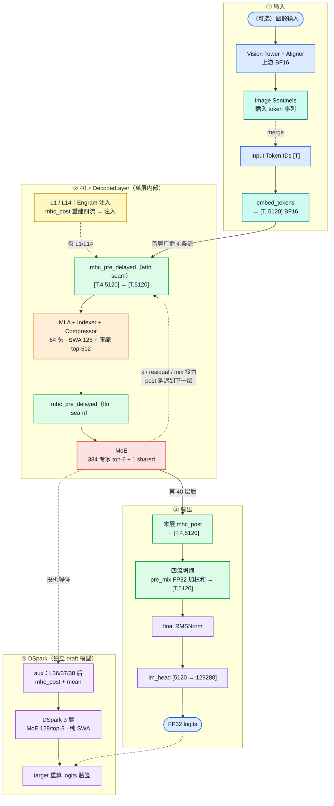
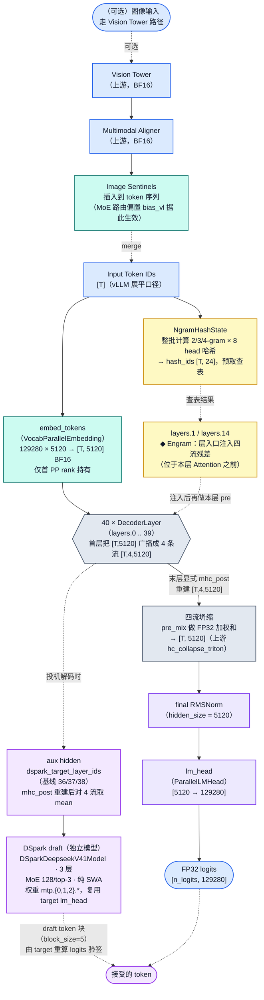
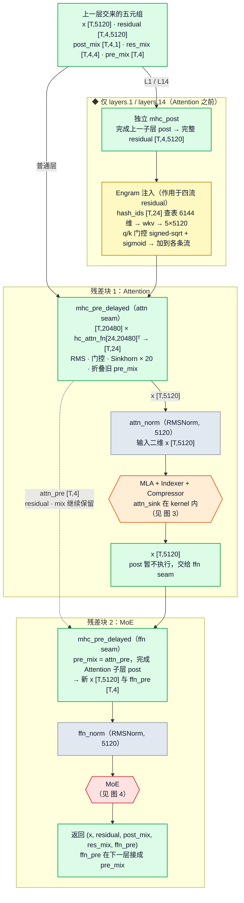
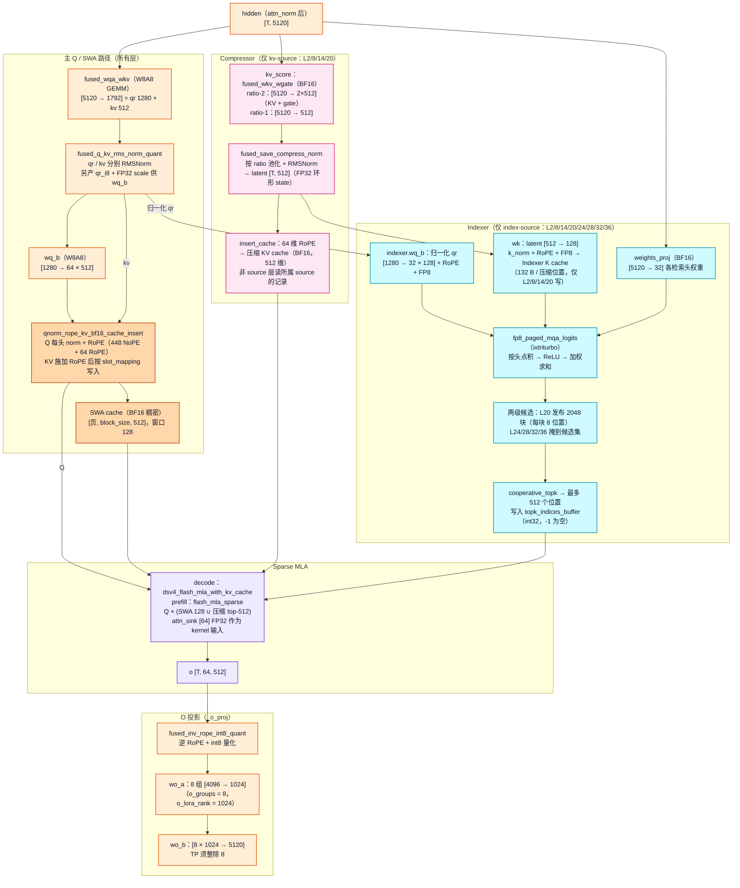
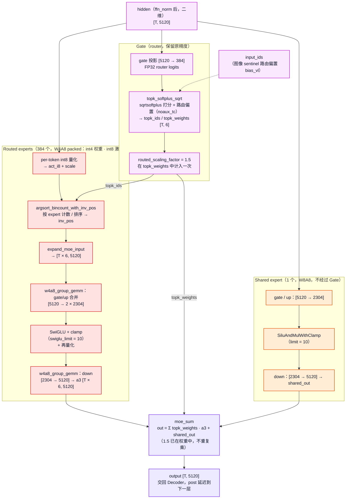

# DeepSeek-V4.1-Flash · 架构图集与算子映射

> ## ⚠️ 本文内容已全部并入 [`README.md`](README.md)
>
> 本文的**每一段文字、每一张图、每一份 Mermaid 源码**都已原样迁入 [`README.md`](README.md) 的对应章节，没有任何删减。保留此文件只是为了让你核对迁移是否完整；**后续维护请以 `README.md` 为准**，不要再改这里，否则两边会分叉。
>
> | 本文章节 | 已迁入 README 的位置 |
> |---|---|
> | 1. 一页纸调用链速览（含 1.1/1.2/1.3） | [第 0 章 一页纸速览](README.md#0-一页纸速览)（小节号改为 0.1 / 0.2 / 0.3） |
> | 2.1 关键参数表 | [1.2 完整参数速查表](README.md#12-完整参数速查表) |
> | 2.2 七分区模型架构总图 | [1.3 代码对象怎样嵌套](README.md#13-代码对象怎样嵌套) |
> | 2.3 图 0 · 一页速览 | [0.4 图 0 · 一页速览](README.md#04-图-0--一页速览) |
> | 2.4 图 1 · 模型总览 | [1.3 代码对象怎样嵌套](README.md#13-代码对象怎样嵌套) |
> | 2.5 图 2 · DecoderLayer 内部 | [2.3 40层主干循环](README.md#23-40层主干循环单层怎样靠五元组接力m4) |
> | 2.6 图 3 · MLA 内部 | [3.2 Attention 怎样读历史并返回结果](README.md#32-attention-怎样读历史并返回结果m5内部含-m7--m6--m9) |
> | 2.7 图 4 · MoE 内部 | [3.3 MoE 怎样汇合两路专家](README.md#33-moe-怎样汇合两路专家并把状态交给下一层m8) |
> | 3. 推理数据流与算子映射图（含颜色图例） | [2.5 端到端时序小结](README.md#25-端到端时序小结) |
> | 4. 结构—算子对照与历史验证记录 | [9.3 结构—算子对照与历史验证记录](README.md#93-结构算子对照与历史验证记录) |
> | 5.1 DSpark vs 经典 MTP | [5.4 DSpark：用独立草稿模型提案](README.md#54-dspark用独立草稿模型提案再交-target-验证m11) |
> | 5.2 全文口径说明 | [9.4 全文图例与口径说明](README.md#94-全文图例与口径说明) |

> **阅读导航**：[全局索引 (INDEX)](INDEX.md) ｜ **[核心架构长文 (README，含全部架构图)](README.md)** ｜ [实服部署指南](部署指南.md) ｜ [分步交互查看器](assets/html/dsv41_dynamic_architecture.html)

本文整合原分支的**调用链速览**、**五级分层模型架构图**与**Iluvatar/CoreX 算子数据流图**。所有参数口径已按主文档 [`README.md`](README.md) 的 w4a8 基线校订；需要逐算子公式、跨层共享细节与计算量推导时，请继续阅读 [`README.md`](README.md)。

- [1. 一页纸调用链速览](#1-一页纸调用链速览)：主调用链、Attention 路径与 MoE 路径。
- [2. 关键参数与分层模型架构图](#2-关键参数与分层模型架构图)：参数速查表、七分区架构总图 + 图 0～图 4 分层拆解。
- [3. 推理数据流与算子映射图](#3-推理数据流与算子映射图)：把网络拓扑映射到 Iluvatar / CoreX 实际执行的算子。
- [4. 结构—算子对照与历史验证记录](#4-结构算子对照与历史验证记录)：模块到算子的映射表及原分支调试期记录。
- [5. 附：DSpark vs 经典 MTP 与口径说明](#5-附dspark-vs-经典-mtp-与口径说明)：投机解码草稿模型辨析及全文图例口径。

---

## 1. 一页纸调用链速览

- **动态交互版**：[打开调用链速览动态查看器](assets/html/dsv41_dynamic_architecture_brief.html)（支持调用链动画、节点聚焦、路径追踪及 MLA / MoE / DSpark 分章节播放）
- **可维护图源**：[`assets/dot/dsv41_call_architecture_brief.dot`](assets/dot/dsv41_call_architecture_brief.dot)

### 1.1 主调用链

1. `DeepseekV41ForCausalLM` 作为 VL 外层包装；纯文本或视觉特征最终都进入 CoreX 版 `DeepseekV41LLMForCausalLM`。
2. `DeepseekV41LLMForCausalLM.forward()` 调用 `DeepseekV4Model.forward()`，先完成 token embedding（`[T,5120]`，vocab=129280）。
3. 若启用 Engram，进入 Decoder **之前**整批计算 n-gram hash（2/3/4-gram × 8 head = 24 列）并预取查表结果；注入发生在 **L1 / L14** 的层入口：先独立 `mhc_post` 重建四流残差，注入后才执行本层 `mhc_pre_delayed`，因此 Engram 位于 **Attention 之前**。
4. 主干执行 40 个 `DeepseekV4DecoderLayer`。每层依次执行：
   - `mhc_pre_delayed → attn_norm → MLA（投影 fan-out）→ O Projection`
   - `mhc_pre_delayed`（把 attention 子层 post 折进 pre）`→ ffn_norm → MoE`
5. mHC 在子层外维护 `[T, hc_mult=4, hidden_size=5120]`；进入 Attention / MoE 前折叠为 `[T, 5120]`。MoE 输出不在本层做完整 post，而是连同 `residual / post_mix / res_mix / ffn_pre` 交给下一层的 `mhc_pre_delayed`（`ffn_pre` 在下一层接成 `pre_mix`）。
6. 第 40 层结束后才显式 `mhc_post`，再用末层 `pre_mix` 对 4 条流做 FP32 加权求和坍缩为 `[T,5120]`（插件用 torch 实现，上游对应 `hc_collapse_triton`），然后 `final RMSNorm → ParallelLMHead`，得到 **target logits**。
7. 投机解码时，选定层结束后用 `mhc_post` 重建 aux hidden（再对 hc 流 `mean`），交给 DSpark。层号来自 `dspark_target_layer_ids`（基线 0-based 36/37/38）。DSpark 默认 3 个 draft layer；`dspark_block_size=5` 是 token 块长度，`num_speculative_tokens` 是建议 token 数，二者都不是网络层数。Draft 由 target 重算 logits 验签后采样。

### 1.2 Attention 路径

- `attn_gemm_parallel_execute` 从同一份 `attn_norm` hidden **fan-out** 三路（不是 `fused_wqa_wkv → compressor → indexer` 串行）：
  - `fused_wqa_wkv`（W8A8，5120→1792）→ `qr [T,1280]` + `kv [T,512]` → q_norm / RoPE / SWA KV insert（SWA 窗 128）
  - `kv_score` → Compressor（**仅 kv-source 层** L2/8/14/20）→ compressed KV cache
  - `indexer.weights_proj` + 归一化 qr → Indexer（**仅 index-source 层** L2/8/14/20/24/28/32/36）→ top-512
- 两级候选：L20 发布 2048 个候选块（每块 8 个压缩位置），L24/28/32/36 只在候选集中选 top-512。
- 压缩比按层分三档：L0–L1 纯 SWA、L2–L19 ratio-2、L20–L39 ratio-1；非 source 层复用所属 source 的 cache / top-k。
- Sparse MLA kernel 吃 Q、SWA KV、compressed KV、top-k；**`attn_sink`（每头一个 FP32 标量，全局 `[64]`）是该 kernel 的输入**，不是 O Projection 前的加法。
- prefill：`flash_mla_sparse`；decode：`dsv4_flash_mla_with_kv_cache`。
- `_o_proj`：inverse RoPE → 8 组 `wo_a [4096→1024]` → `wo_b [8×1024→5120]`，输出 `[T, 5120]`；分组布局要求 TP 整除 8。

### 1.3 MoE 路径

- `ffn_norm` 的同一份 hidden **并行**进入 Gate 与 Shared Expert；Shared Expert **不经过** Gate。
- Gate 输出 384 个专家的 FP32 logits，`sqrtsoftplus` 打分后每 token 选 **top-6**，驱动 **384 个 W4A8 packed routed experts**（int4 权重 / int8 激活；gate/up 合并 `[5120→2×2304]` → SwiGLU/clamp → down `[2304→5120]`）。
- Shared expert 为 W8A8 SwiGLU，`swiglu_limit=10`。
- 聚合语义：`routed_scaling_factor=1.5` 已在 top-k 路由权重中计入一次，`moe_sum` 再加 shared，聚合处**不重复乘 1.5**。

---

## 2. 关键参数与分层模型架构图

本节按“一页速览 → 模型总览 → DecoderLayer 内部 → MLA 内部 → MoE 内部”逐层拆解**网络拓扑与张量形态**。每张图先给出高清导出图，下方可展开查看/编辑对应的 Mermaid 源码。

### 2.1 关键参数表（DSV4.1-Flash）

| 维度 | 值 | 备注 |
|---|---|---|
| `hidden_size` | **5120** | V4.1；V4 标准版是 4096 |
| `vocab_size` | 129280 | `lm_head` 输出宽度 |
| 层数 | **40** | V4.1 紧凑版；V4 标准版是 43 |
| `hc_mult` | **4** | 残差流数；**每流宽 = 5120**（不是展平 20480） |
| hc 张量形态 | `[T, hc_mult=4, hidden_size=5120]` | 3 维张量；子层实际计算 `[T,5120]` |
| mHC 混合系数 | `pre_mix [T,4]`、`post_mix [T,4,1]`、`res_mix [T,4,4]` | 均为 FP32 |
| `hc_sinkhorn_iters` / `hc_eps` / `hc_post_alpha` | 20 / 1e-6 / 2.0 | Sinkhorn 双随机归一化 |
| `num_attention_heads` | 64 | MLA 主干头数 |
| `head_dim` | **512 = 448 NoPE + 64 RoPE** | 主 Q 与 KV latent 同宽 |
| `q_lora_rank` | **1280** | `fused_wqa_wkv` 输出 `qr 1280 + kv 512 = 1792` |
| SWA 窗口 | 128 | 每层都读本地窗口 |
| `compress_ratios` | L0–L1 = 0（纯 SWA）、L2–L19 = 2、L20–L39 = 1 | 只接受 0/1/2 三档 |
| kv-source 层 | L2 / L8 / L14 / L20 | 持有 Compressor；L20–L39 共享 L20 的压缩 KV |
| index-source 层 | L2 / L8 / L14 / L20 / L24 / L28 / L32 / L36 | 持有 Indexer；只有前 4 个写 Indexer K |
| 两级候选 | L20 发布 2048 块（每块 8 个压缩位置） | L24/28/32/36 只在候选集中选 |
| Indexer | 32 头 × 128 维；`index_topk = 512` | 检索 Q/K 与主注意力 Q/KV 是不同数据 |
| `o_groups` / `o_lora_rank` | 8 / 1024 | 8 组 `wo_a [4096→1024]` → `wo_b [8192→5120]`；TP 须整除 8 |
| `attn_sink` | 每头 1 个 FP32 标量，全局 `[64]` | **Sparse MLA kernel 的输入**，不是 O 投影前的加法 |
| `n_routed_experts` | **384** | 路由专家数 |
| `num_experts_per_tok` | **6** | 另有 1 个 shared expert |
| `moe_intermediate_size` | 2304 | 每个 expert 中间宽 |
| `routed_scaling_factor` | **1.5** | 在 top-k 路由权重中计入一次，聚合时不重复乘 |
| `swiglu_limit` | 10 | routed / shared 激活钳制 |
| 路由打分 | `sqrtsoftplus` + `noaux_tc` | `topk_softplus_sqrt` 选 top-6 并归一化 |
| Engram 层 | `{1, 14}` | 24 个哈希列（2/3/4-gram × 8 head），在本层 **Attention 之前**注入 |
| DSpark | **独立 3 层 draft**，MoE 128/top-3，纯 SWA | `dspark_block_size=5` 是 token 块长度，不是层数；捕获层基线 0-based 36/37/38 |
| 量化（w4a8 基线） | routed expert = W4A8 packed；attention 投影与 shared expert = W8A8 | router / norm / mHC / Engram / compressor / `indexer.weights_proj`·`wk` / `attn_sink` 保留原精度 |
| 主干 KV cache | **BF16 稠密**，SWA 与压缩 KV 每行 512 维 | 区别于上游 `fp8_ds_mla` 打包记录 |
| Indexer K cache | FP8 值 + 页尾 FP32 scale，132 B / 压缩位置 | 上游 MXFP4 变体为 68 B |
| 多模态 | VL 包装 `DeepseekV41ForCausalLM` | 视觉塔 / aligner 复用上游，文本特征汇入主干 |

### 2.2 七分区模型架构总图（SVG 矢量全景）

- **可维护图源**：[`assets/dot/dsv41_model_architecture.dot`](assets/dot/dsv41_model_architecture.dot)

---

### 2.3 图 0 · 一页速览

展开查看图 0 Mermaid 图源（对应 <code>assets/png/dsv41_model_architecture_overview.png</code>）

---

### 2.4 图 1 · 模型总览（Top-Level）

> **hc 残差流的真实形态**：DSV4.1 把层间状态维护成 `residual ∈ R[T, hc_mult=4, hidden_size=5120]` 的 **3 维张量**，每流宽 5120。每个子层（Attention / MoE）前由 `mhc_pre_delayed` 用 mix 系数把 4 流折叠成二维 `x [T,5120]` 再做 norm 与计算；普通层的 post 延迟到下一个子层的 pre 里一并完成。**NORM 与 LM_HEAD 看到的维度始终是 `hidden_size=5120`，不是 20480。** 40 层循环结束后才显式 `mhc_post`，再用末层 `pre_mix` 做 FP32 加权和坍缩 → `final RMSNorm (5120)` → `lm_head (5120→129280)`。

展开查看图 1 Mermaid 图源（对应 <code>assets/png/dsv41_model_architecture.png</code>）

---

### 2.5 图 2 · DecoderLayer 内部（单层拓扑）

每个 DecoderLayer 由两个**残差块**组成，hc 流贯穿整个 layer。**layers.1 / layers.14** 在本层入口、Attention 之前插入 Engram 注入。

> **hc 流 3 维张量与折叠节点**：
> - `residual ∈ R[T, hc_mult=4, hidden_size=5120]`：mHC 维护的 3 维张量；`x [T,5120]` 是子层实际计算的二维激活。
> - `mhc_pre_delayed` 交回 `(residual, post_mix, res_mix, x, attn_pre)`：`x` 送往 `attn_norm`，`attn_pre [T,4]` 留给本层 FFN 前的 mHC 当 `pre_mix`。
> - 首层没有上一层状态：先在层内把 embedding 广播成 4 条流，并用专门的 `hc_attn_fn_broadcast` 权重计算 mix 系数。
> - **Engram 层特殊处理**（仅 L1/L14）：注入**必须发生在上一子层 post 完成之后、本层 pre 之前**，让本层 Sinkhorn 系数看到注入后的残差；因此 Engram 层不能像普通层那样把 post 折进 pre，而是先独立执行一次 `mhc_post`。

展开查看图 2 Mermaid 图源（对应 <code>assets/png/fig2_decoder_layer_internals.png</code>）

---

### 2.6 图 3 · MLA 内部（Multi-Head Latent Attention + Indexer + Compressor）

MLA 用 512 维 latent 同时充当 K/V，并用滑动窗口（128）加压缩检索（top-512）读取历史，不对全部历史做完整注意力。CoreX fork 的主干 cache 为 BF16 稠密行。

> **MLA 关键点**：
> - **三路 fan-out**：同一份 `attn_norm` hidden 同时进入 `fused_wqa_wkv`、`kv_score`、`weights_proj`，满足多流条件时分别在默认流与 aux 流 0/1 上并发，三者之间没有串行依赖。
> - **两种 Q**：主注意力 Q 已从 1280 展开为 `64×512`；Indexer 使用的是展开前的归一化 qr（再投到 `32×128`）。
> - **cache 布局**：SWA 与压缩 KV 都是 512 维 BF16 稠密行（448 NoPE + 64 RoPE，不另拼 576 维）；Indexer K 为 FP8 + 页尾 FP32 scale。
> - **latent 两个下游**：Compressor 的 latent 一份经 `wk` 生成 Indexer K，另一份经 `insert_cache` 发布为压缩 KV，二者可重叠执行。
> - **`attn_sink`**：每头一个 FP32 标量（全局 `[64]`，TP 后各 rank 持有本地头部分），作为 Sparse MLA kernel 参数参与 softmax，而不是 O 投影前的加法偏置。
> - **短上下文**：`max_seq_len // ratio ≤ 512` 时直接填满 top-k，跳过打分；owns_k 层仍写 K cache。

展开查看图 3 Mermaid 图源（对应 <code>assets/png/fig3_mla_indexer_internals.png</code>）

---

### 2.7 图 4 · MoE 内部（384 experts × top-6 + 1 shared）

> **MoE 关键点**：
> - **routed experts** 采用 W4A8 packed（int4 权重、int8 激活、TN 布局、`iluvatar_quant.version=2`）；gate/up 是**合并**的一次分组 GEMM，down 是第二次分组 GEMM。上游 NVIDIA 路径对应 MXFP4 + MegaMoE。
> - **shared expert** 与 routed 共享输入但走独立 W8A8 MLP，不受 top-6 分发，也不乘路由缩放因子。
> - top-k = 6，路由专家 384 个（区别于 V3 系列的 256 / top-8）。
> - **routed_scaling_factor = 1.5**：只在路由权重中计入一次，`output = Σ(topk_weights · routed) + shared`。
> - `bias_vl` 是图像 sentinel 的**路由偏置**，作用在 gate 选专家阶段，不在聚合处相加。

展开查看图 4 Mermaid 图源（对应 <code>assets/png/fig4_moe_internals.png</code>）

---

## 3. 推理数据流与算子映射图

第 2 章展示网络拓扑与张量形态；本章把同一条前向路径映射到 **Iluvatar / CoreX 上实际调用的算子**。

### 颜色图例

| 颜色 | 含义 |
|---|---|
| 🟦 蓝 | 输入 / 输出（含 VL 多模态入口） |
| 🟩 绿 | mHC / hc 流（3 维张量折叠混合） |
| 🟧 橙 | Attention 主路径（主 Q / SWA / Sparse MLA / O 投影） |
| 🩷 粉 | Compressor（仅 kv-source 层） |
| 🩵 青 | Indexer（仅 index-source 层） |
| 🟨 黄 | Engram（哈希在入口，注入仅 L1 / L14） |
| 🟥 红 | MoE |
| 🟪 紫 | DSpark draft |
| ⬜ 灰 | 辅助（norm / PP 边界 / 输出头） |

```mermaid
flowchart TB
    classDef inputStyle fill:#dbeafe,stroke:#2563eb,stroke-width:1.5px,color:#0f172a
    classDef mhcStyle fill:#dcfce7,stroke:#16a34a,stroke-width:1.5px,color:#0f172a
    classDef attnStyle fill:#ffedd5,stroke:#ea580c,stroke-width:1.5px,color:#0f172a
    classDef idxStyle fill:#cffafe,stroke:#0891b2,stroke-width:1.5px,color:#0f172a
    classDef compStyle fill:#fce7f3,stroke:#db2777,stroke-width:1.5px,color:#0f172a
    classDef moeStyle fill:#fee2e2,stroke:#dc2626,stroke-width:1.5px,color:#0f172a
    classDef normStyle fill:#e2e8f0,stroke:#64748b,color:#0f172a
    classDef draftStyle fill:#f3e8ff,stroke:#9333ea,stroke-width:1.5px,color:#0f172a
    classDef engramStyle fill:#fef9c3,stroke:#ca8a04,stroke-width:1.5px,color:#0f172a

    %% ===== 输入 =====
    subgraph INPUT["输入（首 PP rank）"]
        direction LR
        IMG(["图像输入（可选）"]):::inputStyle --> VTOWER["Vision Tower + Aligner<br/>上游 BF16"]:::inputStyle --> SENT["Image Sentinels<br/>插入 token 序列"]:::inputStyle
        TOK["input_ids [T]"]:::inputStyle --> EMB["embed_tokens<br/>→ [T, 5120] BF16"]:::inputStyle
        TOK --> HASH["NgramHashState<br/>_hash_ids_kernel → hash_ids [T, 24]<br/>预取流查表"]:::engramStyle
    end

    %% ===== 单层 =====
    subgraph LAYER["DecoderLayer × 40（TP 须整除 8；PP=2 示例边界 L19 → L20）"]
        direction TB

        ENGRAM["仅 L1 / L14：Engram 注入<br/>独立 mhc_post → residual [T,4,5120]<br/>_fused_engram_post_wkv_kernel 门控加到各条流"]:::engramStyle
        MHC_PRE_ATTN["mhc_pre_delayed（attn seam）<br/>FP32 matmul + mhc_delayed_after_gemm<br/>Sinkhorn × 20 → x [T,5120] · attn_pre [T,4]"]:::mhcStyle
        ATTN_NORM["attn_norm · RMSNorm(5120)"]:::normStyle

        subgraph ATTN["Attention：三路 fan-out（默认流 + aux 流 0/1）"]
            direction TB
            subgraph FANOUT[" "]
                direction LR
                GEMM1["fused_wqa_wkv<br/>cuInfer scaled_mm · W8A8<br/>5120 → qr 1280 + kv 512"]:::attnStyle
                KVS["kv_score（仅 kv-source）<br/>fused_wkv_wgate · BF16"]:::compStyle
                IDXW["weights_proj（仅 index-source）<br/>5120 → 32 · BF16"]:::idxStyle
            end
            FQK["fused_q_kv_rms_norm_quant<br/>qr / kv RMSNorm + qr int8 量化"]:::attnStyle
            WQB["wq_b · W8A8<br/>1280 → 64 × 512"]:::attnStyle
            ROPE_SWA["fused_deepseek_v4_qnorm_rope_kv_bf16_cache_insert<br/>Q norm / RoPE · KV RoPE → SWA cache（BF16，窗 128）"]:::attnStyle
            CMN["fused_save_compress_norm<br/>→ latent [T,512]（FP32 环形 state）"]:::compStyle
            CINS["compressor.insert_cache<br/>_rope_plain_insert_kernel → 压缩 KV cache（BF16）"]:::compStyle
            IDXQ["indexer.wq_b + fused_indexer_q_rope_quant<br/>→ index_q [T,32,128] FP8"]:::idxStyle
            IDXK["indexer_k_norm_rope_store<br/>wk 512 → 128 · FP8 K cache（132 B/位置）"]:::idxStyle
            BSLOG["fp8_paged_mqa_logits（ixtriturbo Triton）<br/>L20 候选块 / L24–36 候选掩码"]:::idxStyle
            SEL["cooperative_topk<br/>→ topk_indices_buffer [*, 512] int32"]:::idxStyle
            MAP["compute_global_topk_indices_and_lens<br/>压缩位置 → 物理 slot"]:::idxStyle
            FLASH["decode · dsv4_flash_mla_with_kv_cache<br/>prefill · flash_mla_sparse<br/>attn_sink [64] FP32 作为 kernel 参数"]:::attnStyle
            OP["_o_proj：fused_inv_rope_int8_quant<br/>→ wo_a（8 组 4096→1024）→ wo_b（8192→5120）"]:::attnStyle
        end

        MHC_PRE_FFN["mhc_pre_delayed（ffn seam）<br/>pre_mix = attn_pre → x [T,5120] · ffn_pre [T,4]"]:::mhcStyle
        FFN_NORM["ffn_norm · RMSNorm(5120)"]:::normStyle

        subgraph MOE["MoE：384 routed（top-6）+ 1 shared"]
            direction TB
            GATE["gate [5120 → 384] FP32 logits<br/>topk_softplus_sqrt → top-6（权重含 ×1.5）"]:::moeStyle
            PREP["per-token int8 量化 · argsort_bincount_with_inv_pos<br/>expand_moe_input → [T×6, 5120]"]:::moeStyle
            W4A8["w4a8_group_gemm × 2（W4A8 packed）<br/>gate/up [5120→2×2304] → SwiGLU clamp 10 → down"]:::moeStyle
            SHARED["shared expert · W8A8<br/>SiluAndMulWithClamp"]:::moeStyle
            MOE_SUM["moe_sum<br/>Σ topk_weights · a3 + shared_out"]:::moeStyle
        end

        RET["返回 (x, residual, post_mix, res_mix, ffn_pre)<br/>post 延迟到下一层 pre"]:::mhcStyle
    end

    %% ===== 输出 =====
    subgraph OUTPUT["输出（末 PP rank）"]
        direction TB
        POST["末层显式 mhc_post → [T,4,5120]"]:::mhcStyle
        HC_COL["四流坍缩：pre_mix FP32 加权和（torch）<br/>[T,4,5120] → [T,5120]（上游 hc_collapse_triton）"]:::mhcStyle
        NORM["final RMSNorm(5120)"]:::normStyle
        HEAD["logits_indices 选行 → lm_head [5120 → 129280]"]:::normStyle
        OUT(["FP32 logits → Sampler"]):::inputStyle
    end

    PPLBL["PP 边界：IntermediateTensors<br/>hidden_states [T,4,5120] · pre_mix [T,4] · input_ids · aux"]:::normStyle

    %% ===== DSpark =====
    subgraph DSPARK["DSpark（独立 draft 模型）"]
        direction TB
        AUX["aux：L36/37/38 后 mhc_post + mean<br/>combine_hidden_states：main_proj 3×5120 → 5120"]:::draftStyle
        DRAFT["DSparkDeepseekV41Model · 3 层<br/>MoE 128/top-3 · 纯 SWA<br/>precompute_and_store_context_kv"]:::draftStyle
        VERIFY["draft token 块（block_size=5）<br/>target 重算 logits 验签 / 采样"]:::draftStyle
    end

    %% ===== 连接 =====
    SENT -.->|merge| TOK
    EMB -->|首层广播 4 条流| MHC_PRE_ATTN
    HASH -.->|L1 / L14| ENGRAM
    ENGRAM --> MHC_PRE_ATTN
    MHC_PRE_ATTN --> ATTN_NORM
    ATTN_NORM --> GEMM1
    ATTN_NORM --> KVS
    ATTN_NORM --> IDXW
    GEMM1 --> FQK --> WQB --> ROPE_SWA
    KVS --> CMN --> CINS
    CMN --> IDXK
    FQK -->|归一化 qr| IDXQ
    IDXQ --> BSLOG
    IDXK --> BSLOG
    IDXW --> BSLOG
    BSLOG --> SEL --> MAP --> FLASH
    ROPE_SWA --> FLASH
    CINS --> FLASH
    FLASH --> OP --> MHC_PRE_FFN
    MHC_PRE_FFN --> FFN_NORM
    FFN_NORM --> GATE
    FFN_NORM --> PREP
    FFN_NORM --> SHARED
    GATE --> PREP --> W4A8 --> MOE_SUM
    SHARED --> MOE_SUM
    MOE_SUM --> RET
    RET -.->|下一层| MHC_PRE_ATTN
    RET -->|第 40 层后| POST
    RET -.->|非末 PP rank| PPLBL
    POST --> HC_COL --> NORM --> HEAD --> OUT
    RET -.->|投机解码| AUX --> DRAFT --> VERIFY
    OUT -.-> VERIFY

    style FANOUT fill:none,stroke:none
```

展开查看推理数据流 Mermaid 图源（对应 <code>assets/png/dsv41_inference_pipeline.png</code>）

---

## 4. 结构—算子对照与历史验证记录

下表整合了网络结构元素、Iluvatar 推理算子，以及原分支调试期的验证记录（仅作历史排查参考，本轮只按源码与配置校订了结构口径，未重新起服复核数值）。

| 模型架构元素 | 对应推理算子 | 原分支验证记录（历史） | 现状说明 |
|---|---|---|---|
| embed 查表 | `VocabParallelEmbedding` | ✅ cos = 1.0 | — |
| hc 流 3 维张量 `[T, hc_mult, hidden_size]` | 层内广播 / OOT `mhc_pre_delayed` | ✅ 已自然继承 | — |
| mHC-pre（Sinkhorn） | FP32 matmul + `mhc_delayed_after_gemm`（Triton） | ✅ 与官方 tilelang 公式对照一致 | — |
| attn_norm（RMSNorm, 5120） | fused RMSNorm | ✅ | — |
| MLA：`fused_wqa_wkv` | `fused_wqa_wkv`（cuInfer scaled_mm, W8A8） | ✅ 绝对口径一致 | — |
| MLA：Q/KV RMSNorm + 量化 | `fused_q_kv_rms_norm_quant` | ★ L0 的 q 存在 bf16 ULP 级非确定，会翻转 top-k，层间放大到 7–9% | 未复核 |
| MLA：`wq_b` | `wq_b`（W8A8） | ✅ cos = 0.9999 | — |
| MLA：q_norm + RoPE + SWA insert | `fused_deepseek_v4_qnorm_rope_kv_bf16_cache_insert` | ✅ cache 内容 cos = 0.9998 | — |
| Indexer：`wq_b` + 后处理 | `indexer.wq_b` + `fused_indexer_q_rope_quant` | ⚠️ 未单独验证 | 未复核 |
| Indexer 打分 + top-k | `fp8_paged_mqa_logits` + `cooperative_topk` | ✅ top-512 overlap = 1.000 | 实服已支持 INT8 Indexer（见 [`部署指南.md`](部署指南.md)） |
| Sparse MLA（prefill / decode） | `flash_mla_sparse` / `dsv4_flash_mla_with_kv_cache` | ✅ prefill err ≤ 0.009（S9239/S16792）；decode 合成 A/B err ≤ 0.002 | — |
| Compressor | `fused_save_compress_norm` + `insert_cache` | ⚠️ 当时未做 per-stage 复核 | — |
| KV cache dtype | BF16 稠密（区别于上游打包 FP8） | ⚠️ 长上下文需关注显存 | 是设计选择（`use_fp8_ds_mla_layout=False`） |
| O 投影 | `fused_inv_rope_int8_quant` → `wo_a` → `wo_b` | ✅ cos 0.995–0.9995 | — |
| aux 多流并发 | `execute_in_parallel` / `maybe_execute_in_parallel` | ★ 曾存在竞态，用 `VLLM_ILUVATAR_DSV41_DISABLE_AUX_STREAM=1` 规避 | 开关仍保留，Event 顺序见 [`README.md` 7.2 节](README.md#72-多流先保证依赖再谈重叠) |
| Engram 注入（L1/L14） | `Engram` + `NgramHashState` | ⚠️ 当时仅对照开关 Engram 的差别 | — |
| ffn_norm（RMSNorm, 5120） | fused RMSNorm | ✅ | — |
| MoE：gate + sqrtsoftplus + top-k | `topk_softplus_sqrt` | ✅ A/B 100% 一致、确定性 | — |
| MoE：routed experts | `w4a8_group_gemm` × 2（W4A8 packed） | ★★ 当时观测到输出 ≈ 原始 × 1.4999，cos 0.03–0.27 | 幅值 1.5 与 `routed_scaling_factor=1.5` 计入路由权重的设计语义吻合；方向差未复核 |
| MoE：shared expert | W8A8 path | ⚠️ 当时混在 MoE 段整体对照 | 未复核 |
| SwiGLU clamp（limit = 10） | `SiluAndMulWithClamp` / fused activation | ★ 曾缺失 `swiglu_limit` 钳制，后已补 | 补丁后未单独验证 |
| 四流坍缩 | torch FP32 加权和（上游 `hc_collapse_triton`） | ✅ 误差 0.000% | — |
| DSpark draft | `DSparkDeepseekV41Model`（`mtp.*` 权重） | ⚠️ 与 V4 标准版经典 MTP 不通用 | — |
| VL 多模态 | `DeepseekV41ForCausalLM`（VL 包装） | ⚠️ 当时已补 `packed_modules_mapping` | — |

---

## 5. 附：DSpark vs 经典 MTP 与口径说明

### 5.1 DSpark vs 经典 MTP

DSV4.1 的投机解码草稿模型是 **DSpark**，不是经典 MTP：
- 是独立模型 `DSparkDeepseekV41ForCausalLM`，不是 target 40 层里的子模块；层号接在主干之后（`layers[40..42]`）。
- 权重命名空间：`mtp.{0,1,2}.*`（V4.1 的 Markov 命名为 `embed/head`，0731 为 `markov_w1/w2`）。
- 默认 3 层（优先读 `n_mtp_layers / num_nextn_predict_layers`，缺失时回退 3），MoE 128 专家 / top-3，主干纯 SWA。
- `dspark_block_size=5` 是一次草稿的 token 块长度；部署可设 `num_speculative_tokens`，二者都不是层数。
- 与 V4 标准版（`deepseek_v4`、43 层、hidden 4096）的经典 MTP **不通用**。
- `has_own_lm_head = False`：draft logits 复用 target `lm_head`，最终由 target 重算 logits 验签。

### 5.2 全文口径说明

- 图中 `[T, ...]` 使用 vLLM 已展平 token 维度。
- `dspark_target_layer_ids` 是 checkpoint 配置（基线 0-based `36/37/38`），不是实现硬编码。
- 图只描述 forward 推理结构；权重加载、TP/PP/EP 约束和 CUDA Graph 细节见 [`README.md` 第 7 章](README.md#7-插件怎样接入框架哪些依赖必须保持)。
