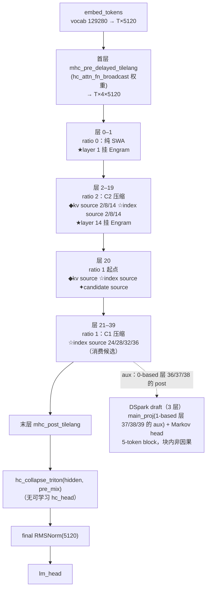
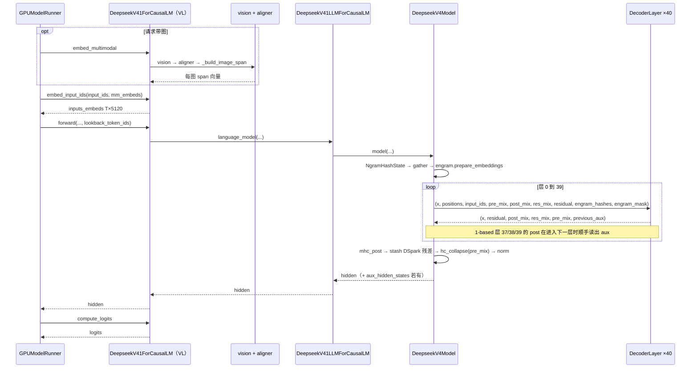
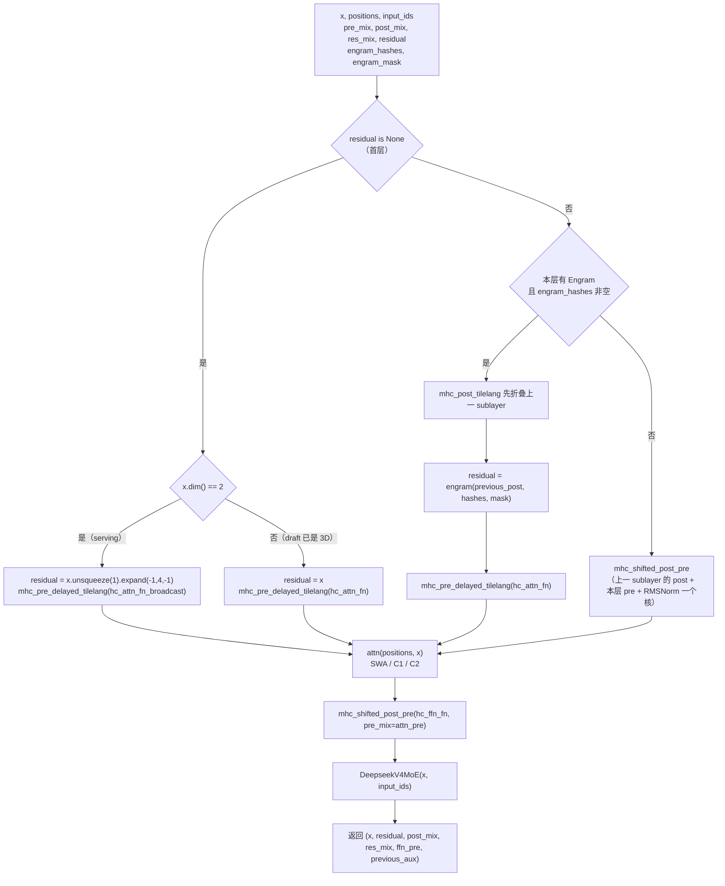
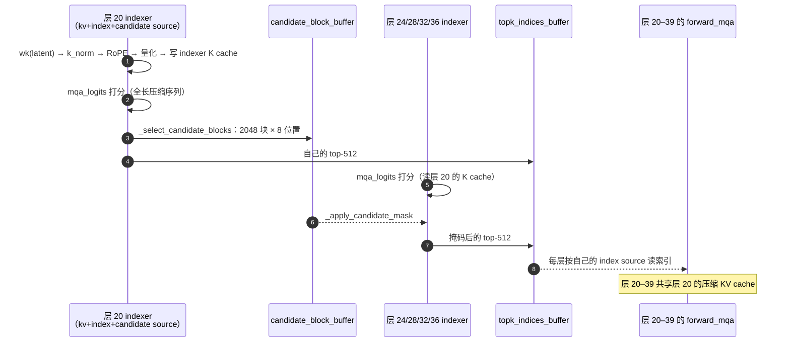

# 读懂 DeepSeek-V4.1-Flash：跨层共享压缩 KV、两级候选与 Engram 的上游 vLLM 实现

DeepSeek-V4.1-Flash 是一个 40 层的全 MoE 模型：没有 dense FFN，384 个专家每 token 取 top-6 加 1 个 shared expert；注意力全部是 head_dim 512 的 MLA，按 `compress_ratios` 分三档——2 层纯滑窗、18 层 ratio-2 压缩、20 层 ratio-1 压缩；但**压缩器只存在于 4 个层、indexer 只存在于 8 个层**，其余压缩层（ratio 大于 0）复用自己下方最近那个 source 的压缩 KV 与 top-k 索引，层 0–1 是纯滑窗、不读压缩 cache；layer 20 的 indexer 还额外发布一批候选块，让后面 4 个 indexer 做二级过滤；残差是 4 条流的 mHC，用的是**延迟 pre-mix**，末端没有可学习的 hc_head；layer 1 和 14 各挂一个 Engram，把 n-gram 哈希查表的结果门控注入残差流；投机解码只有 DSpark（3 层，draft 自带 128/top-3 的 MoE），没有经典 MTP。本文以 checkpoint 的 `config.json` 为起点，对照上游 vLLM 的 NVIDIA 实现，把模型结构、forward 调用链、Prefill/Decode 换核和 kernel 入口讲清楚。

读完你能讲清四件事：

- **40 层层表怎样数出来**——`compress_ratios` 的 0/1/2 三档，加上 `kv_source_layer_ids` / `index_source_layer_ids` 决定谁真的持有模块；
- **一次 serving forward 怎样调用**——VL 外层容器 → 文本塔 → 40 层 DecoderLayer，以及 pre-mix 为什么要跨 sublayer 接力；
- **跨层共享与两级候选怎样分工**——4 个 compressor、8 个 indexer、1 个 candidate source 各自产出什么、谁消费；
- **Engram / MoE / DSpark 落在哪些 kernel**——n-gram 哈希与门控、MegaMoE、DSpark 的非因果块式 draft。

**四个先入为主的提醒**。一是 `compress_ratios` 里的 `1` 不等于 `0`：V4.0 用 `max(1, ratio)` 把 0 归一成 1，V4.1 严格区分，只接受 0/1/2 三个值（`attention.py:262-273`），`1` 表示「全长压缩 cache」（逐 token 压一条、无 gate），只有 `0` 才是纯滑窗。二是不要假设每层都有 compressor 和 indexer——本 checkpoint 只有 4 个 compressor 和 8 个 indexer，这是 V4.1 相对 V4.0 最大的结构变化。三是 `num_nextn_predict_layers=3` 在 V4.1 里是 **DSpark 的层数**，不是 MTP 层数；registry 里根本没有 V4.1 的 MTP 条目（`registry.py:679` 的 `DeepSeekV4MTPModel` 指向 `deepseek_v4`）。四是 checkpoint 的 `architectures` 写着 `DeepseekV41ForCausalLM`，但它是**多模态包装**（`nvidia/vl_model.py:118`），文本塔叫 `DeepseekV41LLMForCausalLM`；纯文本请求加载的也是这个包装。VL 包装类**无条件**加载；`vision_n_layers > 0` 门控的是 `is_mm_prefix_lm` 与 `mm_prefix_clamp_sliding_window` 两个属性（`configs/deepseek_v41.py:66,70`），不是「VL 分支」。

> 面向读者：会起 vLLM 服务、想弄清跨层共享压缩 MLA + 全 MoE + mHC 的工程师。文中所有 `xxx` 都是可 grep 的源码符号，行号对应 `/workspace/vllm_official` 的 `vllm/models/deepseek_v41/`（= 上游 vLLM `v0.30.0`，commit `ced6857afa`，2026-09-21；这是写作机容器内路径，同一棵树在共享盘上是 `<share>/user_homes/zyp/vllm_official`）；模型配置为 `/workspace/models/deepseek-ai/DeepSeek-V4.1-Flash/config.json`。行号会随上游推进漂移，按符号名 grep 最稳。本文是 `docs/community_talks/` 学习讲义家族的一员：DeepSeek-V4-Flash（[对应模型讲义](../../deepseek_v4_flash_0731/LEARN.md)，本模型的前一代，三态压缩 + 哈希 MoE + 双 draft）、GLM-5.3-Flash（[对应模型讲义](../../glm53_flash/LEARN.md)，mHC 的 CustomOp ABI 形态 + KDA）、Qwen3.8-Flash-Next（[对应模型讲义](../../qwen38_flash_next/LEARN.md)，HC 低秩门控 + GDN）、GLM-5.2（[对应模型讲义](../../glm52/LEARN.md)，token 级 top-2048 的 DSA 代码族）。

## 目录

- 第 1 章：整体架构
- 第 2 章：config 怎么决定 40 层层表
- 第 3 章：类与调用链
- 第 4 章：单层 DecoderLayer 与延迟 mHC
- 第 5 章：注意力：三档压缩、跨层共享与两级候选
- 第 6 章：Engram
- 第 7 章：MoE
- 第 8 章：DSpark
- 第 9 章：Prefill/Decode 与 kernel 速查
- 复盘
- 常见问题
- 附录 A：源码速查

## 怎么读

按章节顺序读，一路对照源码。图用于梳理结构，两边冲突以源码为准。

```text
config.json（text_config 被摊平到顶层）
  → registry 与模块包含关系
    → DeepseekV41ForCausalLM（VL）→ DeepseekV41LLMForCausalLM → DeepseekV4Model → DecoderLayer.forward
      → mHC / MLA（compressor · indexer · SWA）/ Engram / MoE
        → TileLang · DeepGEMM · FlashMLA · Triton
          → Prefill kernel  vs  Decode kernel
            → 写了哪块 cache / 发布了什么给后面的层
```

## 术语速览

- mHC，超连接残差。4 条 residual stream，层间延迟传递 `post_mix` / `res_mix` / `pre_mix`。
- SWA，sliding window attention。窗口 128 token 的滑窗，**每层都有**，是近期记忆。
- 压缩 KV。`DeepseekCompressor` 把 `compress_ratio` 个 token 压成一条 512 维 latent，是长上下文记忆的主体。
- ratio-1 层 / ratio-2 层。`compress_ratio == 1`：逐 token 压一条，无 gate；`== 2`：每 2 个 token 压一条，带学习 gate。两者都 attend indexer 选出的 top-k 压缩条目。
- kv source。持有 compressor 与压缩 KV cache 的层，本 checkpoint 是 `{2, 8, 14, 20}`。其余压缩层读它的 cache。
- index source。持有 indexer 的层，本 checkpoint 是 `{2, 8, 14, 20, 24, 28, 32, 36}`。其余层复用它发布的 top-k 索引。
- candidate source。`layer 20`。它的 indexer 额外发布 2048 个候选块（每块 8 个压缩位置），layer 24/28/32/36 先用它掩掉分数再做自己的 top-k。
- Engram。n-gram 哈希大表 + 门控注入，只在 layer 1 和 14。
- DSpark。半自回归投机解码 draft：3 层，一次出 5-token block，块内非因果。

hidden 有两档形态，看到就能对上：单流 `[T, 5120]`，四流 `[T, 4, 5120]`（**是 3 维张量，不是展平成 20480**）。

---

## 第 1 章：整体架构

`model_type` 是 `deepseek_v41`，checkpoint 的 `architectures` 是 `DeepseekV41ForCausalLM`——多模态入口。主干 40 层，每层都是 `mHC + MLA + MoE`，没有 dense FFN（`nvidia/model.py:205-209` 无条件挂 `DeepseekV4MoE`）。

层表由三组字段共同决定，缺一不可：

- `compress_ratios`（43 项，仅前 40 项被主干消费）决定每层注意力的**形态**：`0` → 纯 SWA，`1` → 全长压缩，`2` → ratio-2 压缩；
- `kv_source_layer_ids = [2, 8, 14, 20]` 决定谁**持有** compressor 和压缩 KV cache；
- `index_source_layer_ids = [2, 8, 14, 20, 24, 28, 32, 36]` 决定谁**持有** indexer。

```text
idx:     0    1★   2◆☆  3-7  8◆☆  9-13 14★◆☆ 15-19 20◆☆✦ 21-23 24☆  25-27 28☆ ... 36☆  37-39
ratio:   0    0    2    2     2    2    2     2     1     1     1    1     1       1    1
attn:   SWA  SWA  C2    C2   C2   C2   C2    C2    C1    C1    C1   C1    C1      C1   C1
mlp:    MoE 384/top-6 + 1 shared × 40（没有 dense FFN）
mHC:    每层 attn 前、FFN 前各一次 shifted post+pre；层间传 (x, residual, post_mix, res_mix, pre_mix)
```

`★` = Engram 层（1, 14）；`◆` = kv source（2, 8, 14, 20）；`☆` = index source（2, 8, 14, 20, 24, 28, 32, 36）；`✦` = candidate source（20）。

数一遍：`ratio 0` 是层 0-1 共 2 层；`ratio 2` 是层 2-19 共 18 层；`ratio 1` 是层 20-39 共 20 层。列表第 41-43 项（下标 40-42）的三个 `0` 超出 `num_hidden_layers`，正好对应 3 个 DSpark draft 层——它们因此是纯 SWA（第 8 章）。



和 V4.0 对照：

| | DeepSeek-V4-Flash（0731） | DeepSeek-V4.1-Flash |
| --- | --- | --- |
| 层数 / hidden | 43 / 4096 | 40 / 5120 |
| 注意力形态 | 2 SWA + 21 C4A + 20 C128A | 2 SWA + 18 ratio-2 + 20 ratio-1 |
| compressor 数量 | 每个压缩层一个（41 个） | **只有 4 个**（kv source） |
| indexer 数量 | 每个 C4A 层一个（21 个） | **只有 8 个**（index source） |
| indexer 的 K 来源 | indexer 自带 compressor over hidden | **kv source 的 compressor latent**（`k_norm(wk(latent))`） |
| 候选过滤 | 单级 top-512 | **两级**：layer 20 发布 2048 候选块，后 4 层掩码后再 top-k |
| MoE 路由 | 前 3 层 `tid2eid` 哈希 + 40 层 noaux_tc | 全 40 层 noaux_tc（`num_hash_layers=0`） |
| 专家规模 | 256 / top-6 | 384 / top-6 |
| mHC 末端 | 可学习 `hc_head_fn` 带参坍缩 | `hc_collapse_triton(hidden, pre_mix)`，**无 hc_head** |
| mHC 层间 | `mhc_fused_post_pre`（当层 pre-mix） | `mhc_shifted_post_pre`（**上一 sublayer 的 pre-mix**） |
| 浅层注入 | 无 | **Engram**（layer 1 / 14） |
| 投机解码 | DSpark + MTP 二选一 | **只有 DSpark** |
| 量化 | block-FP8 `[128,128]` | **MXFP8 线性 `[32,32]` + ue8m0，专家 MXFP4** |

---

## 第 2 章：config 怎么决定 40 层层表

打开 `/workspace/models/deepseek-ai/DeepSeek-V4.1-Flash/config.json`。读表前先注意一件事：字段都在 `text_config` 下，但 `DeepseekV41Config.__init__`（`vllm/transformers_utils/configs/deepseek_v41.py:18-44`）**把 `text_config` 的字段全部摊平到顶层**，所以模型代码里是 `config.hidden_size` 直读，不是 `config.text_config.hidden_size`。同一处还把 `rope_scaling` 改名成 `rope_parameters`（Transformers v5 里 `rope_scaling` 变成了属性），并把 `quantization_config.expert_dtype` 提到顶层（`:49-50`）。

| 字段 → 代码属性 | 本 checkpoint | 代码消费点 |
| --- | --- | --- |
| `num_hidden_layers` | 40 | `make_layers` 建 40 个 `DeepseekV4DecoderLayer`（`nvidia/model.py:518-529`） |
| `hidden_size` | 5120 | 单流宽度；mHC 四流 `hc_dim = 4 × 5120 = 20480`（`model.py:475`），但张量保持 3 维 |
| `num_attention_heads` / `head_dim` | 64 / 512 | MLA Q 头数与头宽（512 = 448 NoPE + 64 RoPE，`attention.py:243-244`） |
| `num_key_value_heads` | 1 | 代码不读这个字段：`MLAAttentionSpec(num_kv_heads=1, ...)` 硬编码（`attention.py:960`） |
| `q_lora_rank` / `o_lora_rank` / `o_groups` | 1280 / 1024 / 8 | Q 低秩、O 低秩、O 分组（第 5 章） |
| `qk_rope_head_dim` | 64 | RoPE 维度；NoPE 448 |
| `rms_norm_eps` | **1e-20** | 所有 RMSNorm 的 eps（`model.py:195`），比常见的 1e-6 小 14 个数量级 |
| `compress_ratios` | 43 项：`[0,0, 2×18, 1×20, 0,0,0]` | 逐层注意力形态，只接受 0/1/2（`attention.py:262-273`） |
| `kv_source_layer_ids` | `[2, 8, 14, 20]` | 谁持有 compressor + 压缩 KV cache（`attention.py:274-276, 480-490`） |
| `index_source_layer_ids` | `[2, 8, 14, 20, 24, 28, 32, 36]` | 谁持有 indexer（`attention.py:277-279, 380-431`） |
| `candidate_source_layer_id` | 20 | 发布候选块的 indexer（`attention.py:280, 409-431`） |
| `candidate_topk_blocks` / `candidate_block_size` | 2048 / 8 | 候选块数与每块压缩位置数（`model.py:495-504`） |
| `index_n_heads` / `index_head_dim` / `index_topk` | 32 / 128 / 512 | indexer 打分头配置与选块数（`attention.py:1075-1078`） |
| `compress_rope_theta` / `rope_theta` | 160000 / 10000 | `compress_ratio > 0` 的层用前者，`== 0` 用后者（`common/rope.py:29-30`） |
| `rope_scaling` → `rope_parameters` | yarn, factor 16, original 65536 | `deepseek_yarn`，强制 `mscale=0`、`is_neox_style=False`（`common/rope.py:44-52`） |
| `sliding_window` | 128 | `window_size`（`attention.py:247`），**全层生效** |
| `hc_mult` / `hc_sinkhorn_iters` / `hc_eps` | 4 / 20 / 1e-6 | mHC 流数、Sinkhorn 迭代、归一化 eps（`model.py:213-215`） |
| `n_routed_experts` / `num_experts_per_tok` | 384 / 6 | MoE top-6 |
| `n_shared_experts` / `moe_intermediate_size` | 1 / 2304 | shared expert 与专家宽度 |
| `scoring_func` / `topk_method` / `routed_scaling_factor` / `norm_topk_prob` | sqrtsoftplus / noaux_tc / 1.5 / true | 路由数学（第 7 章） |
| `swiglu_limit` | 10.0 | `SiluAndMulWithClamp`，也作为 `activation_clamp` 进 MegaMoE 核 |
| `engram_layer_ids` | `[1, 14]` | Engram 层（`model.py:182-193`） |
| `engram_num_embeddings` | `[384006168, 384016682]` | 两张表的行数（第 6 章会说明它怎么来的） |
| `engram_max_ngram_size` / `engram_n_heads` / `engram_head_dim` | 4 / 8 / 256 | 每位置 3 个 n-gram × 8 head = 24 个哈希列（`common/engram.py:199`） |
| `engram_vocab_size` / `engram_compressed_vocab_size` | 16000000 / 99092 | 质数起点 / 归一化后的词表大小（`common/engram.py:186-198, 94-142`） |
| `num_nextn_predict_layers` | 3 | **DSpark** 层数（`nvidia/dspark.py:82-86`） |
| `dspark_block_size` / `dspark_target_layer_ids` / `dspark_markov_rank` | 5 / `[37,38,39]` / 256 | DSpark draft（第 8 章） |
| `dspark_n_routed_experts` / `dspark_num_experts_per_tok` | 128 / 3 | **draft 层的 MoE 规模与主干不同**（`model.py:99-105`） |
| `quantization_config` | fp8, `weight_block_size [32,32]`, `scale_fmt ue8m0`, `expert_dtype fp4` | MXFP8 线性 + MXFP4 专家（第 7 章） |
| `max_position_embeddings` | 1048576 | 1M 上下文 |
| `vision_config.num_hidden_layers` → `vision_n_layers` | 32 | 非 0 即启用 VL 分支（`configs/deepseek_v41.py:52-70`） |
| `vision_config.max_image_tokens` → `vision_max_n_token` | 1024 | prefill SWA 索引行的加宽上限（`attention.py:248-254`） |

### compress_ratios 的三档语义

`DeepseekV4Attention.__init__` 逐层读这个列表（`attention.py:262-273`）：

```python
if compress_ratios is not None and layer_id < len(compress_ratios):
    self.compress_ratio = int(compress_ratios[layer_id])
else:
    # MTP layers past the configured list are pure sliding-window.
    self.compress_ratio = 0
if self.compress_ratio not in (0, 1, 2):
    raise ValueError(...)
```

注释里的 “MTP layers” 是 V4.0 留下的措辞（V4.1 已无 MTP 模块）。V4.1 的 draft 层编号是 40/41/42，仍在 43 项列表内，读到的是尾部那三个 0（所以是纯滑窗）；真越界时 `else` 分支同样兜底成 0。这里**没有** V4.0 的 `max(1, ...)` 归一。三档的区别：

- **`0`（层 0-1）**：不建 compressor、不建 indexer，`get_kv_cache_spec` 返回 None（`attention.py:947-953`）——它按 `not is_kv_source` 判（`:952`，`is_kv_source` 见 `:285`），本 checkpoint 的 ratio-0 层恰好也不是 kv source。只挂 `DeepseekV4SWACache`。RoPE 用 `rope_theta=10000` 且关掉 YaRN（`common/rope.py:31-42` 把 `factor` 设成 1.0）。
- **`1`（层 20-39）**：全长压缩 cache——compressor 逐 token 压一条，**无 gate**（`compressor.py:205` 的 `has_gate = compress_ratio > 1` 为假，checkpoint 本身就不带这层的 gate 权重），也没有 state cache（`compressor.py:230-238`）。
- **`2`（层 2-19）**：每 2 个 token 压一条，带学习 gate 和 `CompressorStateCache`（存 open group 的 `[kv, score]` 行）。

两档压缩层都 attend indexer 选出的 top-k 压缩条目，差别只在压缩页的 block size（`block_size // ratio`），所以各需一个独立的 FlashMLA tile-scheduler plan（`sparse_mla.py:36-50`）。

```text
_V41_LAYER_TYPES = {0: SWAONLY, 1: C1A, 2: C2A}   # sparse_mla.py:36-40
```

`compress_ratio > 0` 的层（即层 2-39，**含 ratio-1**）RoPE theta 换成 `compress_rope_theta=160000` 并走 YaRN。这和 V4.0 的判定条件不同——V4.0 是 `> 1`，V4.1 是 `> 0`（`common/rope.py:29-37`）。

### 容易看错的四个点

1. **`hc_post_alpha` 不在 config 里**：`model.py:216` 硬编码 `2.0`。
2. **`rms_norm_eps = 1e-20`**：这不是笔误。它同时是 mHC 的 `rms_eps` 参数（`model.py:351, 367`），换成 1e-6 会改变归一化数值。
3. **ratio-1 层的 compressor 没有 gate 权重**：对照 ratio-2 层会以为少加载了东西，实际是 checkpoint 按 `has_gate` 区别存的。
4. **layer 14 同时是 Engram 层和 kv source**：Engram（残差侧）与压缩比/source 归属（注意力侧）正交，互不冲突。

---

## 第 3 章：类与调用链

按顺序打开：

1. `vllm/model_executor/models/registry.py`（`:379-381` `DeepseekV41ForCausalLM`、`:647-650` `DSparkV41DraftModel`，模块都指向 `vllm.models.deepseek_v41`）
2. `vllm/models/deepseek_v41/__init__.py`（按平台分发：ROCm → `amd/`，否则 `nvidia/`）
3. `vllm/models/deepseek_v41/nvidia/vl_model.py`（多模态入口）
4. `vllm/models/deepseek_v41/nvidia/model.py`（文本塔主实现）
5. `vllm/models/deepseek_v41/attention.py`（注意力基类，平台无关）
6. `vllm/models/deepseek_v41/nvidia/flashmla.py`（FlashMLA 后端子类）

模块包含关系（不是 forward 顺序）：

```text
DeepseekV41ForCausalLM（SupportsMultiModal, SupportsPP, SupportsEagle3）  ← checkpoint 的 architectures
├─ vision：DeepseekV4ViT（32 层）
├─ aligner：DeepseekV4Aligner
├─ image_start / image_newline / image_end（3 个学习向量）
└─ language_model：DeepseekV41LLMForCausalLM（SupportsPP, SupportsEagle3, SupportsLoRA, MixtureOfExperts）
   ├─ model：DeepseekV4Model（EagleModelMixin）
   │  ├─ embed_tokens
   │  ├─ DeepseekV4DecoderLayer × 40
   │  │  ├─ attn（FlashMLA / FlashInfer 子类，三档）
   │  │  │  ├─ swa_cache_layer（每层都有）
   │  │  │  ├─ compressor（仅 kv source）
   │  │  │  └─ indexer（仅 index source）
   │  │  ├─ ffn：DeepseekV4MoE
   │  │  ├─ engram（仅 layer 1 / 14）
   │  │  └─ attn_norm / ffn_norm / hc_attn_fn / hc_ffn_fn
   │  ├─ topk_indices_buffer（全局共享，所有 indexer 写同一块）
   │  ├─ candidate_block_buffer（layer 20 写，层 24/28/32/36 读）
   │  ├─ engram_hash：NgramHashState
   │  ├─ norm（final RMSNorm）
   │  └─ _mtp_hidden_buffer（投机解码时缓存扁平残差）
   └─ lm_head + LogitsProcessor
```

三块**跨层共享的 buffer** 是 V4.1 的结构特征，都建在 `DeepseekV4Model.__init__`：

- `topk_indices_buffer`（`model.py:485-489`，`[max_num_batched_tokens, 512]` int32）：所有 index source 的 indexer 把选中的压缩位置写进这里，非 index source 层直接读。
- `candidate_block_buffer`（`model.py:495-504`，`[max_num_batched_tokens, 2048]` int32）：只在 `candidate_source_layer_id >= 0 and candidate_topk_blocks > 0` 时分配。
- `aux_stream_list`（`model.py:482`，3 条 CUDA stream）：给输入投影做多流重叠。

### 一次 serving forward

纯文本请求也走 VL 入口，但 `embed_multimodal` 直接返回空（`vl_model.py:263-267`），视觉塔不跑。

1. 有图时，runner 调 `embed_multimodal` → `self.vision(patches)` → `self.aligner(...)`，再由 `_build_image_span` 把 aligner 行放到 IMAGE 槽位、三个学习向量放到 START / NEW_LINE / END 槽位（`vl_model.py:208-220`）。每张图的 span 长度是 `n_llm_h * (n_llm_w + 1) + 2`（`:253`）。
2. runner 调 `embed_input_ids`：查词表得 `[T, 5120]`，有图的位置用第 1 步的向量盖上（`vl_model.py:269-288`）。
3. runner 调 `forward`，直接转给 `language_model`（`vl_model.py:300-315`），再落到 `DeepseekV4Model.forward`（`model.py:603`）。`lookback_token_ids` 一路透传——Engram 的 n-gram 需要 chunk 起点之前的 token id。
4. **Engram 哈希一次算完**（`model.py:627-682`）：在任何 sequence-parallel 分片之前，对整批 token 算出 `engram_hashes`，`gather_engram_hashes` 收集同一张 DP 分片表的所有行，再 `engram.prepare_embeddings(...)` 给每个 Engram 层预取 embedding 行。profile run（KV cache 未绑定）跳过这步。
5. `residual, post_mix, res_mix = None, None, None`、`pre_mix = None` 起步（`model.py:694-695`）。循环 40 层，每层返回**六元组** `(hidden_states, residual, post_mix, res_mix, pre_mix, previous_aux)`（`model.py:706-717`）。MoE 也要 `input_ids`——VL checkpoint 的 router 要用它识别 image sentinel 并加 `bias_vl`。
6. 末层后再 `mhc_post_tilelang` 折叠（`model.py:725-727`），PP 非末 rank 在此返回 `IntermediateTensors`（含 `hidden_states` 和 `pre_mix` 两项，`model.py:740-743`）。
7. 末 rank 上：stash `_mtp_hidden_buffer`（`model.py:747-752`，DSpark 用）→ `hc_collapse_triton(hidden_states, pre_mix)` 坍缩四流 → final RMSNorm → runner 另调 `compute_logits`。



权重名映射有两层。文本塔的 `_make_deepseek_v4_weights_mapper`（`model.py:969-1023`）：前缀 `layers.`→`model.layers.`、`embed.`→`model.embed.`、`norm.`→`model.norm.`；后缀 `head.weight`→`lm_head.weight`、`.ffn.gate.bias`→`.ffn.gate.e_score_correction_bias`；子串 `.shared_experts.w2`→`.shared_experts.down_proj`，并把 `mtp.`、`vision.`、`aligner.`、`image_` 全部丢弃（文本塔不要视觉权重，DSpark 权重由 draft 模型单独加载）。VL 包装的 `_make_deepseek_v4_vl_weights_mapper`（`vl_model.py:84-110`）把同一套规则重新挂到 `language_model.` 下。

注意 `_make_deepseek_v4_weights_mapper` 里**没有 `hc_head` 这一项**——V4.0 有 `hc_head`→`model.hc_head`，V4.1 根本没有这个参数。

融合权重的堆叠映射（`model.py:768-776`）：

```text
gate_up_proj              ←（w1 | w3）
attn.fused_wqa_wkv        ←（attn.wq_a | attn.wkv）
compressor.fused_wkv_wgate ←（compressor.wkv | compressor.wgate）
```

两处特殊加载：`attn_sink` 按 TP 头范围**窄化**（`model.py:866-873`，每 rank 只填前 `n_local_heads` 个槽）；e8m0 的 expert scale 走字节保持（`model.py:830-838`，`float8_e8m0fnu` 先 `view(torch.uint8)` 再拷贝，否则数值转换会毁掉指数位）。

---

## 第 4 章：单层 DecoderLayer 与延迟 mHC

打开 `nvidia/model.py:166-452`。

每层持有 `hc_attn_fn` / `hc_ffn_fn`（`(24, 20480)` fp32）、`hc_attn_base` / `hc_ffn_base`（`(24,)`）、`hc_attn_scale` / `hc_ffn_scale`（`(3,)`）（`model.py:269-313`）。24 = `(2 + hc_mult) * hc_mult = (2+4)*4`（`model.py:269`），20480 = `hc_mult * hidden_size`。模型级**没有** `hc_head_fn`。

### 延迟 pre-mix 是 V4.1 的关键

`DecoderLayer.forward` 开头那段注释把它说明白了（`model.py:337-339`）：

> The reference collapses each sublayer's input with the *previous* sublayer's pre-mix: attention uses the pre-mix carried in (identity for the first layer), the FFN uses this layer's attention pre-mix.

也就是说每个 sublayer 折叠用的混合系数来自**上一个** sublayer，而不是自己算的。所以：

- attention 前用传进来的 `pre_mix`（首层是恒等，选 copy 0）；
- FFN 前用本层 attention 产出的 `attn_pre`（`model.py:447`）；
- 本层 FFN 产出的 `ffn_pre` 作为返回值的第 5 项，交给下一层的 attention（`model.py:452`）。

这条链一直接到模型末尾：最后一层的 `ffn_pre` 就是 `hc_collapse_triton` 用来坍缩四流的 `pre_mix`（`model.py:754-758`）。PP 场景下它必须跟 `hidden_states` 一起过 rank 边界，这就是 `make_empty_intermediate_tensors` 要声明两项的原因（`model.py:576-601`）。

### 四条入口

`forward` 按 `residual is None`、输入维度、是否 Engram 层分四条路：



四条路各自的用处：

1. **首层 2D 输入**（`model.py:341-359`）：serving 时 `inputs_embeds` 是 `[T, 5120]`，先 `unsqueeze(1).expand(-1, 4, -1).contiguous()` 广播成四流，再用 `hc_attn_fn_broadcast` 做 pre。这个权重由 `finalize_mhc_broadcast_weights` 固化（`model.py:939-952`，`hc_attn_fn.view(-1, hc_mult, hidden).sum(dim=1)`），在 `process_weights_after_loading` 里算好。
2. **首层 3D 输入**（`model.py:360-375`）：DSpark draft 自己 repeat 过了，直接 `mhc_pre_delayed_tilelang`（传原 `hc_attn_fn`，不走 broadcast 权重）。
3. **Engram 层**（`model.py:376-402`）：必须先 `mhc_post_tilelang` 把上一 sublayer 折叠出来，再注入，再做本层 pre。注释给了原因（`:377-380`）——注入发生在完整的四流上，混合系数要看到注入后的流；顺带这也把 post 从 pre-norm GEMM 的融合序言里挪了出去。
4. **常规层**（`model.py:403-425`）：`mhc_shifted_post_pre` 一个核干三件事（上一 sublayer 的 post 折叠、本 sublayer 的 pre 展开、RMSNorm），`capture_previous_aux` 为真时顺手把 `mean(dim=1)` 的 aux hidden 也吐出来，不用重算。

### mega_mhc：DeepGEMM 优先，TileLang 兜底

`mhc_shifted_post_pre`（`nvidia/ops/mega_mhc.py:92-156`）先试 DeepGEMM 的 `mega_mhc` 融合核，核自身的可用性条件在 `:19-31`（DeepGEMM 可用、capability 10.x 家族、`hidden_size % 1024 == 0`、`hc_mult == 4`）；本次调用另外要求有 `pre_mix` 与 `norm_weight`、token 数 ≤ 2²⁰、且不需要抓 aux（`ops/mega_mhc.py:113-119`）。本 checkpoint `5120 % 1024 == 0`，满足。不满足就回落 `mhc_fused_post_pre_delayed_tilelang`。

抓 aux 的那一步只有 TileLang 路径支持。捕获发生在**进入下一层**的 fused pre 里，所以走 TileLang 的是 0-based 层 37、38、39，读到的是上一层的 post（第 8 章说明这组和 config 里的 37/38/39 为什么差一）。

### Sequence parallel

判定在 `_use_sequence_parallel`（`model.py:155-163`）：PP==1 且开了 EP 且 TP>1 且（MegaMoE 或 DP>1）。开启时 mHC 在本地 token shard 上跑，attention 前 `sp_all_gather`、attention 后 `sp_reduce_scatter`（`model.py:427-432`），`attn.wo_b.reduce_results = False`（`model.py:203-204`）。Engram 哈希在分片**之前**算（`model.py:627` 的位置在 `sp_shard` 之上），Engram 内部再按 TP 切（`common/engram.py` 的 `Engram.forward`）。

shape 全程两种：层间 `residual` 是 `[T, 4, 5120]`，`mhc_*` 吐给 attention / MoE 的 `x` 是 `[T, 5120]`。

---

## 第 5 章：注意力：三档压缩、跨层共享与两级候选

`DeepseekV4Attention`（`attention.py:161`）是平台无关基类，抽象方法 `forward_mqa` / `get_padded_num_q_heads` / `_o_proj`；CUDA 侧两个子类：`DeepseekV4FlashMLAAttention`（`nvidia/flashmla.py:49`）与 `DeepseekV4FlashInferMLAAttention` / `DeepseekV4FlashInferSM120Attention`（`nvidia/flashinfer_sparse.py`）。选择逻辑在 `_select_dsv4_attn_cls`（`model.py:117-152`）：显式 `FLASHMLA_SPARSE_DSV41` / `FLASHINFER_MLA_SPARSE_DSV41` 优先；缺省时 SM12 走 FlashInfer、其余走 FlashMLA；V3.2 的 `FLASHINFER_MLA_SPARSE(_SM120)` 被显式拒绝（`:126-135`）。

### 5.1 MLA 形状：两段低秩 + 分组输出

```text
Q 路：hidden 5120
  → fused_wqa_wkv（MergedColumnParallelLinear [1280 | 512]，disable_tp，attention.py:316-323）
     ├─ q_lora 1280 → q_norm RMSNorm(1280)（:324）
     │    → wq_b：1280 → 64×512（ColumnParallel，:325-332）
     └─ kv latent 512 → kv_norm RMSNorm(512)（:334）
KV：单头（num_kv_heads=1 硬编码，attention.py:960），head_dim 512 = 448 NoPE + 64 RoPE

O 路：attn out 64×512
  → wo_a：（64×512/8 = 4096）→ 8×1024，is_bmm=True 按 8 组批矩阵乘（:335-344）
  → wo_b：8×1024 → 5120（RowParallel，:348-355）
```

`o_lora_rank=1024` + `o_groups=8`：输出投影不是 `64×512→5120` 的大矩阵，而是先按 8 组压到 `8×1024` 的低秩空间再升回 5120。这两段低秩（Q 侧 1280、O 侧 1024）和 V4.0 同形态，只是 `q_lora_rank` 从 1024 变成 1280。

`fused_wqa_wkv` 和 `q_norm` / `kv_norm` 还能再融一层：`_split_qkv_and_norm`（`attention.py:609-638`）在 `q_lora_rank % 32 == 0` 且投影后端支持时走 `fused_q_kv_rmsnorm_quant`，把量化后的 Q 和 scale 直接交给 `wq_b` 与 indexer 的 `wq_b` 共用；否则走 `fused_q_kv_rmsnorm` 返回归一化后的 Q。

Q 头数要 padding：FlashMLA 的 FP8 decode 核只支持 `h_q ∈ {64, 128}`（`nvidia/flashmla.py:77-85`）。`attn_sink` 按 padded 头数分配、初值 `-inf`（`attention.py:309-314`），加载时只填前 `n_local_heads` 个槽。

### 5.2 谁持有什么：三层归属关系

这是 V4.1 最需要想清楚的一段。三种模块的归属互相独立：

| 模块 | 谁持有 | 本 checkpoint | 非持有层怎么办 |
| --- | --- | --- | --- |
| `swa_cache_layer` | **每层** | 全 40 层（`attention.py:463-473`） | — |
| `compressor` + 压缩 KV cache | `is_kv_source` | 层 2, 8, 14, 20（`attention.py:480-490`） | 读 source 的 cache（`_compressed_kv_cache`，`:974-981`） |
| `indexer` | `is_index_source` | 层 2, 8, 14, 20, 24, 28, 32, 36（`attention.py:380-431`） | 读共享的 `topk_indices_buffer` |
| indexer 的 K cache | `owns_k`（= 同时是 kv source） | 层 2, 8, 14, 20（`attention.py:386-395`） | 非 owning 的 index source 共享 source 的 K cache（`:396-408`） |

解析规则是「往下找最近的那个」（`attention.py:295-300`）：

```python
self.kv_source_layer_id = max(s for s in self.kv_source_layers if s <= layer_id)
self.index_source_layer_id = max(s for s in self.index_source_layers if s <= layer_id)
```

落到本 checkpoint：

```text
层 2–7   → kv source 2,  index source 2
层 8–13  → kv source 8,  index source 8
层 14–19 → kv source 14, index source 14
层 20–23 → kv source 20, index source 20
层 24–27 → kv source 20, index source 24
层 28–31 → kv source 20, index source 28
层 32–35 → kv source 20, index source 32
层 36–39 → kv source 20, index source 36
```

于是 ratio-1 的那 20 层（20-39）**共享同一份压缩 KV cache**（layer 20 的），但有 5 个不同的 indexer（20/24/28/32/36）各自选 top-k。这是 V4.1 省 KV 显存的主要手段。

一个硬限制：PP 不能切在一个 kv-sharing group 中间。两处显式报错——indexer K cache 找不到 source（`attention.py:403-408`）、压缩 KV source 不在本 rank（`attention.py:498-506`）。

### 5.3 Compressor：压缩记忆的写入方

`DeepseekCompressor`（`compressor.py:171`）只支持 ratio 1 和 2（`:192-197`，注释说明 ratio-4/128 的 CuTe-DSL 核是 V4.0 专用的，没接到这里）。

- 主干是 `fused_wkv_wgate`（MergedColumnParallelLinear，`disable_tp`）：ratio-2 时 sizes 是 `[512, 512]`（wkv | wgate），ratio-1 时只有 `[512]`（无 gate）（`compressor.py:216-227`）。
- `forward`（`:246-291`）用一个 Triton 核 `fused_save_compress_norm`：按 ratio 池化并做 RMSNorm，返回 bf16 的 **pre-RoPE latent**。ratio-2 还会把 open group 的 `[kv, score]` 写进 state cache；ratio-1 的 `state_cache` 是 None（`:261-263`），核里不存状态。
- `insert_cache`（`:293-323`）再把 latent 过 `rope_quant_insert` 写进压缩主 cache。
- ratio-2 的 `CompressorStateCache`（`:132-168`）是 per-request 环形缓冲，`state_dim = 2 * 512`（kv_state + score_state）fp32，block_size 是 `max(8, 2^ceil(log2(num_spec+2)))`，KV spec 用 `CircularBufferSpec`。

关键在于这个 latent 被**两个下游**共用：压缩主 cache 的插入，和 indexer 的 K 生成。`_prepare_and_attn`（`attention.py:668-750`）正是围绕这件事编排多流：

```text
默认流：wq_b 投影 + fused_qnorm_rope_kv_insert（SWA cache）
aux 流 0：compressor(kv_score, positions) → latent
   ↓ latent ready
默认流：indexer(qr, latent, ...) 准备 Q
aux 流 0：compressor.insert_cache(latent, ...) 写压缩主 cache
   ↓ 两边都 join
eager break：indexer_op（打分 + top-k）→ forward_mqa（sparse MLA）
```

输入投影本身也拆了流（`_run_parallel_input_projections`，`attention.py:768-819`）：最重的 `fused_wqa_wkv` 留默认流，compressor 的 `kv_score` 和 indexer 的 `weights_proj` 分到 aux 0/1，受 `VLLM_MULTI_STREAM_GEMM_TOKEN_THRESHOLD` 门控。注释特别点出（`:782-783`）：**V4.1 的 indexer K 来自 compressor latent，所以这里没有 V4.0 那个 indexer K GEMM**。

### 5.4 Indexer：K 来自 latent，选 512 条

`DeepseekV4Indexer`（`attention.py:1036`）配置：`topk_tokens = index_topk = 512`、`n_head = index_n_heads = 32`、`head_dim = index_head_dim = 128`、`rope_dim = 64`、`q_lora_rank = 1280`（`:1075-1079`）。

```text
Q 侧：qr（已归一化的 q_lora 1280）
  → indexer.wq_b（ReplicatedLinear 1280 → 32×128，:1089-1095）
  → fused_indexer_q_rope_quant（RoPE 64 维 + MXFP4/FP8 量化，:1227-1234）
hidden 5120 → weights_proj（5120 → 32，:1096-1102）→ 每 head 打分权重

K 侧（仅 owns_k 的层，:1149-1181）：
  compressor latent（pre-RoPE, bf16）
  → wk（ReplicatedLinear 512 → 128，bf16 无量化 scale，:1119-1128）
  → k_norm RMSNorm(128) + RoPE（按 group 位置）+ MXFP4/FP8 量化
  → indexer_k_norm_rope_store 写进 paged indexer K cache

打分与选择：SparseAttnIndexer（:1132-1147，skip_k_cache_insert=True）
  → DeepGEMM fp8_fp4_(paged_)mqa_logits
  → top-k 选 512 条压缩条目 → 写 topk_indices_buffer
```

indexer K cache 的每 token 字节宽由 `_indexer_k_cache_head_dim`（`attention.py:83-91`）给出：MXFP4 → `128/2 + 128/32 = 68` 字节（每维半字节 + 每 32 维 1 B scale）；FP8 → `128 + (128/128)×4 = 132` 字节（128 个 fp8 值 + 每 128 值 1 个 4 B scale）。

短上下文快路径（`attention.py:1192-1217`）：当 `max_seq_len // compress_ratio <= 512` 且不在 CUDA graph 捕获中，候选数不超过 top-k，`_fill_short_context_topk_indices`（`:94-110`）直接全选；但如果本层 `owns_k`，**K cache 还是要写**，否则后面的层读不到。

### 5.5 两级候选过滤

这是 V4.1 独有的机制。`model.py:491-494` 的注释说得最清楚：

> Two-level candidate filtering: the indexer at `candidate_source_layer_id` publishes the top candidate blocks of compressed positions here; later ratio-1 indexers (24/28/32/36) mask their scores with it.

实现分两处。构造期（`attention.py:409-431`）决定本层 indexer 拿不拿到那块 buffer：

```python
is_candidate_source = layer_id == self.candidate_source_layer     # 20
uses_candidates = 0 <= self.candidate_source_layer < layer_id     # 24/28/32/36
... candidate_block_buffer if (is_candidate_source or uses_candidates) else None
... candidate_write=is_candidate_source
```

运行期在 `SparseAttnIndexer`（`vllm/model_executor/layers/sparse_attn_indexer.py`）：`candidate_write=True` 的层调 `_select_candidate_blocks` 写出 2048 个块（每块 `candidate_block_size=8` 个压缩位置），后面的层调 `_apply_candidate_mask` 把自己的分数掩到这些块里再做 top-k（prefill 分 chunk 在 `:593-615`，decode 在 `:726-751`）。这条路和 DCP 不兼容，显式报错（`:356-362`）。

两级的意义：layer 20 在 1M 上下文上做一次粗筛（压缩位置 → 2048×8 个候选），后面 4 个 indexer 只在这个子集里精选 512 条，省掉对全长压缩序列的重复打分。



### 5.6 KV cache：每层两到三块，页规格不同

| cache | 内容 | 谁拥有 | tokens_per_state |
| --- | --- | --- | --- |
| `DeepseekV4SWACache` | 滑窗内逐 token KV | 每层 | 1（block_size 32，`attention.py:463-473`） |
| 压缩 KV（`MLAAttentionSpec`） | compressor 产物，`num_kv_heads=1`、head_size 语义 512 | kv source | `compress_ratio`（`attention.py:958-972`） |
| `DeepseekV4IndexerCache` | indexer 的打分 K（68 或 132 字节/token） | kv source | `compress_ratio`（`attention.py:1009-1028`） |

每 token 的打包记录宽度有两种，由 `_use_v41_mxfp8_kv_record()`（`attention.py:119-120`）按设备代际选（`attention.py:459-462`）：

- **SM100 家族 → V4.1 记录**：全 512 维（含 RoPE）fp8 e4m3 + 每 32 维一个 UE8M0 scale = 512 + 16 = **528 字节**，页按 kernel 的 **512 B** TMA stride 对齐。
- **其他代际 → V4.0 记录**：448 fp8 NoPE + 2×64 bf16 RoPE + 7 个 64 维 UE8M0 scale + 1 字节 pad = **584 字节**（576 B 是页对齐粒度，584 B 是记录宽）。

dtype 解析在 `_resolve_dsv4_kv_cache_dtype`（`attention.py:123-158`）：`fp8_ds_mla` 布局是 UE8M0 块尺度 fp8 打包成 uint8；plain-row 布局（FlashInfer）按元素 dtype 存，bf16 或 per-tensor fp8。注意 indexer 的页和主 KV 页**共享物理 block**（block stride 是组内各页之和），所以必须带同样的 padding（`attention.py:1018-1028`）。

---

## 第 6 章：Engram

Engram 只在 layer 1 和 14（`engram_layer_ids`）。它做的事一句话：把 n-gram 哈希查表的结果，按「和当前残差流有多匹配」门控后加进残差流。

### 6.1 哈希布局

`EngramLayout`（`common/engram.py:167-202`）：每个位置算 `max_ngram_size - 1 = 3` 个 n-gram（2-gram、3-gram、4-gram），每个再分 `n_heads = 8` 个 head，所以一层有 `n_hash_cols = 3 × 8 = 24` 个哈希列（`:199`）。

每个 `(n-gram size, head)` 对占表里一段**质数大小**的 bucket 区间，质数从 `engram_vocab_size - 1 = 15999999` 往上依次取、全局不复用（`:186-198`），所以区间互不重叠。两层共取 48 个质数。

这解释了 `engram_num_embeddings`：config 给的值就是该层 24 个质数之和（代码本身只断言 `sum(head_sizes) <= num_embeddings`，见 `common/engram.py:659`）。`24 × 16000000 = 384000000`，而 config 里是 `384006168` 和 `384016682`——质数比起点略大，累加起来就是这两个数。

表本身是 `fp8_e4m3` + ue8m0 scale（每 32 列一个字节）。按行数算单层约

```text
384006168 × (256 + 256/32) = 384006168 × 264 ≈ 101.4 GB ≈ 94.4 GiB
```

两层合计约 189 GiB。这就是 `ParallelEngramEmbedding` 必须支持 CPU offload（pinned host memory + UVA）、按 head 做 TP/DP 分片、以及节点内 DP 共享内存的原因（`nvidia/engram.py:92-215, 217-328`）。

### 6.2 token 要先归一化

n-gram 不是直接对 token id 哈希，而是对**压缩 id** 哈希。`build_compressed_token_map`（`common/engram.py:94-142`）用一串 normalizer（NFKC → NFD → StripAccents → Lowercase → 空白折叠 → Strip）把每个 token 解码后的文本归一，文本相同的 token collapse 成同一个压缩 id。于是 `" The"`、`"the"`、`"THE"` 哈希结果一致。压缩后的大小断言等于 `engram_compressed_vocab_size = 99092`。

这个数还有第二个用途：哈希乘子的上界由它决定（`compute_hash_multipliers`，`:145-164`），乘子取自 per-layer RNG `default_rng(10007 * layer_id)`，保持奇数且有界，使 `token_id * multiplier` 不会溢出 int64。两层因此哈希得不一样。

### 6.3 跨 forward 的两块状态

vLLM 按 chunk 流式送 token，但位置 `p` 的 n-gram 需要 `p-1..p-3` 的 token id。`NgramHashState`（`common/engram.py:382`）用两条路补齐（模块 docstring `:10-35` 讲得很细）：

- `hash_cache`：给第一个本地层的 SWA cache 的**每个 KV slot** 配一个 int32 槽，存该 slot 最后写入 token 的压缩 id。slot 对 `(request, position)` 是稳定的——block table 把位置钉在物理 slot 上，prefix-cache 命中会复用同样的 block 和同样的 token id，spec-decode 回滚重写同一批 slot。lookback 深度 3 远小于窗口 128，所以窗口淘汰不会释放还被 lookback 需要的 block。
- `lookback_token_ids`：slot 不属于 KV cache，所以从别的实例搬来的 KV（P/D 分离、offload connector）不会写这些槽。runner 因此额外传每个请求 chunk 起点之前的 token id，**优先于** slot。V2 runner 从设备端 token 历史读，不需要 slot cache；V1 runner 的 CPU token 表在异步调度下对生成 token 存的是占位符，所以只传 prompt 位置，其余靠 slot。

图像 span 的 token 是「死」的：它们打断 n-gram（哈希核里 `True = dead`），并且 gate 被置零（`Engram.forward` 里 `True = keep`）（`model.py:642-646`）。

### 6.4 门控注入

`Engram.forward`（`common/engram.py:995-1056`）：

```text
hash_ids [T, 24]
  → embed(hash_ids) → [T, 24, 256]（TP/DP gather 后）
  → flatten(-2) → [T, 6144]
  → wkv（ReplicatedLinear 6144 → 5120 × (4+1) = 25600）
     └─ 切成 4 个 key（每条 hc 流一个）+ 1 个共享 value

gate（_fused_engram_post_wkv_kernel，:755）：
  dot = Σ hidden · q_weight · k_weight · key
  dot *= rsqrt(mean(hidden²)+eps) · rsqrt(mean(key²)+eps) · rsqrt(dim)
  gate_input = sign(dot) · sqrt(max(|dot|, 1e-6))      ← signed-sqrt，对齐训练核
  gate = sigmoid(gate_input)
  if token_mask is False: gate = 0

output = hidden + gate * value
```

`q_weight` / `k_weight` 是 `[4, 5120]` 的 bf16 参数。注意 gate 是**每条 hc 流各算一个**（kernel grid 是 `num_tokens * hc_mult`），value 则四流共享。

性能上有一层异步：`prepare_embeddings`（`nvidia/engram.py:373-390`）在进入 decoder 层之前就把查表发到一条独立 stream 上，`_ready_rows` 在真正要用时才 join（`:396-403`）。CPU offload 时这条 prefetch stream 是必须的，否则 PCIe 读会卡在关键路径上。

---

## 第 7 章：MoE

40 层全部挂 `DeepseekV4MoE`（`model.py:89-114`），它继承 V4.0 的 `DeepseekV4MoEBase`，只改三个参数：

```python
super().__init__(
    ...,
    n_routed_experts=n_routed_experts,        # 主干 384；draft 层 128
    n_activated_experts=n_activated_experts,  # 主干 6；draft 层 3
    num_hash_layers=0,                        # V4.1 没有哈希路由
    image_sentinel_lo=IMAGE_SENTINEL_BASE_ID,
)
```

两处和 V4.0 的差别值得停一下。

**没有哈希 MoE**。`num_hash_layers=0`（`model.py:112`）让基类里的 `is_hash_moe = extract_layer_index(prefix) < num_hash_layers`（`deepseek_v4/nvidia/model.py:846`）永远为假，所以 V4.1 不建 `gate.tid2eid`，前 3 层也走普通路由。V4.0 的「前 3 层查 token-id 哈希表」在 V4.1 里不存在了。

**但 `input_ids` 还是要传进 ffn**。原因换了：VL checkpoint（`vision_n_layers > 0`）会建 `gate.bias_vl`（`deepseek_v4/nvidia/model.py:872-879`），router 要用 `input_ids` 识别 image sentinel token 并给它们加这个偏置；`bias_vl is not None and input_ids is None` 会直接报错（`:1025-1028`）。所以 `DeepseekV4Model.forward` 把 `input_ids` 一路传到 `self.ffn(x, input_ids)`（`model.py:451`）的理由，V4.0 是哈希路由，V4.1 是 `bias_vl`。

**draft 层的专家规模不同**。`extract_layer_index(prefix) >= config.num_hidden_layers` 时切换到 `dspark_n_routed_experts=128` / `dspark_num_experts_per_tok=3`（`model.py:99-105`）。DSpark 的 3 个 draft 层 prefix 是 `layers.40/41/42`，正好落进这个分支。

### 路由数学

- 门控 GEMM：`GateLinear(5120 → 384, out_dtype=fp32)`。
- 打分：`scoring_func="sqrtsoftplus"`（softplus 后开方），MegaMoE 模式下这是唯一合法取值（`deepseek_v4/nvidia/model.py:818-822`），对应 `_moe_C.topk_softplus_sqrt`。
- 选择：`topk_method="noaux_tc"`，挂 `gate.e_score_correction_bias (384,)` fp32 参与 top-k。
- 权重：`topk=6`、`renormalize=norm_topk_prob=true`、`routed_scaling_factor=1.5`，一起进 `fused_topk_bias`（`:1034-1048`）。
- shared expert：1 个，宽度 `moe_intermediate_size × n_shared_experts = 2304`，`swiglu_limit=10.0` 经 `SiluAndMulWithClamp` 生效。

### 量化：MXFP8 线性 + MXFP4 专家

这是 V4.1 和 V4.0 的一处实质差异。`quantization_config` 是 `weight_block_size=[32, 32]` + `scale_fmt="ue8m0"` + `expert_dtype="fp4"`。

`DeepseekV4FP8Config`（`quant_config.py:33`）按 `expert_dtype` 分派，且 `is_scale_e8m0 = (expert_dtype == "fp4")`（`:85-88`）。当 `weight_block_size == [32, 32]` 且 `is_scale_e8m0` 时（`:189-190`），线性层拿到 `QuantSpec(weight=kMxfp8Static, activation=kMxfp8Dynamic)`（`:204-206`）——也就是 **MXFP8**，而不是 V4.0 那套 `[128,128]` block-FP8。

这个分派还决定 scale 参数叫什么名字。`_linear_scale_param_name`（`model.py:955-966`）：MXFP8（`[32,32]` + fp4 experts）走 `ModelOptLinearMethod`，注册 `weight_scale`；block-FP8 注册 `weight_scale_inv`。weights mapper 的 `.scale` 重写规则跟着它走（`model.py:969-1000`）。专家侧 MXFP4 用 `Mxfp4MoEMethod`，scale 注册成 `w{1,2,3}_weight_scale`（无 `_inv`）。

Engram 的 fp8 表有个单独的重路由规则：`embed.weight` → `embed_tokens.weight` 的后缀规则会改表名但不改 scale 名，所以 mapper 显式把 `engram.embed.scale` 路由到 `engram.embed_tokens.weight_scale_inv`（`model.py:985-986`）。

MegaMoE 的硬门槛（继承 V4.0）：`expert_dtype` 必须 fp4、必须开 EP（`model.py:466-471`）、scoring_func 必须 sqrtsoftplus。

block-FP8 的 shared expert 还要补 padding：`_pad_shared_expert_weight`（`model.py:894-919`）把 intermediate 轴按 `TP × block` 向上取整补零，让标准 TP loader 能均匀切（尾部 rank 落在零 pad 上）；SP 或未量化时不需要。

---

## 第 8 章：DSpark

V4.1 只有 DSpark 一套 draft，registry 里是 `DSparkV41DraftModel`（`registry.py:647-650`）。`DeepSeekV4MTPModel`（`:679`）指向的是 `deepseek_v4`，V4.1 没有对应条目；VL 变体的 mapper 还显式丢弃 draft 权重（`vl_model.py:104-109`）。

`DSparkDeepseekV4ForCausalLM`（`nvidia/dspark.py:300`）→ `DSparkDeepseekV4Model`（`:68`）。权重装在目标 checkpoint 的 `mtp.{0,1,2}.*` 命名空间，经 `_remap_dspark_name`（`:526-559`）映射。

结构：

- `num_dspark_layers = n_mtp_layers or num_nextn_predict_layers or 3`（`:82-86`）→ 本 checkpoint 是 **3**。
- 复用 `DeepseekV4DecoderLayer`，prefix 是 `layers.{40+i}`（`:112-121`）。于是 `layer_id = 40, 41, 42`，读 `compress_ratios[40..42]` 得 `0` → 纯 SWA；同时 `>= num_hidden_layers` → MoE 用 128/top-3。
- `target_layer_ids = dspark_target_layer_ids = (37, 38, 39)`（`:79`）。这组数是 **1-based** 层号，不是层表里的 0-based 下标。上一 sublayer 的 post 要到下一层的 fused pre 才折叠，所以捕获写在进入 0-based 层 `idx` 的时候（`model.py:716` 的 `capture_previous_aux=idx in ...`），读到的是 0-based 层 `idx-1` 的 post；注释直接写明这个 `idx` 就是「该 post 所属层的 1-based 编号」（`:719`）。因此 config 的 37/38/39 对应层表里的 **0-based 36/37/38**，不是最后三层 37/38/39。最后一层（0-based 39，1-based 40）要等循环外的 `mhc_post`，而且只在 `end_layer` 落在目标集合里才记（`:728`）；本 checkpoint 的目标到 39 为止，所以不包含它。AMD 实现用 `idx + 1`（`amd/model.py:625`），对的是同一组 1-based 编号。
- `main_proj: ReplicatedLinear(5120×3 → 5120)` + `main_norm`（`:95-103`）：把三条目标隐状态拼起来投影，得到 draft 侧共享的上下文向量 `main_x`。
- `markov_head = DSparkMarkovHead(vocab, draft_vocab, dspark_markov_rank=256)`（`:132-137`）；`confidence_head` 可选（`:138-143`），checkpoint 里没有对应权重时在加载末尾置 None（`:513-514`）。
- 自己的 `topk_indices_buffer`（`:105-109`）和 `norm`（`:128`）。

**非因果是怎么做的**。文件 docstring（`:9-11`）说明：

> To implement non-causal attention, we leverage the sparse attention implementation to include the future query tokens in the top-k indices for each query token.

也就是不改 attention 核，而是把块内未来位置塞进 top-k 索引。SWA 侧有专门的 metadata 核 `_COMPUTE_DSPARK_NONCAUSAL_SWA_INDICES_KERNEL`，构造期按 `num_speculative_tokens` 注册 warmup（`attention.py:539-549`）。

**上下文 KV 预计算**（`precompute_and_store_context_kv`，`:155-186`）：每层用**同一个** `main_x` 过该层自己的 `fused_wqa_wkv` 取 kv 半区（丢掉 q_lora 部分）、`kv_norm`，再 `_insert_context_kv`（`:231-297`）写到该层的 context slot。draft block 内所有位置共享这份上下文 KV。

**forward**（`:188-228`）：embed → `unsqueeze(-2).repeat(1, hc_mult, 1)` 广播进四流（不走 broadcast 核，直接 repeat）→ 3 层 decoder（同样走延迟 pre-mix）→ `mhc_post_tilelang` → `hc_collapse_triton(hidden, pre_mix)`，返回 **pre-norm** 的头隐状态；`compute_logits = lm_head(norm(h))`（`:363-365`）。

采样侧：`markov_embed` / `markov_bias`（`:374-378`）给每个位置的 logits 加上「上一个已采样 token」的 Markov 偏置；`compute_confidence`（`:380-385`）是 per-position 接受概率，用于自适应验证。`dspark_block_size=5` 表示一次 draft 出 5-token block，`dspark_noise_token_id=128799` 填充 block 中 anchor 之外的待预测槽位。

和 V4.0 的 DSpark 对照：层数同为 3，但 V4.1 的 draft 层**自带 128/top-3 的 MoE**（V4.0 的 draft 层用主干的 256/top-6），Markov 头在 checkpoint 里的名字从 `markov_w1/w2` 变成 `embed`/`head`（`:538-547` 做了映射），而且 V4.1 没有 MTP 可以二选一。

---

## 第 9 章：Prefill/Decode 与 kernel 速查

### 9.1 组件 → kernel 总表

| 组件 | Python 入口 | Kernel / Op | Prefill | Decode |
| --- | --- | --- | --- | --- |
| mHC 首层 | `DeepseekV4DecoderLayer.forward` | `mhc_pre_delayed_tilelang`（2D 用 broadcast 权重 / 3D 用原权重） | 同 | 同 |
| mHC 层间 | 同上 | `mega_mhc`（DeepGEMM，SM100 + hidden%1024==0）否则 `mhc_fused_post_pre_delayed_tilelang`（`ops/mega_mhc.py:92-155`） | 同 | 同 |
| mHC 末层 | `DeepseekV4Model.forward` | `mhc_post_tilelang` + `hc_collapse_triton(hidden, pre_mix)` | 同 | 同 |
| Engram 查表 | `Engram.prepare_embeddings` | `_engram_lookup_kernel`（`common/engram.py:588`），CPU offload 时走独立 prefetch stream | 同 | 同 |
| Engram 注入 | `Engram.forward` | `_fused_engram_post_wkv_kernel`（`common/engram.py:755`） | 同 | 同 |
| n-gram 哈希 | `NgramHashState.forward` | `_hash_ids_kernel` / `_write_hash_cache_kernel`（`common/engram.py:247, 212`） | 全批算一次 | 同 |
| Compressor | `DeepseekCompressor.forward` | `fused_save_compress_norm`（存状态+池化+RMSNorm 一个 Triton 核） | 写压缩 KV | 滑窗增量 |
| 压缩 cache 插入 | `DeepseekCompressor.insert_cache` | `rope_quant_insert` | 同 | 同 |
| SWA cache 插入 + Q RoPE | `_fused_qnorm_rope_kv_insert` | `torch.ops._C.fused_deepseek_v4_qnorm_rope_kv_rope_quant_insert`（uint8）/ `..._full_cache_bf16_insert` / `..._full_cache_fp8_insert`（`attention.py:881-938`） | 同 | 同 |
| Indexer K | `DeepseekV4Indexer._produce_k` | `indexer_k_norm_rope_store` | 同 | 同 |
| Indexer Q | 同上 | `fused_indexer_q_rope_quant` | 同 | 同 |
| Indexer 打分 | `SparseAttnIndexer` | DeepGEMM `fp8_fp4_mqa_logits` / `fp8_fp4_paged_mqa_logits` | dense | paged |
| 候选块 | 同上 | `_select_candidate_blocks`（层 20）/ `_apply_candidate_mask`（层 24+） | 分 chunk | 整批 |
| 短上下文 top-k | `DeepseekV4Indexer.forward` | `_fill_short_context_topk_indices`（全选） | 同 | 同 |
| 主注意力 decode | `DeepseekV4FlashMLAAttention._forward_decode` | `flash_mla_with_kvcache`（tile_sched_swaonly / c1a / c2a） | — | ✓ |
| 主注意力 prefill | `..._forward_prefill` | `dequantize_and_gather_k_cache` → `combine_topk_swa_indices` → `flash_mla_sparse_fwd` | ✓（按 `PREFILL_CHUNK_SIZE=4` 分块） | — |
| O 投影 | `_o_proj` | `deep_gemm_fp8_o_proj`（逆 RoPE + wo_a + wo_b 融合 FP8 einsum，`nvidia/flashmla.py:61-75`） | 同 | 同 |
| MoE | `DeepseekV4MegaMoEExperts` | `deep_gemm.fp8_fp4_mega_moe` + `prepare_megamoe_inputs` | 同 | 同 |
| 路由 | `fused_topk_bias` | `_moe_C.topk_softplus_sqrt` | 同 | 同 |
表中 `DeepseekV4MegaMoEExperts`、`prepare_megamoe_inputs`（MoE 实验类与输入准备）继承自 V4.0 基类，定义在 `vllm/models/deepseek_v4/nvidia/model.py:180`、`:85/:733`；`SiluAndMulWithClamp` 是 vLLM 通用激活层；`DeepseekV4ViT` / `DeepseekV4Aligner` 定义在 `vllm/models/deepseek_v4/common/vision.py:182,210`（v41 树内没有 `common/vision.py`）。

### 9.2 FlashMLA 的 Prefill/Decode 形态差

**Decode 一次搞定**（`nvidia/flashmla.py:180-259`）。注意参数的分工：主 `k_cache` 传的是 **SWA cache**，压缩 cache 走 `extra_k_cache`：

```python
flash_mla_with_kvcache(
    q=q.unsqueeze(1),
    k_cache=swa_cache,                      # 滑窗
    indices=swa_indices, topk_length=swa_lens,
    extra_k_cache=kv_cache if not swa_only else None,   # 压缩 KV（可能是别人的）
    extra_indices_in_kvcache=topk_indices,
    extra_topk_length=topk_lens,
    attn_sink=self.attn_sink,
    tile_scheduler_metadata=tile_metadata,  # 按 compress_ratio 选
    head_dim_v=512, is_fp8_kvcache=True,
)
```

tile scheduler 按本层 `compress_ratio` 三选一（`:231-235`），同类型的层在一个 decode step 内共享一份 `FlashMLASchedMeta`——第一次调用触发核内 planner，后续同类型层看到 `have_initialized=True` 就跳过。这也是为什么 `DeepseekV41SparseSWAMetadataBuilder` 要按 V4.1 的层表重算 plan 集合（`sparse_mla.py:53-68`）：共享的 builder 默认按 V4.0 的 1/4/128 分类，V4.1 的 0/1/2 对不上。

非 SWA-only 层还要把 indexer 写的**本地**索引转成全局：`compute_global_topk_indices_and_lens`（`:201-207`），压缩页的 block size 是 `attn_metadata.block_size // compress_ratio`。

**Prefill 是「gather 后 sparse」**（`:261-387`）。按 `PREFILL_CHUNK_SIZE = 4`（`attention.py:185`）分块，每块：

1. 在 workspace 里把选中的压缩 KV 反量化 gather 成稠密 bf16（`dequantize_and_gather_k_cache`，offset 0）；
2. 再把 SWA KV gather 到同一块 workspace 的 `offset=chunk_N` 之后；
3. `combine_topk_swa_indices` 把 top-k 索引和 SWA 索引合并，VL 场景还要带上 `left_visible` / `right_visible` 和 `max_image_tokens`——图像 span 内部是双向可见的，会加宽索引行；
4. `flash_mla_sparse_fwd`。

workspace 宽度 `combined_topk = round_up(top_k + window_size + max_image_tokens, 128)`（`:305`）。注意 `has_compressed = not swa_only`（`:296-302`）：V4.1 里 **ratio-1 层也要 gather 全长压缩区**，只有 ratio-0 层是纯 SWA。

### 9.3 后端与开关

| 开关 | 作用 |
| --- | --- |
| attention backend | `FLASHMLA_SPARSE_DSV41` / `FLASHINFER_MLA_SPARSE_DSV41`；缺省 SM12 → FlashInfer、其余 → FlashMLA（`model.py:117-152`）。`FLASHINFER_MLA_SPARSE(_SM120)`（V3.2 的）被显式拒绝 |
| `--kv-cache-dtype` | `fp8_ds_mla`（UE8M0 uint8，528 B/576 B 两种记录）vs `auto`/`bf16`/`fp8` plain row（`attention.py:123-158`） |
| `--kernel-config moe_backend` | `deep_gemm_mega_moe` / `flashinfer_moe_ep_mega_*` / 其他 → FusedMoE |
| `VLLM_MULTI_STREAM_GEMM_TOKEN_THRESHOLD` | token 数 ≤ 阈值才开多流输入 GEMM（`attention.py:815-817`） |
| `VLLM_MOE_SKIP_PADDING` | padding token 的 topk 置 -1 跳过路由（`model.py:686-690`） |
| engram config | `cpu_offload`（pinned host + UVA）、`dp_shared_memory`（节点内 DP 共享一份表，要求 `cpu_offload=True` 且 engram DP size > 1）（`nvidia/engram.py:222-262`） |
| 计算能力 | sparse-MLA backend 只支持 SM 9 / 10（`sparse_mla.py:123-125`）；`mega_mhc` 只在 SM100 家族（`ops/mega_mhc.py:24`）；V4.1 KV 记录只在 SM100 家族（`attention.py:119-120`） |

---

## 复盘

十分钟能讲完的版本：40 层全是 MoE（384/top-6 + 1 shared，没有 dense FFN，也没有 V4.0 的哈希路由），注意力按 `compress_ratios` 分三档——2 层纯 SWA、18 层 ratio-2、20 层 ratio-1，`1` 和 `0` 是两种不同形态，不要当成同一回事。

V4.1 真正的结构创新是**把模块从「每层一个」改成「几层共享一个」**：compressor 只有 4 个（层 2/8/14/20），indexer 只有 8 个（再加 24/28/32/36），每个压缩层按「往下找最近的 source」解析自己该读谁的 cache 和索引。ratio-1 的 20 层共享 layer 20 的一份压缩 KV。配套的是两级候选过滤：layer 20 的 indexer 先粗筛 2048 个候选块（每块 8 个压缩位置），后面 4 个 indexer 在这个子集里精选 512 条。indexer 的 K 也不再自己算，而是从 kv source 的 compressor latent 过 `k_norm(wk(latent))` 得到，所以输入投影里少了一个 GEMM。代价是 PP 不能切在共享组中间。

mHC 和 V4.0 同族但两处不同：pre-mix 是**延迟**的（每个 sublayer 用上一个 sublayer 的混合系数，一直接到末尾那次 `hc_collapse_triton`），末端**没有**可学习的 hc_head。SM100 上层间那一步走 DeepGEMM 的 `mega_mhc` 融合核，抓 aux 时回落 TileLang。

Engram 是 V4.1 新增的浅层注入，在 layer 1 和 14：对归一化后的 token id 算 3 个 n-gram × 8 head = 24 个哈希列，查两张约 94 GiB 的 fp8 表，`wkv` 出 4 个 key + 1 个 value，gate 是残差流与 key 的归一化点积经 signed-sqrt 再 sigmoid，最后 `hidden + gate * value`。它必须插在「上一 sublayer 的 post 之后、本层 pre 之前」，否则混合系数看不到注入结果。跨 chunk 的 lookback 靠 SWA slot 影子缓存加 runner 传的 `lookback_token_ids` 两条路补齐。

投机解码只有 DSpark：3 层 draft（prefix `layers.40-42`，因此纯 SWA + 128/top-3 的自己的 MoE），读 1-based 目标层 37/38/39（层表里的 0-based 36/37/38）的 aux hidden 过 `main_proj`，一次出 5-token block，块内非因果靠「把未来位置塞进 top-k 索引」实现。

---

## 常见问题

**Q: `compress_ratios` 里的 `1` 和 `0` 有什么区别？**
`0` 是纯滑窗：不建 compressor、不建 indexer、没有压缩 KV cache，RoPE 用 `rope_theta=10000` 且关掉 YaRN。`1` 是全长压缩：逐 token 压一条 latent 进压缩 cache，仍然 attend indexer 选出的 top-512，RoPE 用 `compress_rope_theta=160000` + YaRN。V4.0 用 `max(1, ratio)` 把两者合并了，V4.1 严格区分并拒绝其他取值（`attention.py:268-273`）。

**Q: 为什么只有 4 个 compressor？那其他 36 层的 KV 从哪来？**
压缩层读自己下方最近那个 kv source 的压缩 cache（`attention.py:295-297` 解析，`:974-981` 取用）。层 0-1 是纯 SWA 没有压缩记忆；层 2-7 读层 2 的，层 8-13 读层 8 的，以此类推；层 20-39 全部读层 20 的。每层自己的 SWA cache 还是独立的。

**Q: 既然共享压缩 cache，为什么还要 8 个 indexer？**
压缩 cache 是「有哪些候选」，indexer 是「这一层要看哪 512 条」。不同深度的层关注的历史位置不同，所以索引不能共享到底；但打分用的 K 可以共享（都来自同一个 compressor latent）。层 20-39 共享一份 cache 但有 5 个 indexer，就是这个分工。

**Q: 两级候选过滤省了什么？**
省的是重复打分。1M 上下文、ratio 1 时压缩序列仍有百万量级，层 24/28/32/36 各自对全长打分代价很高。layer 20 先筛出 2048×8 个位置，后面 4 层只在这个子集里算（`sparse_attn_indexer.py:593-615, 726-751`）。代价是这条路和 DCP 互斥。

**Q: V4.1 有 MTP 吗？**
没有。registry 只有 `DSparkV41DraftModel`（`registry.py:647-650`），`DeepSeekV4MTPModel`（`:679`）指向 `deepseek_v4`。`num_nextn_predict_layers=3` 在 V4.1 里被 `DSparkDeepseekV4Model` 当作 DSpark 层数读（`nvidia/dspark.py:82-86`）。

**Q: `dspark_target_layer_ids = [37, 38, 39]` 是层表最后三层吗？**
不是。层表用 0-based 下标，这组数是 1-based 层号。post 延迟到下一层的 fused pre 才折叠，捕获发生在进入 0-based 层 37/38/39 时，读到的是 0-based 层 36/37/38 的 post（`model.py:716-722`）。最后一层（0-based 39）不在这三份 aux 里。

**Q: mHC 四条流最后怎么收起来的？**
`mhc_post_tilelang` 折叠之后，`hc_collapse_triton(hidden_states, pre_mix)` 用**最后一层 FFN 产出的 pre-mix** 做坍缩，再接 final RMSNorm（`model.py:754-759`）。V4.0 那里是可学习的 `hc_head_fn` 带参线性组合，V4.1 没有这个参数——注释写得很直接：`v4.1 has no learned hc_head`。

**Q: 为什么 MoE forward 还需要 `input_ids`？V4.1 不是没有哈希路由了吗？**
V4.1 是为了 `bias_vl`。VL checkpoint 的 router 要用 `input_ids` 识别 image sentinel token 并加路由偏置，缺了会报错（`deepseek_v4/nvidia/model.py:1025-1028`）。V4.0 传它是为了 `tid2eid` 哈希表，两个理由不一样。

**Q: Engram 的表有多大，真的放得下吗？**
单层 `384006168 × (256 + 8) ≈ 94.4 GiB`，两层约 189 GiB，放不进显存。所以 `ParallelEngramEmbedding` 支持 pinned host memory + UVA 的 CPU offload、按 hash head 做 TP×DP 分片、以及节点内 DP 共享同一份 `/dev/shm` 映射（`nvidia/engram.py:92-328`）。查表走独立 prefetch stream，不卡主路径。

**Q: Engram 为什么只放在 layer 1 和 14？**
它注入的是 n-gram 字面信息，需要原始 token id 查表（连续的 hidden 不能当索引）。放在浅层和中层，让后续层在此基础上继续计算。`engram_layer_ids` 是 config 给的，代码不推导。

**Q: `rms_norm_eps = 1e-20` 是不是写错了？**
不是。它被直接读成所有 RMSNorm 的 eps，也作为 mHC 的 `rms_eps` 传进 TileLang / DeepGEMM 核（`model.py:195, 351, 367`）。按常见值改成 1e-6 会改变归一化数值。

**Q: 这个 checkpoint 的线性层是 block-FP8 吗？**
不是。`weight_block_size=[32,32]` + `scale_fmt=ue8m0` + `expert_dtype=fp4` 这组合会被识别成 **MXFP8**（`QuantSpec(weight=kMxfp8Static, activation=kMxfp8Dynamic)`，`quant_config.py:189-206`），专家是 MXFP4。V4.0 的 `[128,128]` 才是 block-FP8。这个分派还决定 scale 参数叫 `weight_scale` 还是 `weight_scale_inv`（`model.py:955-966`）。

**Q: 纯文本请求会加载视觉塔吗？**
会构造，但不执行。checkpoint 的 `architectures` 是 VL 包装 `DeepseekV41ForCausalLM`，纯文本时 `embed_multimodal` 返回空列表，`self.vision` 不跑（`vl_model.py:263-267`）。文本塔的 weights mapper 则把 `vision.` / `aligner.` / `image_` 全部丢弃（`model.py:1016-1021`）。

**Q: 如何在 profiler（如 nsys）里认这些核？**
mHC：`mhc_*` / `mega_mhc` / `hc_collapse`；Engram：`engram_lookup` / `engram_post_wkv` / `hash_ids`；Compressor：`fused_save_compress_norm` / `rope_quant_insert`；Indexer：`mqa_logits` / `candidate`；主注意力：`flash_mla_with_kvcache` / `flash_mla_sparse_fwd`；O 投影：`deep_gemm` einsum；MoE：`mega_moe` / `topk_softplus_sqrt`。

---

## 附录 A：源码速查

基线：`/workspace/vllm_official`（= 上游 vLLM `v0.30.0`，commit `ced6857afa`，2026-09-21；共享盘副本 `<share>/user_homes/zyp/vllm_official`）。行号随上游推进会漂移，按符号名 grep 最稳。

| 主题 | 路径 |
| --- | --- |
| 平台分发入口 | `vllm/models/deepseek_v41/__init__.py` |
| VL 包装（checkpoint 入口） | `vllm/models/deepseek_v41/nvidia/vl_model.py` |
| 文本塔 / DecoderLayer / MoE 子类 / weights mapper | `vllm/models/deepseek_v41/nvidia/model.py` |
| 注意力基类（三档、MLA 投影、source 解析、indexer 接线） | `vllm/models/deepseek_v41/attention.py` |
| FlashMLA 后端（prefill/decode） | `vllm/models/deepseek_v41/nvidia/flashmla.py` |
| FlashInfer 后端 | `vllm/models/deepseek_v41/nvidia/flashinfer_sparse.py` |
| 层类型 / metadata builder / backend 声明 | `vllm/models/deepseek_v41/sparse_mla.py` |
| Compressor + state cache | `vllm/models/deepseek_v41/compressor.py` |
| Engram 数学（layout / 哈希 / 查表 / 门控） | `vllm/models/deepseek_v41/common/engram.py` |
| Engram DP 分片 / CPU offload / prefetch | `vllm/models/deepseek_v41/nvidia/engram.py` |
| mega_mhc（DeepGEMM 优先，TileLang 兜底） | `vllm/models/deepseek_v41/nvidia/ops/mega_mhc.py` |
| RoPE（按 compress_ratio 选 theta / YaRN） | `vllm/models/deepseek_v41/common/rope.py` |
| 量化分派（MXFP8 线性 + MXFP4 专家） | `vllm/models/deepseek_v41/quant_config.py` |
| DSpark draft | `vllm/models/deepseek_v41/nvidia/dspark.py` |
| 多模态预处理 / image sentinel | `vllm/models/deepseek_v41/common/mm_preprocess.py` |
| 融合 op（压缩/量化/cache/查询量化） | `vllm/models/deepseek_v41/common/ops/` |
| model state（runner 侧输入准备） | `vllm/models/deepseek_v41/nvidia/model_state.py` |
| 非 kpool indexer + 两级候选 | `vllm/model_executor/layers/sparse_attn_indexer.py` |
| 候选块核 | `vllm/model_executor/kernels/attention/dsa/candidate_blocks.py` |
| mHC TileLang 核 | `vllm/model_executor/kernels/mhc/tilelang.py` |
| hc_collapse Triton 核 | `vllm/model_executor/kernels/mhc/triton.py` |
| MoE 基类（路由 / MegaMoE / bias_vl） | `vllm/models/deepseek_v4/nvidia/model.py` |
| config 类（摊平 text_config / rope 改名） | `vllm/transformers_utils/configs/deepseek_v41.py` |
| registry | `vllm/model_executor/models/registry.py`（`:379`, `:647`） |
